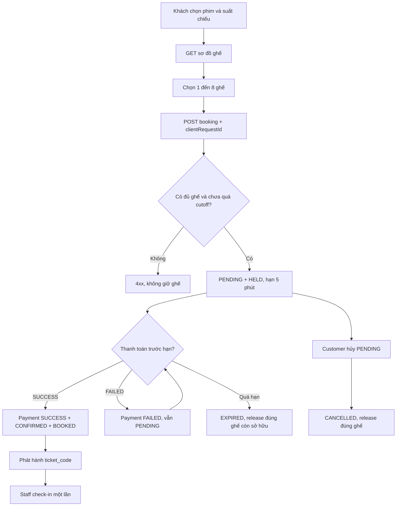
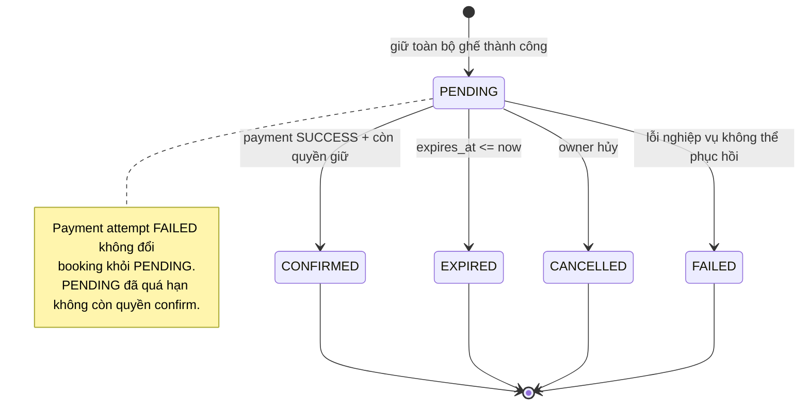
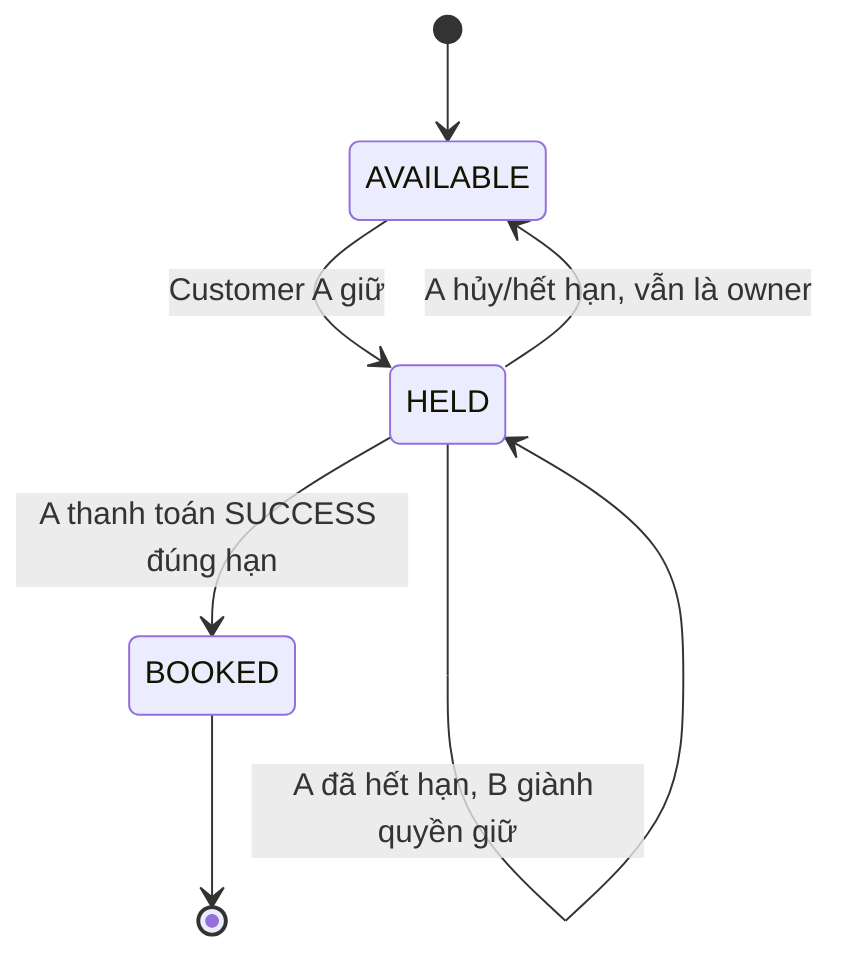

# 04. Luồng hoạt động, trạng thái & xử lý cạnh tranh

Các sơ đồ Mermaid có thể xem trực tiếp trong GitHub Markdown. Đây là đặc tả hành vi, không phải bằng chứng một luồng đã được triển khai.

## 1. Luồng tổng thể đặt vé



## 2. State machine của booking



## 3. Trạng thái ghế theo showtime



**Quan trọng:** `showtime_seats.status=HELD` với `hold_expires_at <= now` có **effective availability** là AVAILABLE. Trên database, quá trình B giành ghế được phép chuyển HELD(A, expired) → HELD(B, valid) trực tiếp; scheduler của A không được reset HELD(B).

## 4. Sequence UC-03 — Tạo booking

```mermaid
sequenceDiagram
    actor C as Customer
    participant FE as React Client
    participant API as BookingController
    participant S as BookingService
    participant DB as MySQL / InnoDB
    C->>FE: Chọn showtime và seatIds
    FE->>API: POST /api/bookings (clientRequestId)
    API->>S: createBooking(principal, request)
    S->>DB: Find prior request (userId,key)
    alt Key đã tồn tại
       S->>DB: So sánh showtime và seatIds chuẩn hóa
       DB-->>S: Previous booking
       S-->>API: Reuse booking hoặc 409
    else Key mới
       S->>DB: BEGIN; insert booking PENDING
       S->>DB: Lock showtime-seat rows theo ID tăng dần
       alt Mọi ghế khả dụng
          S->>DB: HELD + owner + expiresAt; insert booking_seats
          S->>DB: Sum snapshot price; COMMIT
          S-->>API: 201 PENDING
       else Một ghế không khả dụng
          S->>DB: ROLLBACK
          S-->>API: 409 SEAT_UNAVAILABLE
       end
    end
    API-->>FE: JSON result
```

## 5. Sequence UC-04 — Thanh toán và cấp vé

```mermaid
sequenceDiagram
    actor C as Customer
    participant API as PaymentController
    participant S as PaymentService
    participant DB as MySQL / InnoDB
    C->>API: POST /api/bookings/{id}/payments/mock
    API->>S: pay(principal, simulatedResult, key)
    S->>DB: Kiểm tra idempotencyKey
    alt Key đã xử lý
        S-->>API: Kết quả cũ hoặc 409 nếu payload khác
    else Key mới
        S->>DB: BEGIN; lock booking
        S->>DB: Lock từng showtime-seat tăng dần
        S->>DB: Validate PENDING + TTL + ownership tất cả ghế
        alt Không hợp lệ
            S->>DB: Không ghi SUCCESS; hoàn tất/rollback theo thiết kế
            S-->>API: 409/422
        else Simulated FAILED
            S->>DB: Insert payment FAILED; COMMIT
            S-->>API: FAILED, booking vẫn PENDING
        else Simulated SUCCESS
            S->>DB: Insert SUCCESS + BOOKED + ticket codes + CONFIRMED
            S->>DB: COMMIT
            S-->>API: CONFIRMED + tickets
        end
    end
```

## 6. Race conditions cần hiểu trước khi code

### R1. Hai customer giữ A1 cùng lúc

- A và B đọc seat map cùng thấy AVAILABLE (GET không khóa).
- Trong POST, A khóa `showtime_seats(A1)` trước; B chờ lock.
- A cập nhật HELD và commit; B đọc lại thấy HELD còn hạn và trả **409**.
- **Bất biến:** chỉ A có quyền giữ ghế tại một thời điểm.

### R2. Booking A vừa hết hạn, B giành ghế, cleanup của A chạy sau

- A giữ A1 với expiry 11:35:00Z; B đặt sau 11:35:00Z.
- B khóa A1 và đổi `current_booking_id=B`, `hold_expires_at=B.expires_at`.
- Cleanup của A thấy owner không còn A → **không giải phóng A1**, chỉ đổi A sang EXPIRED.

### R3. Thanh toán và cleanup cùng đụng booking

- Hai luồng đều khóa booking A trước khi khóa ghế.
- Nếu payment giành lock trước và `now < expires_at`, CONFIRMED; scheduler thấy CONFIRMED và bỏ qua.
- Nếu cleanup giành trước và đã quá hạn, EXPIRED; payment bị từ chối. Không có trạng thái nửa chừng.

### R4. Hai admin tạo suất cùng phòng

- Mỗi giao dịch phải lock **cùng row room**, kiểm tra overlap **sau khi lock** rồi insert. Nếu không lock, cả hai có thể đồng thời thấy lịch trống và tạo trùng.

### R5. Hai nhân viên check-in cùng một ticket

- Cả hai có thể đọc là chưa check-in; `UNIQUE(ticket_checkins.booking_seat_id)` cho phép tối đa một INSERT, yêu cầu còn lại nhận 409.

## 7. Quy tắc giao dịch nhất quán

- Tạo booking: validate request → transaction, insert booking → khóa `showtime_seats` tăng dần → ghi mọi thay đổi → commit.
- Thanh toán/hủy/cleanup: **lock booking → lock ghế tăng dần**, xác minh trạng thái sau khi có lock.
- Tạo suất: **lock room** rồi kiểm tra overlap và insert.
- Các service phải dùng cùng chiến lược; không để một codepath lock ghế rồi booking khi codepath khác làm ngược (rủi ro deadlock).
- Tránh thông báo thành công trước khi transaction commit; trả code lỗi chuẩn khi trùng key/constraint.
- Không `throw` làm rollback nếu muốn **lưu** trạng thái EXPIRED; xử lý việc chuyển EXPIRED trong transaction riêng hoặc trả kết quả có chủ đích.

## 8. Thời gian và UI

- `booking.expires_at = booking.created_at + 5 minutes`; chuẩn UTC.
- Khi màn hình đếm ngược đến 0, frontend phải gọi lại API lấy trạng thái chính thức. Đồng hồ frontend không có quyền quyết định booking có thể xác nhận hay không.
- UI cần phân biệt: ghế trống, đang giữ, đã bán; không hiển thị thông tin khách giữ ghế.
- Đọc JSON thời gian ISO 8601 có `Z`/offset; chuyển giờ hiển thị sang `Asia/Ho_Chi_Minh`.

## 9. Chi tiết triển khai TASK-09..12

- Sau bước kiểm tra key, create lấy shared showtime row lock (giao thức với TASK-07); insert booking, resolve scalar inventory IDs, khóa từng row tăng dần, đọc lại giờ DB, validate lại cutoff/TTL trước HELD/selection snapshots. Bắt unique/deadlock chỉ ở ngoài worker transaction đã rollback; mỗi retry giữ nguyên key và tạo transaction mới.
- Cancel đã quá TTL trả 409 BOOKING_EXPIRED, không chuyển CANCELLED hoặc hứa đã persist EXPIRED. Cleanup riêng commit EXPIRED, conditional-release theo owner hiện tại; không khóa booking cũ của ghế bị reclaim trong create để tránh đảo thứ tự lock.
- GET history/detail chỉ suy ra effectiveStatus, không đổi state. Replay key không làm sống lại hoặc gia hạn booking đã hết hạn/hủy/xác nhận. Payment/ticket workflows ở mục 5 chưa được triển khai trong TASK-09..12.
