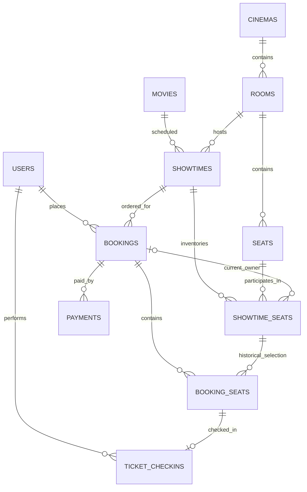

# 05. Database Design — MySQL 8.0.16+

**DDL chuẩn duy nhất:** [`../database/cinema_booking_schema.sql`](../database/cinema_booking_schema.sql). Tên bảng/cột/enum và constraint bên dưới phản ánh file SQL đó. **Không dùng Markdown để thay thế migration.**

## 1. Sơ đồ ERD logic



**Chú ý:** `SHOWTIME_SEATS → BOOKING_SEATS` là **1:N theo thời gian**: một ghế/suất có thể xuất hiện trong lịch sử nhiều booking hết hạn/hủy, nhưng `showtime_seats.current_booking_id` chỉ trỏ đến **một chủ hiện hành**. ERD không thể hiện đầy đủ các điều kiện liên bảng phải kiểm tra ở service.

## 2. Từ điển dữ liệu — 11 bảng

### 2.1 `users`

| Column | Kiểu | Ý nghĩa |
|---|---|---|
| `id` | BIGINT, PK | Mã user. |
| `full_name` | VARCHAR(150), NOT NULL | Tên hiển thị. |
| `email` | VARCHAR(255), UNIQUE | Đăng nhập, chuẩn hóa trước khi tạo. |
| `password_hash` | VARCHAR(255) | BCrypt/Argon2 hash; không lưu plaintext. |
| `role` | ENUM(CUSTOMER,STAFF,ADMIN) | Role mặc định CUSTOMER. |
| `status` | ENUM(ACTIVE,INACTIVE) | Tài khoản bị khóa/đang hoạt động. |
| `created_at` | DATETIME(3) | UTC. |

### 2.2 `movies`

| Column | Kiểu | Ý nghĩa |
|---|---|---|
| `id` | BIGINT, PK | Mã phim. |
| `title` | VARCHAR(255) | Tên phim. |
| `description` | TEXT, nullable | Giới thiệu. |
| `duration_minutes` | SMALLINT UNSIGNED | `>0`; thời lượng phim. |
| `genre` | VARCHAR(100), nullable | Thể loại đơn giản cho MVP. |
| `age_rating` | VARCHAR(20), nullable | Nhãn phân loại độ tuổi. |
| `release_date` | DATE, nullable | Ngày phát hành. |
| `poster_url` | VARCHAR(500), nullable | URL poster. |
| `status` | ENUM(UPCOMING,SHOWING,ENDED,HIDDEN) | Trạng thái công bố. |

Index `idx_movies_status_release(status, release_date)`.

**Mapping Java cho SMALLINT UNSIGNED:** `duration_minutes`, `seats.seat_number`, `showtimes.cleanup_minutes` dùng Integer và `UnsignedSmallIntJdbcType`: binder/extractor JDBC setInt/getInt nhưng SQL type code vẫn SMALLINT để validate schema chuẩn. Không dùng short/getShort/setShort vì tràn tại 32768–65535. Đây là sửa mapping ứng dụng, không thay DDL/migration; integration kiểm thử round-trip 65535 cho cả ba cột.

### 2.3 `cinemas`

`id` BIGINT PK, `name` VARCHAR(150) NOT NULL, `address` VARCHAR(255) NOT NULL, `status` ENUM(ACTIVE,INACTIVE) mặc định ACTIVE. MVP có 1 cinema nhưng giữ quan hệ 1:N tới rooms.

### 2.4 `rooms`

`id` BIGINT PK; `cinema_id` BIGINT FK `cinemas.id`; `name` VARCHAR(50); `status` ENUM(ACTIVE,MAINTENANCE). **UNIQUE (`cinema_id`, `name`)**. Không sửa/xóa phòng nếu ảnh hưởng suất/booking đã có.

### 2.5 `seats`

| Column | Kiểu | Ý nghĩa |
|---|---|---|
| `id` | BIGINT, PK | Mã ghế vật lý. |
| `room_id` | BIGINT, FK | Phòng chủ quản. |
| `seat_row` | VARCHAR(5) | A, B, C,... |
| `seat_number` | SMALLINT UNSIGNED | Số ghế `>0`. |
| `seat_type` | ENUM(STANDARD,VIP) | Căn cứ phụ phí. |
| `status` | ENUM(ACTIVE,MAINTENANCE) | **Chỉ** trạng thái vật lý, không là trạng thái đã bán. |

**UNIQUE (`room_id`,`seat_row`,`seat_number`)**.

### 2.6 `showtimes`

| Column | Kiểu | Ý nghĩa |
|---|---|---|
| `id` | BIGINT, PK | Mã suất chiếu. |
| `movie_id` | BIGINT, FK | Phim. |
| `room_id` | BIGINT, FK | Phòng chiếu. |
| `starts_at` | DATETIME(3) | Giờ bắt đầu UTC. |
| `ends_at` | DATETIME(3) | Giờ kết thúc UTC, lớn hơn starts_at. |
| `cleanup_minutes` | SMALLINT UNSIGNED | Thời gian dọn phòng, mặc định 15. |
| `base_price` | DECIMAL(12,2) | Giá STANDARD, `>=0`. |
| `vip_surcharge` | DECIMAL(12,2) | Phụ phí VIP, `>=0`. |
| `status` | ENUM(SCHEDULED,CANCELLED,COMPLETED) | Trạng thái suất. |

Index `idx_showtimes_room_time(room_id,starts_at,ends_at)` và `idx_showtimes_movie_time(movie_id,starts_at)`. **Chống giao nhau theo thời gian không thể bảo vệ chỉ bằng UNIQUE**: dùng `rooms` row lock + query overlap trong cùng transaction.

### 2.7 `bookings`

| Column | Kiểu | Ý nghĩa |
|---|---|---|
| `id` | BIGINT, PK | Mã DB. |
| `booking_code` | VARCHAR(32), UNIQUE | Mã hiển thị; không làm bằng chứng check-in. |
| `user_id` | BIGINT, FK | Người đặt. |
| `showtime_id` | BIGINT, FK | Suất chiếu duy nhất của đơn. |
| `client_request_id` | VARCHAR(64), nullable trong DDL | API bắt buộc, cho idempotent create. |
| `status` | ENUM(PENDING,CONFIRMED,EXPIRED,CANCELLED,FAILED) | Vòng đời đơn. |
| `total_amount` | DECIMAL(12,2) | Tổng unit_price snapshot, do server tính. |
| `expires_at` | DATETIME(3) | UTC, hạn giữ. |
| `created_at` | DATETIME(3) | UTC. |
| `updated_at` | DATETIME(3) | UTC, auto-update DB. |
| `confirmed_at` | DATETIME(3), nullable | Thời điểm xác nhận. |

**UNIQUE (`user_id`,`client_request_id`)**; các bản ghi NULL trong client_request_id được DB cho phép nhưng API không cho request thiếu key. Index `(status,expires_at)`, `(user_id,created_at)`, `(showtime_id,status)`.

### 2.8 `showtime_seats` — bảng inventory quan trọng nhất

| Column | Kiểu | Ý nghĩa |
|---|---|---|
| `id` | BIGINT, PK | ID inventory của một ghế/suất. |
| `showtime_id` | BIGINT, FK | Suất chiếu. |
| `seat_id` | BIGINT, FK | Ghế vật lý. |
| `status` | ENUM(AVAILABLE,HELD,BOOKED) | Trạng thái persisted. |
| `current_booking_id` | BIGINT, FK, nullable | Booking chủ hiện hành nếu HELD/BOOKED. |
| `hold_expires_at` | DATETIME(3), nullable | Hạn giữ, chỉ có khi HELD. |
| `version` | BIGINT UNSIGNED | Version JPA optimistic locking nếu sử dụng. |

**UNIQUE (`showtime_id`,`seat_id`)**. DB CHECK hợp lệ:

- AVAILABLE → `current_booking_id IS NULL` và `hold_expires_at IS NULL`.
- HELD → `current_booking_id IS NOT NULL` và `hold_expires_at IS NOT NULL`.
- BOOKED → `current_booking_id IS NOT NULL` và `hold_expires_at IS NULL`.

DB **không** đảm bảo `seat.room_id = showtime.room_id`, cũng không đảm bảo `current_booking_id` thuộc đúng showtime: service phải validate + test. Index `(status,hold_expires_at)`, `(current_booking_id)`.

### 2.9 `booking_seats`

`id` BIGINT PK; `booking_id` BIGINT FK; `showtime_seat_id` BIGINT FK; `ticket_code` VARCHAR(48) nullable trước xác nhận, UNIQUE; `unit_price` DECIMAL(12,2) NOT NULL `>=0`.

- **UNIQUE (`booking_id`,`showtime_seat_id`)**, không UNIQUE `showtime_seat_id` riêng.
- FK `showtime_seat_id` phải chỉ đến showtime của booking (service check).
- `unit_price` ghi nhận lúc giữ, không tính lại khi thanh toán.
- `ticket_code` phải đủ ngẫu nhiên (≥128-bit entropy) và chỉ xuất hiện sau CONFIRMED; `booking_seats` không đổi giá khi admin sửa giá sau đó.

### 2.10 `payments`

| Column | Kiểu | Ý nghĩa |
|---|---|---|
| `id` | BIGINT, PK | Payment attempt. |
| `booking_id` | BIGINT, FK | Đơn tương ứng. |
| `method` | ENUM(MOCK,CASH) | MVP chủ yếu MOCK. |
| `status` | ENUM(INITIATED,SUCCESS,FAILED) | Kết quả attempt. |
| `amount` | DECIMAL(12,2) | Phải khớp total_amount của booking. |
| `idempotency_key` | VARCHAR(64), UNIQUE | Key toàn cục. |
| `transaction_code` | VARCHAR(100), UNIQUE, nullable | Mã giao dịch. |
| `failure_reason` | VARCHAR(255), nullable | Lý do thất bại giả lập. |
| `paid_at` | DATETIME(3), nullable | Bắt buộc khi SUCCESS. |
| `created_at` | DATETIME(3) | UTC. |
| `successful_booking_id` | BIGINT GENERATED STORED | Nếu SUCCESS thì `booking_id`, ngược lại NULL. |

**UNIQUE (`successful_booking_id`)** bảo đảm tối đa 1 SUCCESS/booking; MySQL cho phép nhiều NULL trong UNIQUE. Các lần FAILED vẫn lưu được. `idempotency_key` duy nhất và có `CHECK` `paid_at IS NOT NULL` khi SUCCESS.

### 2.11 `ticket_checkins`

`id` BIGINT PK; `booking_seat_id` BIGINT FK + **UNIQUE**; `staff_id` BIGINT FK `users.id`; `checked_in_at` DATETIME(3) UTC. Chỉ STAFF/ADMIN được tạo; DB FK chỉ xác nhận có user, quyền staff/admin phải kiểm tra trong service.

## 3. Ràng buộc liên bảng phải bảo vệ trong Service Layer

1. `showtime_seats.seat_id` thuộc `showtimes.room_id` của `showtime_id`.
2. `showtime_seats.current_booking_id`, nếu có, trỏ tới booking có `showtime_id` tương ứng.
3. `booking_seats.showtime_seat_id` thuộc showtime của `bookings.showtime_id`.
4. `bookings.total_amount = SUM(booking_seats.unit_price)` tại thời điểm tạo đơn.
5. `payments.amount = bookings.total_amount` và payment SUCCESS kéo theo booking CONFIRMED, toàn bộ seats BOOKED, tickets được cấp.
6. `ticket_checkins` chỉ được tạo khi booking CONFIRMED, đúng khung giờ và chưa check-in.
7. Không tạo/sửa showtime chồng interval trong cùng room.
8. Không xóa/đổi chỗ ghế nếu ảnh hưởng bất kỳ inventory/bookings hiện hữu.

## 4. Query mẫu hữu ích

**Tìm danh sách ghế của suất và trạng thái hiệu lực** (API map lại tên/trạng thái):

```sql
SELECT ss.id AS showtime_seat_id, s.id AS seat_id,
       s.seat_row, s.seat_number, s.seat_type,
       CASE
         WHEN ss.status = 'HELD'
              AND ss.hold_expires_at <= UTC_TIMESTAMP(3)
         THEN 'AVAILABLE'
         ELSE ss.status
       END AS effective_status
FROM showtime_seats ss
JOIN seats s ON s.id = ss.seat_id
WHERE ss.showtime_id = :showtimeId
ORDER BY s.seat_row, s.seat_number;
```

Đây là query **chỉ đọc**. Không suy ra `AVAILABLE` từ GET rồi update thiếu khóa. Nếu session MySQL được cấu hình UTC, `UTC_TIMESTAMP(3)` và giá trị DATETIME(3) là tương thích.

**Kiểm tra overlap suất chiếu trong room** (dùng **sau khi** `SELECT ... FOR UPDATE` khóa room):

```sql
SELECT id FROM showtimes
WHERE room_id = :roomId AND status = 'SCHEDULED'
  AND starts_at < DATE_ADD(:newEndsAt, INTERVAL :newCleanup MINUTE)
  AND DATE_ADD(ends_at, INTERVAL cleanup_minutes MINUTE) > :newStartsAt;
```

Với UPDATE hiện hữu, loại bỏ chính `showtime.id` đang cập nhật. Phải validate đồng thời `starts_at < ends_at` và không đổi thời gian khi có booking cần bảo toàn.

## 5. Transaction, lock, migration

- MySQL InnoDB, các entity state quan trọng được ghi trong transaction.
- Quy trình booking/payment/cancel/cleanup: khóa booking (nếu đã có) rồi khóa `showtime_seats` theo ID tăng dần.
- `@Version` có thể map trường `version`; **không kết hợp một cách tùy tiện** JPA dirty checking với native SQL UPDATE không cập nhật version.
- Tên constraint/index chính xác ở file DDL; có thể kiểm tra bằng `SHOW CREATE TABLE` trên MySQL.
- Quản lý schema bằng Flyway. Bản SQL ban đầu nên được đưa vào migration `V1__init_schema.sql` trong mã nguồn **sau khi** thống nhất quy ước tên DB; không để `ddl-auto=update` tự đổi kiểu ENUM, CHECK hoặc generated column.
- Không ghi dữ liệu nhạy cảm như password hash, JWT hoặc token check-in vào log.
