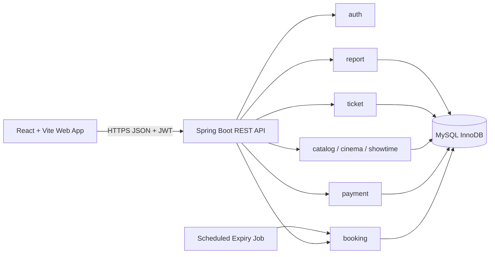

# 07. Kiến trúc Backend & hướng dẫn triển khai Spring Boot

## 1. Kiến trúc logic — Modular Monolith



Một Spring Boot app, một MySQL database. Tách theo **business feature** để có thể đổi công nghệ mà không phá vỡ nghiệp vụ. Không cần Kafka, Redis, microservices cho MVP.

## 2. Gợi ý package

```text
src/main/java/com/example/cinema/
  CinemaApplication.java
  auth/          controller/, service/, security/, dto/, entity/, repository/
  catalog/       controller/, service/, dto/, entity/, repository/   # movies
  cinema/        controller/, service/, dto/, entity/, repository/   # cinema, room, seat
  showtime/      controller/, service/, dto/, entity/, repository/
  booking/       controller/, service/, dto/, entity/, repository/, job/
  payment/       controller/, service/, dto/, entity/, repository/
  ticket/        controller/, service/, dto/, entity/, repository/
  report/        controller/, service/, dto/, repository/
  common/        error/, config/, time/, util/
src/main/resources/
  application.yml
  db/migration/V1__init_schema.sql
src/test/java/com/example/cinema/
  ... # unit + integration tests
```

`src/main/resources/db/migration/V1__init_schema.sql` cần được tạo từ file `database/cinema_booking_schema.sql` và hiệu chỉnh phần `CREATE DATABASE/USE` cho migration framework đang sử dụng; **không** tạo hai đường chạy schema độc lập trong môi trường thực tế.

## 3. Trách nhiệm module

| Module | Chức năng | Quy tắc chủ chốt |
|---|---|---|
| `auth` | Password hashing, JWT validation, principal, role | Không tin `userId`/`role` gửi từ client. |
| `catalog` | Quản lý phim | Soft status, không xóa lịch sử. |
| `cinema` | Cụm rạp/phòng/ghế vật lý | Physical seat status độc lập inventory. |
| `showtime` | Tạo/sửa lịch, initialize inventory | Lock room, reject overlap, không sửa suất có booking ảnh hưởng. |
| `booking` | Giữ ghế, cancel, expire, lịch sử | Bảo vệ atomicity, current_booking_id, TTL. |
| `payment` | Mock result, idempotency, confirm tickets | Một SUCCESS/booking; FAILED không làm FAILED booking. |
| `ticket` | Lấy vé, check-in | Random ticket code; one checkin per ticket. |
| `report` | Revenue/aggregate | Chỉ tính payments SUCCESS. |
| `common` | Error format, time, validation, logging | UTC & error codes thống nhất. |

## 4. Transaction boundaries

| Operation | Bao gồm trong transaction | Thứ tự khóa | Hậu điều kiện |
|---|---|---|---|
| Create showtime | Lock room; overlap query; insert showtime + inventory | `room` trước | Không trùng lịch, inventory đầy đủ. |
| Create booking | Insert PENDING; lock các showtime-seat; update HELD; insert booking_seats, total | New booking rồi `showtime_seats.id ASC` | All-or-nothing. |
| Pay SUCCESS | Lock booking; lock seats; validate TTL/owner; insert SUCCESS; issue tickets; update statuses | `booking` → `showtime_seats.id ASC` | Payment + vé + booking thống nhất. |
| Pay FAILED | Lock booking; verify TTL; insert FAILED | `booking` → ghế nếu cần validation | Booking tiếp tục PENDING. |
| Cancel | Lock booking; lock seats; update CANCELLED; conditional release | `booking` → `showtime_seats.id ASC` | Không release ghế mới đổi chủ. |
| Expire | Lock booking; lock seats; update EXPIRED; conditional release | `booking` → `showtime_seats.id ASC` | Idempotent, safe to retry. |
| Check-in | Validate ticket & booking/showtime; insert unique checkin | ticket/booking tùy thiết kế, không đảo thứ tự với payment | Tối đa một check-in. |

**Ràng buộc khó:** MySQL `REPEATABLE READ` là mặc định và một số query có thể nhận snapshot cũ. Những kiểm tra trạng thái cần sử dụng locking reads trong transaction. Service phải phân biệt entity state đã load trong JPA persistence context và giá trị thay đổi bởi native SQL.

## 5. Pseudocode quan trọng

### Create booking (UC-03)

```text
createBooking(principal, request):
  validate DTO (1-8 unique seat IDs, request ID)
  find existing idempotency request; if found compare normalized payload
  begin TX
    verify showtime SCHEDULED + now < startsAt - 10m
    create booking PENDING, expiresAt = dbNow + 5m
    resolve showtimeSeat IDs by (showtimeId, seatIds)
    validate all seats belong to room and physical seat ACTIVE
    for each showtimeSeatId in sorted ascending order:
      SELECT ... FOR UPDATE  # lock row
      if BOOKED OR (HELD AND expiresAt > dbNow): rollback + 409
      assign owner=newBookingId, status=HELD, holdExpiresAt=booking.expiresAt
    insert bookingSeats with BigDecimal price snapshots
    booking.totalAmount = sum(unitPrice)
  commit TX
  return 201
```

**Khi gặp `clientRequestId` đang được transaction khác tạo:** unique constraint có thể chặn request sau; sau khi conflict cần **đọc lại** booking hiện hữu (trong transaction/persistence context mới nếu cần), so sánh payload rồi trả kết quả ổn định. Không retry bằng cách tạo booking mới với key khác tự động.

### Confirm mock payment (UC-04)

```text
pay(owner, bookingId, result, key):
  check idempotency key (and compare owner + booking + simulated result)
  begin TX
    SELECT booking FOR UPDATE; validate owner
    lock referenced showtimeSeat rows in ascending order
    assert booking.status == PENDING
    assert dbNow < booking.expiresAt
    assert every requested seat HELD, owned by booking, and not expired
    if result == FAILED:
      insert FAILED payment; commit; return PENDING
    else:
      insert SUCCESS payment (DB prevents second SUCCESS)
      for each showtimeSeat: set BOOKED + null holdExpiresAt
      for each bookingSeat: create unique, CSPRNG ticketCode
      set booking CONFIRMED + confirmedAt
  commit TX
  return tickets
```

### Expire booking (UC-06)

```text
expire(bookingId):
  begin TX
    lock booking; if status != PENDING or expiresAt > dbNow: return
    lock booking's inventory rows ascending
    set booking EXPIRED
    for seat row:
      if status == HELD && currentBookingId == bookingId:
        set AVAILABLE + null currentBookingId + null holdExpiresAt
  commit TX
```

**Cảnh báo:** Nếu payment phát hiện hết hạn nhưng lập tức `throw` trong cùng transaction, trạng thái EXPIRED vừa set cũng bị rollback. Có thể để scheduler xử lý việc chuyển EXPIRED, hoặc thực thi `expire` ở transaction riêng đã được commit. Quy tắc BR-12 vẫn phải chặn payment ngay lập tức.

## 6. Row locking & concurrency

- Repository có thể dùng `@Lock(PESSIMISTIC_WRITE)` / `SELECT ... FOR UPDATE`; với nhiều ghế, khóa từng ID tăng dần để giảm deadlock.
- Không chỉ dùng `synchronized`, optimistic check tại browser, hoặc GET seat map làm bảo đảm.
- `UNIQUE(showtime_id,seat_id)` giữ mỗi ghế/suất một inventory row. `current_booking_id` xác định owner hiện tại.
- Đăng ký nhiều ghế: transaction rollback nếu bất kỳ ghế nào lỗi. Không commit từng ghế.
- Dự phòng deadlock (`SQLState 40001`, lock wait timeout): log, retry có giới hạn và chỉ cho operation idempotent; xác minh kết quả trước khi retry.
- `payments.successful_booking_id` generated UNIQUE bảo vệ payment thứ hai. Trùng idempotency key → đọc lại kết quả cũ hoặc 409 nếu payload khác.
- Khi cập nhật `showtimes`, phải phối hợp với booking creation để tránh thay lịch sau khi đã tạo booking. Chính sách MVP: **không cho sửa suất nếu đã có booking**, kiểm tra trong transaction và áp dụng cơ chế khóa thích hợp ở cả hai codepath.

### Giao thức TASK-06/07/08 đã triển khai

- Tạo/sửa cấu hình ghế/phòng: khóa write row phòng, kiểm tra không có suất nào, rồi ghi. Tạo lịch dùng cùng khóa phòng nên không thể bỏ sót thay đổi ghế đang commit.
- Create lịch: transaction READ_COMMITTED, lock phòng → validate rạp/phòng/phim/ghế → native locking overlap read (có cleanup) → insert lịch + inventory. Không dùng kiểm tra overlap cũ bỏ qua cleanup.
- Update lịch: đọc scalar roomId cũ, lock phòng cũ/mới theo ID tăng dần → lock write showtime → kiểm tra roomId vẫn khớp → current locking read lịch sử bookings → kiểm tra overlap, loại chính nó → cập nhật. Phòng không đổi thì giữ inventory; đổi phòng chỉ thay inventory khi chưa có booking và không có ghế HELD/BOOKED.
- **Hợp đồng bắt buộc cho TASK-09/10:** đầu transaction create booking, lấy `ShowtimeRepository.findByIdForBooking` (PESSIMISTIC_READ/shared), đọc cấu hình mới nhất; sau đó insert/lock booking mới → lock inventory theo ID tăng dần. Shared lock giữ đến commit để update lịch không vượt qua kiểm tra lịch sử trong lúc booking đang tạo. Không lock room khi tạo booking, tránh đảo thứ tự khóa với update lịch. Các luồng payment/cancel/expiry trên booking đã tồn tại giữ thứ tự booking → inventory như cũ.
- MySQL session khởi tạo timezone +00:00. GET seat map dùng `DatabaseTime` với UTC_TIMESTAMP(3), không ghi DB; danh sách lịch lọc ngày Việt Nam bằng khoảng UTC nửa mở. GET không có khóa giữ chỗ.
- TASK-06 chỉ đọc rạp seed, không mở rộng CRUD nhiều cụm (GAP-11); cấu hình ghế/phòng sau khi có bất kỳ suất nào bị khóa bảo thủ (GAP-08). Không thay DDL, không thêm Redis hoặc lock Java.

### Giao dịch booking — TASK-09..12

- `BookingService`: façade có method authorization/validation, lấy actor từ SecurityContext/UserPrincipal, không bao transaction; chỉ audit thành công sau khi worker trả kết quả đã commit.
- `BookingTransactions`: worker Spring bean riêng, REQUIRES_NEW + READ_COMMITTED cho create/cancel/expire. Create lấy shared showtime guard, insert booking rồi resolve scalar inventory IDs và khóa **từng row** theo thứ tự tăng dần. Không load inventory entity trước khóa để tránh JPA persistence context giữ snapshot cũ. JPA dirty checking cập nhật @Version, không trộn native SQL ghi inventory trong domain services.
- Create dùng DB now trước insert để đặt createdAt/TTL, đọc lại DB now sau khóa để validate cutoff/TTL và hold expiry. Multi-seat snapshot + HELD + booking + booking_seats trong cùng transaction; không giữ một phần.
- `BookingQueries`: REQUIRES_NEW + read-only REPEATABLE_READ cho replay/GET; `BookingReplay` so sánh showtime + tập ghế lịch sử. Façade bắt unique conflict **sau rollback** rồi gọi Queries bằng transaction/persistence context mới. Trùng key khác payload không bị coi là retry thành công.
- `BookingRetry`: tối đa 3 lần cho ConcurrencyFailureException, backoff 20/40ms, cùng request key; mỗi lần gọi worker tạo transaction mới. Không retry business errors; sau 3 lần trả 409 BOOKING_CONCURRENT_CONFLICT. Cancel/expire cũng retry theo booking ID và luôn khóa booking trước inventory.
- `BookingExpiryService` lấy batch tối đa 100 IDs từ index(status,expires_at), mỗi booking một worker transaction. `BookingExpiryJob` chạy mỗi 30s, có thể disable bằng property. Không có endpoint cleanup; lỗi một đơn không làm rollback các đơn khác. Không release inventory mới được customer khác reclaim.
- `Booking` không dùng @PreUpdate/Instant.now để ghi updatedAt; các write services phải đặt timestamp từ DatabaseTime. Cấu trúc SQL/constraints không thay đổi, không UNIQUE riêng showtime_seat_id trong booking_seats.
- Controller chỉ trả DTO, GET chi tiết có ownership hoặc ADMIN support audit; không có write trên GET, không lộ owner inventory/tickets. Filter correlation ID đặt/khôi phục MDC, kể cả khi lỗi để không rò context giữa request threads.
- Payment/confirm ở TASK-13 phải tiếp tục khóa booking → inventory tăng dần, kiểm tra PENDING + DB now < booking expiry và từng HELD vẫn thuộc owner/còn hạn, đặt timestamp theo DatabaseTime; không tái sử dụng kết luận từ GET hoặc chỉ trạng thái scheduler.

### Mở rộng catalog: Cloudinary poster

- `AdminMoviePosterController` + `MoviePosterService` yêu cầu ADMIN, dùng multipart file, không cho client cung cấp upload URL/public ID/folder.
- `PosterValidator` đọc tối đa 5 MiB + 1 byte, xác minh JPEG/PNG format/dimensions trước decode, re-encode pixels bỏ metadata; không ghi file tạm và không tin filename/content-type.
- `MoviePosterService` NOT_SUPPORTED: read-only worker kiểm tra tồn tại → upload ảnh qua `PosterStorage`/Cloudinary SDK khi không có transaction DB → worker REQUIRES_NEW khóa Movie row, cập nhật poster_url, flush/commit → audit thành công.
- Cloudinary config env là server-side; credential thiếu không ngăn boot, request upload trả 503. Timeout transport default 30s; SDK/provider errors được thay bằng lỗi 502 an toàn, không log message/stacktrace có credential.
- Không sửa schema: poster_url có sẵn VARCHAR(500). Không có distributed transaction/auto-delete/asset lifecycle: asset upload có thể orphan khi lỗi hoặc commit không rõ; giữ ảnh cũ và dọn trong Console, không suy public ID từ URL.
- Cloudinary SDK 2.6.0 và HTTP5/core5/commons-lang3 theo phiên bản của SDK POM. Test dùng adapter mock + local HTTP stub, không thực thi upload thật với tài khoản cloud.

### Giao dịch payment/ticket/report — TASK-13..16

- `PaymentService` xác thực CUSTOMER và principal-derived owner, validation DTO; worker `PaymentTransactions` REQUIRES_NEW/READ_COMMITTED khóa booking → từng inventory ID tăng dần → lấy DB now. Kiểm tra toàn bộ hold và snapshot trước khi insert payment; SUCCESS + CONFIRMED + BOOKED + CSPRNG ticket codes trong cùng transaction. FAILED giữ nguyên booking PENDING.
- Tra key sau ownership và khóa booking cho phép replay sau TTL/CONFIRMED mà không chờ scheduler; key khác payload trả 409. Global-key conflict giữa hai booking được façade bắt sau rollback, rồi `PaymentQueries` đọc lại trong transaction/context mới. Dùng `BookingRetry` tối đa 3 transaction khi deadlock/lock conflict, không retry lỗi nghiệp vụ hoặc va chạm mã vé.
- `TicketCodes` dùng SecureRandom 192 bit → 48 ký tự hex vừa schema; DB UNIQUE vẫn bắt collision và rollback toàn bộ payment. Không thay schema/gỡ generated UNIQUE SUCCESS/booking. Vé GET là read-only snapshot, CUSTOMER owner hoặc ADMIN có audit; chỉ CONFIRMED.
- `CheckinTransactions`: tra scalar bookingId bằng ticket code → khóa booking → đọc lại ticket/duplicate → DB now và validate CONFIRMED/showtime/phòng/cửa sổ giờ → insert UNIQUE checkin. Không khóa inventory rồi quay lại booking, không đảo thứ tự với payment. Cả STAFF/ADMIN dùng principal, không tin staffId trong request. Audit sau commit chỉ ghi checkinId, không ghi bearer ticket code.
- `RevenueRepository` aggregate một query duy nhất từ SUCCESS/paid_at, khoảng UTC nửa mở và nhóm ngày UTC+07; `RevenueService` tính tổng từ cùng tập aggregate để không lệch snapshot giữa tổng/ngày. Không cần MySQL timezone tables cho nhóm UTC+07.
- `SqlExceptionHelper` tắt mặc định vì duplicate errors chứa key/mã vé thô; audit ứng dụng vẫn ghi correlationId/actorId/resourceId/outcome an toàn. Không có outbound payment, Redis, migration hoặc thay đổi giá/lịch sử.

## 7. Time & money

- DB: `DATETIME(3)` theo UTC; MySQL session timezone `+00:00`; ở API trả `Instant` hoặc `OffsetDateTime` với `Z`; frontend đổi sang Vietnam local time.
- Sử dụng `Clock` injectable ở service để unit test **nhưng** giao dịch đa instance cần có chuẩn thời gian DB; không trộn JVM local zone vào điều kiện SQL.
- Tiền: `BigDecimal`, scale 2, không `double`; VND có thể hiển thị không phần thập phân trong UI nhưng vẫn lưu DECIMAL(12,2).
- Cutoff và TTL: dùng **cùng nguồn giờ** khi tạo booking, kiểm tra seat hold và payment.

## 8. Security & audit

- JWT subject = ID/account claim đã được server xác thực; role server-generated, không đọc role từ request.
- Mật khẩu bcrypt/argon2; token/secret đặt trong env variables, không commit `.env` thật.
- Authorization: STAFF/ADMIN check-in, ADMIN CRUD lịch, CUSTOMER/owner create/pay/cancel.
- Mọi action ghi quan trọng (create booking, payment, cancel, check-in, admin schedule) có log gồm correlation ID, actorId, resourceId, outcome; không log thông tin tài khoản thanh toán hay token.
- API công khai chỉ hiển thị trạng thái ghế, không hiển thị chủ ghế.

## 9. Lời khuyên triển khai

Ưu tiên MySQL + Testcontainers trước; nếu phần concurrency chưa đúng, **không** chuyển sang thêm Redis/WebSocket. WebSocket sau này chỉ là cơ chế đồng bộ UI, không là nguồn xác nhận ghế còn trống.
