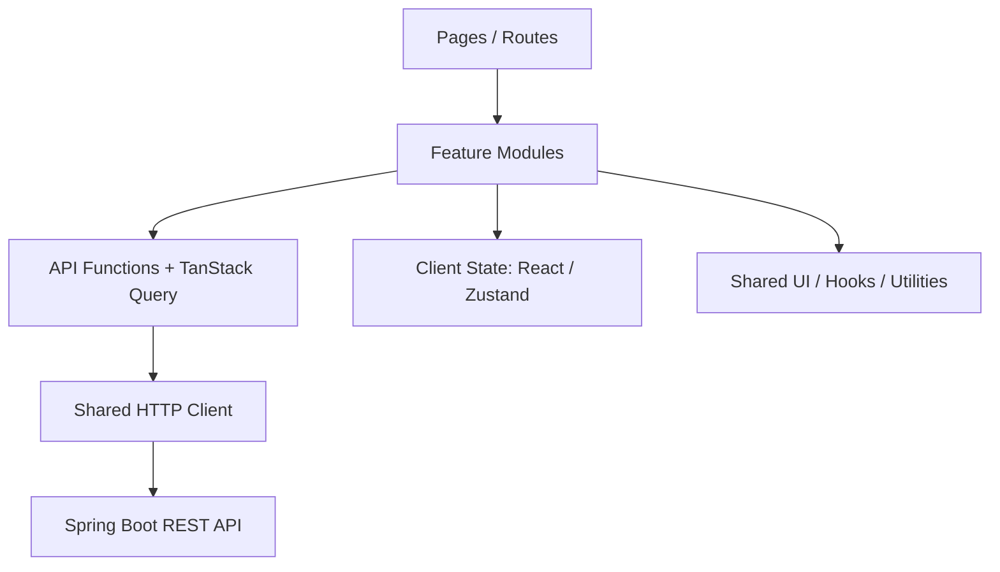

# React Frontend Architecture — Cinema Ticket Booking System

> **Architecture:** Feature-Based Architecture (tham khảo nguyên tắc Feature-Sliced Design, không triển khai FSD nghiêm ngặt)  
> **Frontend:** React + TypeScript + Vite  
> **Backend:** Java Spring Boot REST API  
> **Scope:** Website đặt vé xem phim (Customer + Admin)

## 1. Mục tiêu kiến trúc

- **Scalability:** Dễ mở rộng chức năng theo từng feature.
- **Maintainability:** Dễ sửa đổi, refactor và bảo trì.
- **Separation of Concerns:** Tách UI, giao tiếp API, xử lý dữ liệu và state.
- **Reusability:** Tái sử dụng component, hook và utility.
- **Testability:** Dễ viết unit, component và end-to-end test.
- **Team Collaboration:** Giảm xung đột khi nhiều người cùng phát triển.

**Nguyên tắc:** Ưu tiên cấu trúc đơn giản, vừa đủ cho dự án quy mô trung bình; không tạo thêm abstraction nếu chưa có nhu cầu.

## 2. Sơ đồ kiến trúc tổng quan



Luồng lấy dữ liệu điển hình:

```text
Page → Feature Hook → API Function → HTTP Client → Spring Boot
                    ↓
             TanStack Query Cache
                    ↓
                 React UI
```

**Chú ý:** Các lớp trong sơ đồ thể hiện trách nhiệm logic, không có nghĩa mọi tương tác phải đi qua tất cả lớp. Component trình bày thuần túy có thể nhận dữ liệu qua props.

## 3. Tech stack đề xuất

| Thành phần | Công nghệ | Mục đích |
|---|---|---|
| Framework | React + TypeScript | Giao diện và kiểm tra kiểu |
| Build Tool | Vite | Phát triển và build |
| Routing | React Router | Điều hướng và URL state |
| Server State | TanStack Query | Fetch/cache/synchronize dữ liệu server |
| Client State | React state, Zustand khi cần | State giao diện và state dùng chung |
| HTTP Client | Axios | Giao tiếp Spring Boot REST API |
| Styling | Tailwind CSS | Hệ thống utility CSS |
| UI Components | shadcn/ui (tùy chọn) | Component có thể chỉnh sửa |
| Forms | React Hook Form | Quản lý form |
| Validation | Zod | Kiểm tra dữ liệu đầu vào ở client |
| Unit Testing | Vitest | Unit test |
| Component Testing | React Testing Library | Test hành vi UI |
| E2E Testing | Playwright | Test các luồng quan trọng |

**Không bắt buộc cài toàn bộ ngay từ đầu.** Bắt đầu với React, TypeScript, Vite, Router, Axios, TanStack Query và Tailwind; chỉ thêm Zustand khi có state thực sự cần dùng chung.

## 4. Cấu trúc thư mục

```text
src/
├── app/
│   ├── providers/
│   │   ├── QueryProvider.tsx
│   │   └── ThemeProvider.tsx
│   ├── router/
│   │   ├── index.tsx
│   │   ├── ProtectedRoute.tsx
│   │   └── AdminRoute.tsx
│   ├── App.tsx
│   └── main.tsx
│
├── pages/
│   ├── HomePage.tsx
│   ├── MoviesPage.tsx
│   ├── MovieDetailPage.tsx
│   ├── SeatSelectionPage.tsx
│   ├── CheckoutPage.tsx
│   ├── MyTicketsPage.tsx
│   └── admin/
│       ├── DashboardPage.tsx
│       └── MovieManagementPage.tsx
│
├── features/
│   ├── auth/
│   │   ├── api/auth.api.ts
│   │   ├── components/LoginForm.tsx
│   │   ├── hooks/useLogin.ts
│   │   ├── schemas/login.schema.ts
│   │   ├── store/auth.store.ts
│   │   ├── types/auth.types.ts
│   │   └── index.ts
│   ├── movies/
│   │   ├── api/movies.api.ts
│   │   ├── components/
│   │   │   ├── MovieCard.tsx
│   │   │   ├── MovieGrid.tsx
│   │   │   └── MovieFilter.tsx
│   │   ├── hooks/
│   │   │   ├── useMovies.ts
│   │   │   └── useMovieDetail.ts
│   │   ├── types/movie.types.ts
│   │   └── index.ts
│   ├── showtimes/
│   │   ├── api/
│   │   ├── components/
│   │   ├── hooks/
│   │   └── types/
│   ├── bookings/
│   │   ├── api/
│   │   ├── components/
│   │   │   ├── SeatMap.tsx
│   │   │   ├── Seat.tsx
│   │   │   └── BookingSummary.tsx
│   │   ├── hooks/
│   │   ├── store/
│   │   └── types/
│   └── payments/
│       ├── api/
│       ├── components/
│       ├── hooks/
│       └── types/
│
├── shared/
│   ├── api/http-client.ts
│   ├── components/
│   │   ├── ui/
│   │   │   ├── Button.tsx
│   │   │   ├── Input.tsx
│   │   │   └── Modal.tsx
│   │   └── layout/
│   │       ├── Header.tsx
│   │       ├── Footer.tsx
│   │       └── MainLayout.tsx
│   ├── hooks/
│   ├── lib/
│   ├── types/
│   ├── constants/
│   └── utils/
│
├── assets/
│   ├── images/
│   └── icons/
└── styles/
    └── globals.css
```

> Đây là cấu trúc định hướng, **không phải danh sách thư mục bắt buộc tạo ngay**. Tạo module/file khi có nhu cầu thực tế.

## 5. Trách nhiệm của các tầng

| Tầng | Trách nhiệm | Không nên chứa |
|---|---|---|
| `app/` | App bootstrap, providers, routing và cấu hình toàn ứng dụng | Logic CRUD chi tiết của feature |
| `pages/` | Ghép layout và feature thành trang | HTTP request trực tiếp, logic nghiệp vụ lớn |
| `features/` | Chức năng theo miền nghiệp vụ: UI, hooks, API, types | Logic không liên quan feature |
| `shared/` | UI primitives, HTTP client, hooks/utils dùng chung | Import ngược từ `features/` hoặc `pages/` |
| `assets/` | Ảnh/icon tĩnh | Logic chương trình |
| `styles/` | CSS toàn cục và design tokens | Styling đặc thù của mọi feature |

### Quy tắc phụ thuộc

```text
app       → pages, features, shared
pages     → features, shared
features  → shared
shared    → thư viện ngoài và các module shared khác
```

Trong kiến trúc feature-based thực dụng, **feature A có thể sử dụng public API của feature B khi thật sự cần**; tránh import sâu vào nội bộ của B. Khi quan hệ chéo trở nên phức tạp, hãy chuyển phần phối hợp lên `pages/` hoặc tách module chung có trách nhiệm rõ ràng.

Ví dụ:

```ts
// Tốt: page sử dụng API công khai của feature
import { MovieCard } from '@/features/movies';

// Tốt: feature dùng primitive dùng chung
import { Button } from '@/shared/components/ui/Button';

// Tránh: shared import ngược feature
// import { useMovies } from '@/features/movies/hooks/useMovies';
```

## 6. Ví dụ triển khai feature `movies`

### 6.1. Định nghĩa kiểu dữ liệu

`src/features/movies/types/movie.types.ts`

```ts
export interface Movie {
  id: number;
  title: string;
  posterUrl: string;
  duration: number;
  genre: string;
}
```

### 6.2. HTTP client dùng chung

`src/shared/api/http-client.ts`

```ts
import axios from 'axios';

export const httpClient = axios.create({
  baseURL: import.meta.env.VITE_API_BASE_URL,
  timeout: 10_000,
  withCredentials: true, // Chỉ bật nếu Backend dùng cookie/session phù hợp
});
```

Ví dụ `.env`:

```env
VITE_API_BASE_URL=http://localhost:8080/api/v1
```

Không đưa secret vào biến môi trường `VITE_*`: các giá trị này được đưa vào bundle frontend. `withCredentials` chỉ cần khi chiến lược xác thực dựa vào cookie; cấu hình CORS, CSRF và cookie phải được phối hợp với Backend.

### 6.3. API layer

`src/features/movies/api/movies.api.ts`

```ts
import { httpClient } from '@/shared/api/http-client';
import type { Movie } from '../types/movie.types';

export const moviesApi = {
  getAll: async (): Promise<Movie[]> => {
    const response = await httpClient.get<Movie[]>('/movies');
    return response.data;
  },

  getById: async (id: number): Promise<Movie> => {
    const response = await httpClient.get<Movie>(`/movies/${id}`);
    return response.data;
  },
};
```

**Lưu ý:** Ví dụ giả định Backend trả về `Movie[]`. Nếu Spring Boot trả về `Page<MovieResponse>` hoặc response wrapper, hãy định nghĩa đúng contract và ánh xạ dữ liệu nếu cần.

### 6.4. Query hook

`src/features/movies/hooks/useMovies.ts`

```ts
import { useQuery } from '@tanstack/react-query';
import { moviesApi } from '../api/movies.api';

export function useMovies() {
  return useQuery({
    queryKey: ['movies'],
    queryFn: moviesApi.getAll,
    staleTime: 60_000,
  });
}
```

### 6.5. UI component

`src/features/movies/components/MovieCard.tsx`

```tsx
import type { Movie } from '../types/movie.types';

interface MovieCardProps {
  movie: Movie;
}

export function MovieCard({ movie }: MovieCardProps) {
  return (
    <article className="rounded-lg border p-4">
      
      <h3 className="mt-3 font-semibold">{movie.title}</h3>
      <p className="text-sm text-gray-500">
        {movie.genre} · {movie.duration} phút
      </p>
    </article>
  );
}
```

### 6.6. Public API của feature

`src/features/movies/index.ts`

```ts
export { MovieCard } from './components/MovieCard';
export { useMovies } from './hooks/useMovies';
export type { Movie } from './types/movie.types';
```

### 6.7. Trang danh sách phim

`src/pages/MoviesPage.tsx`

```tsx
import { MovieCard, useMovies } from '@/features/movies';

export function MoviesPage() {
  const { data: movies, isPending, isError } = useMovies();

  if (isPending) return <p>Đang tải danh sách phim...</p>;
  if (isError) return <p>Không thể tải danh sách phim.</p>;
  if (!movies.length) return <p>Hiện chưa có phim.</p>;

  return (
    <main>
      <h1 className="mb-6 text-2xl font-bold">Phim đang chiếu</h1>
      <div className="grid grid-cols-2 gap-6 md:grid-cols-4">
        {movies.map((movie) => (
          <MovieCard key={movie.id} movie={movie} />
        ))}
      </div>
    </main>
  );
}
```

Điều kiện để ví dụ hoạt động: đã cấu hình alias `@/`, `QueryClientProvider`, router và Tailwind CSS.

## 7. Quản lý state

| Loại state | Ví dụ | Công cụ |
|---|---|---|
| Local UI state | Mở/đóng modal, tab đang chọn | `useState` |
| Form state | Form đăng nhập, thanh toán | React Hook Form |
| Server state | Phim, suất chiếu, lịch sử vé | TanStack Query |
| Shared client state | Thông tin người dùng, UI preference | Context hoặc Zustand |
| URL state | Từ khóa tìm kiếm, lọc, phân trang | React Router search params |
| Authoritative state | Ghế thực sự khả dụng, thanh toán thành công | Spring Boot Backend |

Quy tắc:

1. Không copy dữ liệu từ TanStack Query sang Zustand chỉ để hiển thị.
2. Không lưu state có thể tính toán từ state khác nếu không cần thiết.
3. Không dùng global store cho mọi component.
4. Đồng bộ bộ lọc có thể chia sẻ/bookmark vào URL.
5. Backend là nguồn xác thực cuối cùng đối với tồn kho ghế, đặt vé, thanh toán và phân quyền.

## 8. Nguyên tắc riêng cho nghiệp vụ đặt vé

- Frontend chỉ hiển thị **trạng thái ghế từ API** và lựa chọn tạm thời của người dùng.
- Khi người dùng chọn ghế, thao tác chọn trên UI **không đồng nghĩa đặt chỗ thành công**.
- Backend phải kiểm tra cạnh tranh đặt ghế và trả kết quả giữ chỗ/đặt vé chính thức.
- Vé chỉ được đánh dấu đã thanh toán khi Backend xác nhận trạng thái thanh toán hợp lệ.
- Không tin tưởng giá vé, số tiền hoặc quyền truy cập do client tự gửi.
- Protected routes chỉ cải thiện UX; **Spring Security phải kiểm tra quyền ở API**.
- Thiết kế đủ trạng thái: loading, empty, error, disabled, expired hold và seat conflict.

## 9. Testing strategy

- **Unit tests:** Hàm format giá tiền, tính dữ liệu hiển thị, validation và pure functions.
- **Component tests:** MovieCard, SeatMap, form states, thao tác chọn/bỏ chọn.
- **Integration tests:** Page + query hooks + API mock (ví dụ MSW).
- **E2E tests:** Đăng nhập → chọn phim → chọn suất chiếu → chọn ghế → kiểm tra checkout → xác nhận vé với môi trường thử nghiệm.

Không dùng thanh toán thật trong E2E; dùng môi trường sandbox/test của cổng thanh toán và Backend.

## 10. Quy ước phát triển

- Dùng TypeScript strict mode.
- Đặt tên component PascalCase (`MovieCard.tsx`).
- Đặt tên hook với tiền tố `use` (`useMovies.ts`).
- API layer chỉ quản lý giao tiếp HTTP và mapping cần thiết.
- `components/` ưu tiên trình bày, nhận dữ liệu qua props.
- `hooks/` quản lý logic tích hợp React và data fetching.
- `lib/` chứa hàm thuần túy thuộc nghiệp vụ của feature (nếu cần).
- Không đặt code nghiệp vụ riêng của phim/đặt vé vào `shared/`.
- Có trạng thái loading, empty và error cho các trang gọi API.
- Dùng import alias nhất quán và ESLint/Prettier để giữ code đồng nhất.

## 11. Lộ trình triển khai

1. Khởi tạo React + TypeScript + Vite, Tailwind, Router, lint/format.
2. Thiết lập `app/`, provider TanStack Query, shared HTTP client.
3. Xây dựng Design System tối giản: layout, button, input, typography.
4. Phát triển feature `movies` và trang danh sách/chi tiết phim.
5. Phát triển `showtimes` và luồng chọn rạp/suất chiếu.
6. Phát triển `bookings`: seat map, booking summary, xử lý tình huống ghế bị tranh chấp.
7. Phát triển `auth`, protected routes và session handling.
8. Phát triển `payments`, checkout, trang xác nhận.
9. Xây dựng chức năng admin theo feature hiện có, bổ sung module chuyên biệt khi cần.
10. Viết test, tối ưu responsive, accessibility và hiệu năng.

## 12. Khi nào cần nâng cấp kiến trúc?

| Bối cảnh | Giải pháp |
|---|---|
| Dự án nhỏ | Component-based, ít tầng |
| Dự án trung bình | Feature-based như tài liệu này |
| Nhiều team, nhiều miền nghiệp vụ | Cân nhắc FSD với quy tắc import chặt chẽ |
| Logic frontend rất phức tạp | Thêm domain/application layer có chọn lọc |

**Không nên áp dụng Clean Architecture đầy đủ chỉ để có nhiều thư mục.** Chỉ bổ sung tầng mới khi có vấn đề thực tế về kiểm thử, phụ thuộc hoặc bảo trì.

## 13. Tài liệu tham khảo

- React: https://react.dev/
- Feature-Sliced Design: https://feature-sliced.design/
- TanStack Query: https://tanstack.com/query/latest
- React Router: https://reactrouter.com/
- Zustand: https://zustand.docs.pmnd.rs/
- Vite: https://vite.dev/
- Tailwind CSS: https://tailwindcss.com/

---

**Kết luận:** Với hệ thống đặt vé xem phim sử dụng React và Spring Boot, kiến trúc Feature-Based kết hợp TanStack Query, React state/Zustand khi cần, TypeScript và một shared HTTP client mang lại sự cân bằng giữa tính thực dụng, khả năng mở rộng và dễ bảo trì.
