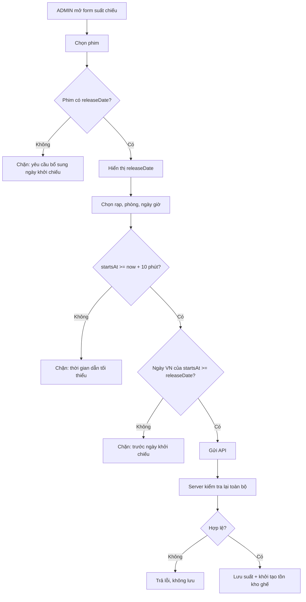

# ĐẶC TẢ YÊU CẦU PHẦN MỀM BẢO TRÌ (SRS)
## Hệ thống đặt vé xem phim Cinema – các yêu cầu HC-01, HC-02, HC-03

**Học phần:** Bảo trì phần mềm – CT244  
**Dự án:** Cinema – hệ thống đặt vé xem phim  
**Phiên bản tài liệu:** 0.1 – bản dự thảo  
**Ngày lập:** 25/11/2026  
**Người lập:** Nhóm thực hiện Project 2  
**Trạng thái:** **Draft – chưa phê duyệt**. Các quyết định kỹ thuật D-01…D-07 đã được chốt ngày 25/11/2026; phiếu phê duyệt CR vẫn cần chữ ký chính thức.

> Tài liệu mô tả **hệ thống phải đáp ứng điều gì** sau thay đổi, không thay thế thiết kế kỹ thuật. Khi có mâu thuẫn, mã nguồn tại commit đang kiểm tra và kết quả lệnh thực tế là nguồn có thẩm quyền. Không ghi “Pass” cho nội dung chưa chạy.

### Bảng theo dõi phiên bản

| Phiên bản | Ngày | Người cập nhật | Nội dung | Trạng thái |
|---|---|---|---|---|
| 0.1 | 25/11/2026 | Nhóm thực hiện | Khung SRS, đặc tả REQ-HC01/02/03, quy tắc và tiêu chí chấp nhận | Nháp |
| 0.2 | | | Sau review kỹ thuật và rà soát chéo với SDD | Chưa thực hiện |
| 1.0 | | | Sau khi CR và SRS được phê duyệt | Chưa thực hiện |

---

## 1. Giới thiệu

### 1.1. Mục đích

Tài liệu đặc tả các yêu cầu chức năng và phi chức năng cho ba yêu cầu bảo trì hiệu chỉnh:

- **HC-01:** chặn tạo/sửa suất chiếu trước ngày khởi chiếu của phim; bảo vệ lịch khi thay đổi ngày khởi chiếu.
- **HC-02:** bảo toàn thông tin đơn/lịch/vé khi phim bị ẩn; phân biệt “phim ngừng hiển thị” với “suất bị hủy”; cảnh báo quản trị viên trước khi ẩn.
- **HC-03:** chặn tạo/sửa suất chiếu trong quá khứ hoặc sát giờ chiếu.

Tài liệu là căn cứ để:

1. Cập nhật thiết kế phần mềm bảo trì (SDD).
2. Xây dựng test case và kiểm thử hồi quy.
3. Đối chiếu phạm vi thay đổi với baseline và các quyết định đã chốt.

### 1.2. Nhóm người đọc

- Ban quản lý thay đổi, trưởng nhóm và người phê duyệt.
- Thành viên backend, frontend, kiểm thử và tài liệu.
- Người rà soát độc lập cần đối chiếu yêu cầu với mã nguồn.
- Giảng viên/người đánh giá cần kiểm tra tính truy vết và khả năng kiểm thử.

### 1.3. Phạm vi sản phẩm

**Trong phạm vi:**

- Hành vi tạo/sửa suất chiếu của ADMIN.
- Hành vi cập nhật phim của ADMIN, tập trung vào `releaseDate` và trạng thái `HIDDEN`.
- Dữ liệu trả về cho chủ đơn/ADMIN khi xem lịch sử, chi tiết đơn và vé.
- Thông báo, điều hướng trên các màn hình đơn/vé và màn hình phim công khai.
- Endpoint cảnh báo tác động trước khi ẩn phim.
- Kiểm thử đơn vị, tích hợp API, giao diện và hồi quy liên quan.

**Ngoài phạm vi:**

- Hủy suất chiếu, hoàn tiền, đổi vé, xử lý tranh chấp thanh toán.
- Thay đổi quy tắc giữ ghế 5 phút, cutoff đặt vé 10 phút, check-in, xác thực.
- Mở lại bán vé cho phim `HIDDEN`.
- Tự động xóa, dời hoặc sửa dữ liệu lịch sử.
- Thay đổi cấu trúc bảng/cột bắt buộc; index chỉ được thêm nếu đo thấy chậm (D-07).
- Các yêu cầu bảo trì thích ứng, hoàn thiện, dự phòng.

**Baseline:** mã nguồn tại commit `79c7178` (sau ổn định baseline) và `3f61df0` (trước ổn định). Tài liệu thiết kế gốc tham chiếu phiên bản 1.0 – 03/11/2026.

### 1.4. Bảng chú giải thuật ngữ

| Thuật ngữ | Giải thích |
|---|---|
| CR | Yêu cầu thay đổi; trong tài liệu là HC-01/02/03 |
| HC | Bảo trì hiệu chỉnh |
| As-built | Hành vi thực tế của mã nguồn đang chạy |
| `releaseDate` | Ngày khởi chiếu của phim trong bảng `movies` |
| `HIDDEN` | Trạng thái phim bị ẩn khỏi kênh công khai; không đồng nghĩa hủy suất/vé |
| `SCHEDULED` | Suất chiếu đang hoạt động |
| `CONFIRMED` | Booking đã xác nhận, vé đã phát hành |
| `PENDING` | Booking đang giữ ghế, chưa xác nhận |
| `EXPIRED` | Booking hết hạn giữ ghế |
| Cutoff 10 phút | Quy tắc không đặt vé muộn hơn 10 phút trước giờ chiếu |
| Thời gian dẫn | Khoảng tối thiểu từ thời điểm hiện tại đến giờ bắt đầu suất chiếu mới |
| DTO | Đối tượng truyền dữ liệu giữa backend và frontend |
| N+1 | Lỗi hiệu năng do truy vấn danh sách kéo theo nhiều truy vấn con |
| RTM | Ma trận truy vết yêu cầu – thiết kế – kiểm thử |

### 1.5. Tài liệu tham khảo

| Tài liệu | Phiên bản/ngày | Vị trí |
|---|---|---|
| Kế hoạch bảo trì hiệu chỉnh | 1.0 – 25/11/2026 | `maintenance_docs/ke-hoach-bao-tri-hieu-chinh.md` |
| Phân tích sự tác động | 0.2 – 25/11/2026 | `maintenance_docs/phan-tich-tac-dong-hieu-chinh.md` |
| Đề xuất bảo trì hiệu chỉnh | Không ghi phiên bản | `maintenance_docs/De-xuat-bao-tri-hieu-chinh.md` |
| Tài liệu thiết kế hệ thống đặt vé xem phim | 1.0 – 03/11/2026 | Tệp `.docx` gốc; bản trích xuất tại `maintenance_docs/nguon/thiet-ke-he-thong-dat-ve-xem-phim.md` |
| Hướng dẫn xây dựng tài liệu Project 2 | Không ghi phiên bản | `maintenance_docs/ke-hoach-viet-tai-lieu-bao-tri.md` |
| Quy trình viết tài liệu | Không ghi phiên bản | `maintenance_docs/quy-trinh-tai-lieu.md` |
| Mã nguồn Cinema | `79c7178` – 25/11/2026 | Nhánh `main` |

### 1.6. Quy ước trình bày

- `[UNCHANGED]`: nội dung gốc được giữ nguyên.
- `[MODIFIED]`: yêu cầu/hành vi gốc được điều chỉnh.
- `[NEW]`: yêu cầu/hành vi mới.
- `[REMOVED]`: nội dung bị loại bỏ; không dùng trong phạm vi này.
- `Draft`: chưa phê duyệt; `Approved`: chỉ dùng sau khi có quyết định thật.
- `Not Run`: chưa chạy; `Blocked`: không thể chạy do môi trường; `Pass`/`Fail`: chỉ sau khi chạy thực tế.

---

## 2. Yêu cầu

### 2.1. Yêu cầu chức năng

#### 2.1.1. Yêu cầu chức năng cần điều chỉnh

##### REQ-HC01.1 – Kiểm tra ngày khởi chiếu khi tạo/sửa suất chiếu `[MODIFIED]`

| Trường | Nội dung |
|---|---|
| Mã yêu cầu | `REQ-HC01.1` – liên kết `HC-01`; điều chỉnh hành vi của UC-02 |
| Tên yêu cầu | Chặn suất chiếu bắt đầu trước ngày khởi chiếu của phim |
| Mục đích | Ngăn bán vé cho suất chiếu không thể diễn ra; bảo vệ lịch chiếu và dữ liệu vận hành |
| Đối tượng sử dụng | ADMIN |
| Tiền điều kiện | Phim tồn tại và không `HIDDEN`; phòng/cụm rạp `ACTIVE`; request có `movieId`, `roomId`, `startsAt`, `endsAt`, giá hợp lệ |
| Cách xử lý | Server đọc `releaseDate` từ cơ sở dữ liệu, không nhận từ client. Nếu `releaseDate` rỗng, từ chối. So sánh **ngày nghiệp vụ** của `startsAt` theo `Asia/Ho_Chi_Minh` với `releaseDate`. Nếu ngày suất chiếu trước ngày khởi chiếu, từ chối. Nếu bằng hoặc sau, tiếp tục các kiểm tra hiện có (thời lượng, trùng phòng, giá, trạng thái phòng/phim) |
| Kết quả | Lưu suất chiếu và khởi tạo tồn kho ghế khi hợp lệ; trả lỗi `SCHEDULE_INVALID` khi không hợp lệ; không tạo suất/tồn kho khi lỗi |
| Ghi chú | Áp dụng cho cả tạo và sửa suất; không tự hủy/dời suất hoặc booking; không đổi đường dẫn API |

**Quy tắc chi tiết:**

| Mã | Điều kiện | Hành vi bắt buộc |
|---|---|---|
| R-HC01-01 | `movies.release_date` là `NULL` | Từ chối; thông báo phải bổ sung ngày khởi chiếu trước khi lập lịch |
| R-HC01-02 | Ngày VN của `startsAt` < `releaseDate` | Từ chối với `SCHEDULE_INVALID`; thông báo nêu ngày khởi chiếu |
| R-HC01-03 | Ngày VN của `startsAt` = `releaseDate` | Cho phép, tiếp tục các kiểm tra khác |
| R-HC01-04 | Ngày VN của `startsAt` > `releaseDate` | Cho phép, tiếp tục các kiểm tra khác |
| R-HC01-05 | Phim `HIDDEN` | Vẫn từ chối với `MOVIE_UNAVAILABLE`; không thay đổi hành vi hiện có |
| R-HC01-06 | Gọi thẳng API bỏ qua giao diện | Server vẫn từ chối; không tin dữ liệu ngày do client gửi |
| R-HC01-07 | Suất chiếu đã tồn tại và vi phạm (dữ liệu cũ) | Không tự sửa/xóa; chỉ chặn thao tác tạo/sửa mới |
| R-HC01-08 | So sánh ngày | Dùng `Asia/Ho_Chi_Minh`; lưu UTC; không dùng múi giờ máy chủ mặc định |

**Tiêu chí chấp nhận:**

- **AC-HC01-01:** Given phim có `releaseDate = 2026-12-01`, When ADMIN tạo suất `2026-11-30 23:59` giờ VN, Then API trả `422 SCHEDULE_INVALID`, không có bản ghi `showtimes`/`showtime_seats` mới.
- **AC-HC01-02:** Given cùng phim, When tạo suất `2026-12-01 00:00` giờ VN và các điều kiện khác hợp lệ, Then suất được tạo thành công.
- **AC-HC01-03:** Given phim có `releaseDate = NULL`, When tạo suất bất kỳ, Then bị từ chối với thông báo yêu cầu bổ sung ngày khởi chiếu.
- **AC-HC01-04:** Given phim `HIDDEN`, When tạo suất, Then vẫn bị từ chối với `MOVIE_UNAVAILABLE`.
- **AC-HC01-05:** Given suất đã tồn tại, When sửa sang thời điểm trước `releaseDate`, Then bị từ chối và dữ liệu cũ không đổi.
- **AC-HC01-06:** Biên múi giờ `00:00–00:30` giờ VN được kiểm thử; kết quả không phụ thuộc múi giờ máy chạy test.
- **AC-HC01-07:** Gọi thẳng `POST/PUT /api/admin/showtimes` bằng công cụ API vẫn bị từ chối; không chỉ chặn ở giao diện.

##### REQ-HC01.2 – Bảo vệ lịch khi thay đổi ngày khởi chiếu `[MODIFIED]`

| Trường | Nội dung |
|---|---|
| Mã yêu cầu | `REQ-HC01.2` – liên kết `HC-01`; điều chỉnh hành vi cập nhật phim |
| Tên yêu cầu | Không cho đổi `releaseDate` làm suất chiếu hiện có vi phạm |
| Mục đích | Tránh biến lịch chiếu đã lập thành không hợp lệ sau khi sửa phim |
| Đối tượng sử dụng | ADMIN |
| Tiền điều kiện | Phim tồn tại; request cập nhật hợp lệ |
| Cách xử lý | Khi `releaseDate` mới muộn hơn ngày cũ (hoặc ngày cũ rỗng), kiểm tra các suất `SCHEDULED` chưa kết thúc có `startsAt` trước ngày khởi chiếu mới. Nếu có, từ chối toàn bộ cập nhật. Nếu ngày mới sớm hơn hoặc bằng, cho phép. Nếu đặt `releaseDate` về `NULL` khi còn suất chưa kết thúc, từ chối |
| Kết quả | Cập nhật thành công hoặc trả `RESOURCE_STATE_CONFLICT`; không tự dời/xóa suất |
| Ghi chú | Thông báo nên nêu số suất bị ảnh hưởng và thời điểm bắt đầu sớm nhất nếu có; không tiết lộ dữ liệu khách hàng |

**Quy tắc chi tiết:**

| Mã | Điều kiện | Hành vi bắt buộc |
|---|---|---|
| R-HC01-09 | Ngày mới muộn hơn ngày cũ và có suất `SCHEDULED`, `endsAt > now`, `startsAt < newReleaseStart` | Từ chối với `RESOURCE_STATE_CONFLICT`; không lưu bất kỳ trường nào |
| R-HC01-10 | Ngày mới sớm hơn hoặc bằng ngày cũ | Cho phép; không làm suất hiện có vi phạm |
| R-HC01-11 | Ngày cũ `NULL`, ngày mới có giá trị, có suất chưa kết thúc trước ngày mới | Từ chối như R-HC01-09 |
| R-HC01-12 | Đặt `releaseDate` về `NULL` khi còn suất `SCHEDULED`, `endsAt > now` | Từ chối; yêu cầu xử lý lịch trước |
| R-HC01-13 | Đặt `releaseDate` về `NULL` khi không còn suất chưa kết thúc | Cho phép; phim sẽ không thể lập lịch mới cho đến khi có ngày |
| R-HC01-14 | Suất đã kết thúc (`endsAt <= now`) | Không chặn cập nhật |
| R-HC01-15 | Có suất vi phạm | Không tự hủy, dời hoặc hoàn tiền |

**Tiêu chí chấp nhận:**

- **AC-HC01-08:** Given phim có 2 suất chưa kết thúc trước ngày mới, When ADMIN đổi `releaseDate` sang ngày muộn hơn, Then API trả `409 RESOURCE_STATE_CONFLICT`, phim và suất không đổi.
- **AC-HC01-09:** Given chỉ có suất đã kết thúc, When đổi `releaseDate` sang ngày muộn hơn, Then cập nhật thành công.
- **AC-HC01-10:** Given đổi `releaseDate` sang ngày sớm hơn, When lưu, Then thành công.
- **AC-HC01-11:** Given đặt `releaseDate = NULL` khi còn suất chưa kết thúc, When lưu, Then bị từ chối.
- **AC-HC01-12:** Thông báo lỗi có số suất bị ảnh hưởng; không có thao tác tự động nào lên `showtimes`, `bookings`, `booking_seats`, `ticket_checkins`.

##### REQ-HC02.1 – Bổ sung thông tin đơn/vé khi phim bị ẩn `[MODIFIED]`

| Trường | Nội dung |
|---|---|
| Mã yêu cầu | `REQ-HC02.1` – liên kết `HC-02`; điều chỉnh UC-08 |
| Tên yêu cầu | Trả đủ thông tin rạp, phòng, trạng thái phim/suất và giờ kết thúc cho chủ đơn/ADMIN |
| Mục đích | Giúp khách hiểu đơn/vé vẫn còn giá trị khi phim ngừng hiển thị; giảm hiểu nhầm và khiếu nại |
| Đối tượng sử dụng | CUSTOMER sở hữu đơn; ADMIN |
| Tiền điều kiện | Người dùng đã đăng nhập; booking tồn tại; người gọi là chủ đơn hoặc ADMIN |
| Cách xử lý | Bổ sung trường vào DTO tóm tắt và chi tiết; dữ liệu lấy từ quan hệ `booking → showtime → movie/room/cinema` đã được nạp. Không gọi API phim công khai để tránh 404 khi phim `HIDDEN` |
| Kết quả | Lịch sử đơn có `cinemaName`, `roomName`, `movieStatus`, `showtimeStatus`, `endsAt`; chi tiết đơn có `cinemaName`, `movieStatus`, `showtimeStatus`, `endsAt`; các trường cũ giữ nguyên |
| Ghi chú | Thay đổi additive; không đổi tên/kiểu trường cũ; không trả PII của khách khác; không mở lại bán vé cho phim `HIDDEN` |

**Quy tắc chi tiết:**

| Mã | Điều kiện | Hành vi bắt buộc |
|---|---|---|
| R-HC02-01 | `GET /api/bookings/me` | Mỗi item có thêm `cinemaName`, `roomName`, `movieStatus`, `showtimeStatus`, `endsAt` |
| R-HC02-02 | `GET /api/bookings/{id}` | Có thêm `cinemaName`, `movieStatus`, `showtimeStatus`, `endsAt` |
| R-HC02-03 | Người gọi không phải chủ đơn/ADMIN | Giữ hành vi từ chối hiện có; không rò rỉ dữ liệu |
| R-HC02-04 | Client cũ đọc JSON | Các trường cũ vẫn hiện diện, cùng tên/kiểu; trường mới có thể bị bỏ qua |
| R-HC02-05 | Danh sách nhiều booking | Không phát sinh N+1 quá mức; dùng `EntityGraph`/truy vấn phù hợp |

**Tiêu chí chấp nhận:**

- **AC-HC02-01:** Given booking `CONFIRMED` của phim `HIDDEN`, When chủ đơn gọi `/api/bookings/me`, Then item có đủ 5 trường mới và vẫn có các trường cũ.
- **AC-HC02-02:** Given chủ đơn gọi `/api/bookings/{id}`, Then chi tiết có `cinemaName`, `movieStatus`, `showtimeStatus`, `endsAt`.
- **AC-HC02-03:** Given người khác gọi `/api/bookings/{id}`, Then vẫn bị từ chối như trước.
- **AC-HC02-04:** Given client cũ chỉ đọc `movieTitle`, `startsAt`, `status`, Then không lỗi và dữ liệu không đổi nghĩa.
- **AC-HC02-05:** Đo số truy vấn khi tải 20 booking; không tăng tuyến tính theo số booking do thiếu `EntityGraph`.

##### REQ-HC02.2 – Thông báo và điều hướng khi phim bị ẩn `[MODIFIED]`

| Trường | Nội dung |
|---|---|
| Mã yêu cầu | `REQ-HC02.2` – liên kết `HC-02`; điều chỉnh UC-08 và màn hình phim công khai |
| Tên yêu cầu | Phân biệt rõ “phim ngừng hiển thị” với “suất bị hủy”; hướng khách đã đặt vào “Vé của tôi” |
| Mục đích | Khách không hiểu nhầm vé bị mất; không khẳng định sai rằng vé còn giá trị khi suất đã hủy/kết thúc |
| Đối tượng sử dụng | CUSTOMER; ADMIN (xem cùng dữ liệu) |
| Tiền điều kiện | Có dữ liệu booking/showtime/movie từ API |
| Cách xử lý | Chỉ hiển thị thông báo “vé vẫn có giá trị sử dụng” khi đồng thời: booking `CONFIRMED`, suất `SCHEDULED`, hiện tại trước `endsAt`, phim `HIDDEN`. Các trạng thái khác hiển thị đúng trạng thái, không dùng nhãn “Hợp lệ” cố định. Màn hình phim `HIDDEN` dùng thông báo trung tính và liên kết “Vé của tôi” |
| Kết quả | Khách thấy thông tin rạp/phòng, trạng thái và hướng dẫn phù hợp; không có bán vé mới cho phim `HIDDEN` |
| Ghi chú | Không tiết lộ booking/vé của người khác; không tự hủy/hoàn tiền; giữ nguyên luồng check-in cho vé hợp lệ |

**Quy tắc chi tiết:**

| Mã | Điều kiện | Hành vi bắt buộc |
|---|---|---|
| R-HC02-06 | Booking `CONFIRMED` + suất `SCHEDULED` + `now < endsAt` + phim `HIDDEN` | Hiển thị thông báo: phim không còn hiển thị để đặt mới; suất vẫn diễn ra; vé đã thanh toán vẫn có giá trị sử dụng |
| R-HC02-07 | Booking `PENDING` còn hạn | Hiển thị “đang giữ ghế”; hướng dẫn thanh toán theo chính sách hiện tại; không gọi là vé đã phát hành |
| R-HC02-08 | Booking `EXPIRED`, `CANCELLED`, `FAILED` | Hiển thị đúng trạng thái; không khẳng định vé còn giá trị |
| R-HC02-09 | Suất `CANCELLED` hoặc đã kết thúc | Không hiển thị “suất vẫn diễn ra” |
| R-HC02-10 | Màn hình phim công khai trả 404 do `HIDDEN` | Thông báo trung tính: nội dung không còn hiển thị công khai; nếu đã đặt vé, vào “Vé của tôi” để kiểm tra |
| R-HC02-11 | Khách chưa đặt tìm phim `HIDDEN` hoặc tạo booking mới | Không được bán công khai; giữ hành vi chặn hiện có |
| R-HC02-12 | Vé `CONFIRMED` của phim `HIDDEN` trong khung giờ hợp lệ | Check-in vẫn thành công; không thay đổi quy tắc check-in |
| R-HC02-13 | Bất kỳ thông báo nào | Không tự hủy suất/booking/vé; không hoàn tiền; không mở lại bán vé |

**Tiêu chí chấp nhận:**

- **AC-HC02-06:** Given booking `CONFIRMED`, suất `SCHEDULED` chưa kết thúc, phim `HIDDEN`, When mở “Vé của tôi”/chi tiết, Then thấy thông báo đúng và thông tin rạp/phòng.
- **AC-HC02-07:** Given booking `PENDING` còn hạn, When mở chi tiết, Then thấy “đang giữ ghế”, không thấy “vé đã phát hành”.
- **AC-HC02-08:** Given booking `EXPIRED`/`CANCELLED`, When mở chi tiết, Then không thấy thông báo vé còn giá trị.
- **AC-HC02-09:** Given suất `CANCELLED`, When mở đơn, Then không thấy “suất vẫn diễn ra”.
- **AC-HC02-10:** Given mở link phim `HIDDEN` khi chưa đặt, Then thấy thông báo trung tính và liên kết “Vé của tôi”.
- **AC-HC02-11:** Given vé `CONFIRMED` của phim `HIDDEN`, When STAFF check-in trong khung giờ hợp lệ, Then thành công.
- **AC-HC02-12:** Không có bản ghi booking/vé nào bị tự động đổi trạng thái bởi thay đổi giao diện.

##### REQ-HC03.1 – Kiểm tra thời gian dẫn tối thiểu khi tạo/sửa suất chiếu `[MODIFIED]`

| Trường | Nội dung |
|---|---|
| Mã yêu cầu | `REQ-HC03.1` – liên kết `HC-03`; điều chỉnh UC-02 |
| Tên yêu cầu | Chặn suất chiếu trong quá khứ hoặc sát giờ |
| Mục đích | Tránh tồn kho không thể bán; thống nhất quy tắc thời gian với cutoff đặt vé |
| Đối tượng sử dụng | ADMIN |
| Tiền điều kiện | Request tạo/sửa suất hợp lệ; `DatabaseTime` đọc được thời gian DB |
| Cách xử lý | Lấy `now` từ `DatabaseTime`; tính `earliestStart = now + 10 phút`. Nếu `startsAt < earliestStart`, từ chối. Nếu bằng hoặc sau, tiếp tục các kiểm tra khác. Áp dụng cho cả tạo và sửa |
| Kết quả | Suất hợp lệ được lưu; suất quá khứ/sát giờ bị từ chối với `SCHEDULE_INVALID`; dữ liệu cũ không bị tự động sửa/xóa |
| Ghi chú | 10 phút đồng bộ với `BookingRules.requireBeforeCutoff` (600 giây); không dùng `Instant.now()` trong logic nghiệp vụ |

**Quy tắc chi tiết:**

| Mã | Điều kiện | Hành vi bắt buộc |
|---|---|---|
| R-HC03-01 | `startsAt < now + 10 phút` | Từ chối với `SCHEDULE_INVALID`; thông báo nêu thời gian dẫn tối thiểu |
| R-HC03-02 | `startsAt = now + 10 phút` | Cho phép, tiếp tục các kiểm tra khác |
| R-HC03-03 | `startsAt > now + 10 phút` | Cho phép, tiếp tục các kiểm tra khác |
| R-HC03-04 | Nguồn thời gian | Dùng `DatabaseTime` (UTC từ DB); không dùng đồng hồ máy chủ ứng dụng |
| R-HC03-05 | Tạo mới hoặc sửa suất | Áp dụng cùng quy tắc |
| R-HC03-06 | Giao diện | `DateTimePicker` có `minDateTime`; form kiểm tra lại trước khi gửi; server vẫn quyết định cuối cùng |
| R-HC03-07 | Suất cũ đã qua | Không tự xóa/sửa; chỉ chặn thao tác mới |
| R-HC03-08 | Suất đã có booking | Giữ nguyên quy tắc cấm sửa suất đã có lịch sử booking hiện có |

**Tiêu chí chấp nhận:**

- **AC-HC03-01:** Given `now = 2026-12-01T10:00:00Z`, When tạo suất `10:09:59Z`, Then `422 SCHEDULE_INVALID`.
- **AC-HC03-02:** Given cùng `now`, When tạo suất `10:10:00Z`, Then được chấp nhận (nếu các điều kiện khác hợp lệ).
- **AC-HC03-03:** Given cùng `now`, When tạo suất `10:10:01Z`, Then được chấp nhận.
- **AC-HC03-04:** Given sửa suất sang thời điểm quá khứ, Then bị từ chối.
- **AC-HC03-05:** Given gọi thẳng API bỏ qua giao diện, Then server vẫn từ chối.
- **AC-HC03-06:** Giao diện không cho chọn ngày/giờ trước `minDateTime`; khi gửi form không hợp lệ, không gọi API.
- **AC-HC03-07:** Suất đã tồn tại trong quá khứ không bị tự động xóa/sửa.

#### 2.1.2. Yêu cầu chức năng mới

##### REQ-HC02.3 – Cảnh báo tác động trước khi ẩn phim `[NEW]`

| Trường | Nội dung |
|---|---|
| Mã yêu cầu | `REQ-HC02.3` – yêu cầu mới thuộc `HC-02` |
| Tên yêu cầu | Xem tác động và xác nhận trước khi ẩn phim |
| Mục đích | Admin biết còn suất/booking đang hiệu lực trước khi ẩn; tránh hiểu nhầm là hệ thống đã hủy cam kết |
| Đối tượng sử dụng | ADMIN |
| Tiền điều kiện | Phim tồn tại; người gọi là ADMIN; đang sửa phim hoặc chuẩn bị đổi trạng thái sang `HIDDEN` |
| Cách xử lý | Gọi endpoint đọc `GET /api/admin/movies/{id}/hide-impact`. Endpoint trả số suất `SCHEDULED` chưa kết thúc, số booking `CONFIRMED`/`PENDING` còn hiệu lực và khoảng thời gian sớm nhất/muộn nhất. Nếu có cam kết hiệu lực, giao diện hiển thị modal xác nhận; chỉ gửi cập nhật `HIDDEN` sau khi admin xác nhận. Nếu không có cam kết, có thể ẩn mà không cần modal |
| Kết quả | Admin thấy tác động trước khi ẩn; thao tác ẩn không tự hủy suất/booking/vé; endpoint không trả PII |
| Ghi chú | Endpoint chỉ đọc; không thay đổi dữ liệu. Nếu endpoint lỗi, giao diện hiển thị cảnh báo chung và vẫn yêu cầu xác nhận; không tự hủy dữ liệu |

**Quy tắc chi tiết:**

| Mã | Điều kiện | Hành vi bắt buộc |
|---|---|---|
| R-HC02-14 | `GET /api/admin/movies/{id}/hide-impact` | Chỉ ADMIN; trả 404 nếu phim không tồn tại; 403 nếu không đủ quyền |
| R-HC02-15 | Response | Có `movieId`, `title`, `activeShowtimes`, `confirmedBookings`, `pendingBookings`, `earliestStart`, `latestEnd` |
| R-HC02-16 | Đếm suất | Chỉ tính suất `SCHEDULED` có `endsAt > now` |
| R-HC02-17 | Đếm booking | `confirmedBookings`: booking `CONFIRMED` thuộc suất đang hiệu lực; `pendingBookings`: booking `PENDING` còn hạn (`expiresAt > now`) thuộc suất đang hiệu lực |
| R-HC02-18 | Có cam kết hiệu lực | Bắt buộc xác nhận trước khi gửi `HIDDEN` |
| R-HC02-19 | Không có cam kết hiệu lực | Không bắt buộc modal; vẫn có thể hiển thị thông báo ngắn |
| R-HC02-20 | Endpoint lỗi/timeout | Hiển thị cảnh báo chung; vẫn cho phép xác nhận ẩn; không tự hủy dữ liệu |
| R-HC02-21 | Dữ liệu trả về | Không có tên/email/số điện thoại khách hàng, mã vé hoặc danh sách ghế |
| R-HC02-22 | Sau khi ẩn | Không tự hủy suất/booking/vé; không hoàn tiền; không mở lại bán vé |

**Tiêu chí chấp nhận:**

- **AC-HC02-13:** Given phim có 3 suất chưa kết thúc và 18 booking `CONFIRMED`, When ADMIN gọi `hide-impact`, Then response có đúng số liệu và khoảng thời gian.
- **AC-HC02-14:** Given STAFF/CUSTOMER gọi endpoint, Then `403`.
- **AC-HC02-15:** Given phim không tồn tại, Then `404`.
- **AC-HC02-16:** Given có cam kết hiệu lực, When ADMIN đổi trạng thái sang `HIDDEN`, Then modal xác nhận xuất hiện; hủy modal thì không gửi cập nhật.
- **AC-HC02-17:** Given chỉ có booking của suất đã kết thúc, When ẩn phim, Then không bị chặn bởi modal cảnh báo.
- **AC-HC02-18:** Given endpoint lỗi, When ẩn phim, Then có cảnh báo chung, không tự hủy dữ liệu, và admin vẫn có thể xác nhận.
- **AC-HC02-19:** Response không chứa PII/mã vé.

### 2.2. Yêu cầu phi chức năng

#### 2.2.1. Yêu cầu phi chức năng cần điều chỉnh

| Mã | Thuộc tính | Yêu cầu | Cách xác minh |
|---|---|---|---|
| `NFR-HC01-TZ` | Đúng đắn thời gian | So sánh ngày nghiệp vụ theo `Asia/Ho_Chi_Minh`; lưu UTC; không phụ thuộc múi giờ máy chủ | Unit test biên `00:00–00:30`; integration test với DB UTC |
| `NFR-HC03-CLOCK` | Có thể kiểm thử | Logic thời gian dùng `DatabaseTime`; test stub được `now` | Unit test `ShowtimeServiceTest` với `DatabaseTime` mock |
| `NFR-HC02-COMPAT` | Tương thích | Thay đổi DTO theo hướng additive; không đổi tên/kiểu trường cũ; client cũ vẫn đọc được | Contract test JSON; kiểm tra type frontend |
| `NFR-HC-UX` | Khả dụng | Giữ giao diện tối hiện có; thông báo tiếng Việt rõ ràng; focus-visible, bàn phím, responsive; tôn trọng `prefers-reduced-motion` | Kiểm tra thủ công + test UI hiện có |

#### 2.2.2. Yêu cầu phi chức năng mới

| Mã | Thuộc tính | Yêu cầu | Cách xác minh |
|---|---|---|---|
| `NFR-HC02-PERF` | Hiệu năng | Lịch sử 20 booking không N+1; `hide-impact` phản hồi mục tiêu ≤ 1 giây trên dữ liệu demo | Đếm query/Hibernate statistics; đo thời gian endpoint; `EXPLAIN` nếu chậm |
| `NFR-HC02-SEC` | Bảo mật | `hide-impact` chỉ ADMIN; DTO booking chỉ chủ đơn/ADMIN; không trả PII | Test phân quyền 401/403; test người khác truy cập |
| `NFR-HC-AUDIT` | Truy vết | Ghi log actor/action/outcome cho tạo/sửa suất, cập nhật phim, ẩn phim; không ghi token/PII | Kiểm tra log; test không lộ dữ liệu nhạy cảm |
| `NFR-HC-QUALITY` | Chất lượng | `npm run build`, `npm run test`, `npm run lint` không hồi quy; backend test chạy khi môi trường sẵn sàng | Chạy lệnh thực tế, ghi commit/thời điểm/kết quả |
| `NFR-HC-ERROR` | Khả năng chẩn đoán | Lỗi nghiệp vụ dùng mã hiện có (`SCHEDULE_INVALID`, `RESOURCE_STATE_CONFLICT`, `MOVIE_UNAVAILABLE`); thông báo nêu cách xử lý | Kiểm tra response API và UI |

---

## 3. Tính năng

### 3.1. Tính năng được điều chỉnh

#### 3.1.1. UC-02 – Tạo/sửa suất chiếu `[MODIFIED]`

| Trường | Nội dung |
|---|---|
| Mã use case | UC-02 |
| Tác nhân | ADMIN |
| Mục tiêu | Tạo/sửa suất chiếu hợp lệ về phòng, thời lượng, giá, ngày khởi chiếu và thời gian dẫn |
| Tiền điều kiện | Đăng nhập ADMIN; phim tồn tại, không `HIDDEN`, có `releaseDate`; phòng/cụm rạp `ACTIVE`; phòng có ghế `ACTIVE` |
| Kích hoạt | ADMIN mở form tạo/sửa suất chiếu |
| Luồng chính | 1. Chọn phim. 2. Hệ thống hiển thị ngày khởi chiếu. 3. Chọn rạp/phòng. 4. Chọn ngày giờ bắt đầu. 5. Hệ thống tính giờ kết thúc theo thời lượng. 6. Kiểm tra thời gian dẫn và ngày khởi chiếu. 7. Gửi API. 8. Server kiểm tra lại toàn bộ. 9. Lưu suất và khởi tạo tồn kho ghế |
| Luồng thay thế | ADMIN đổi phim/ngày giờ; form tính lại giờ kết thúc và giới hạn tối thiểu |
| Ngoại lệ | Phim `HIDDEN`/không có `releaseDate`; ngày giờ trước ngày khởi chiếu; thời gian dẫn < 10 phút; trùng phòng; phòng không hoạt động; không có ghế; giá không hợp lệ |
| Hậu điều kiện | Suất được lưu và có tồn kho, hoặc không có thay đổi dữ liệu và có thông báo lỗi |

**Luồng xử lý tổng quát:**

#### 3.1.2. UC-08 – Xem lịch sử, chi tiết đơn và vé `[MODIFIED]`

| Trường | Nội dung |
|---|---|
| Mã use case | UC-08 |
| Tác nhân | CUSTOMER sở hữu đơn; ADMIN |
| Mục tiêu | Xem đơn/vé kể cả khi phim bị ẩn; hiểu đúng trạng thái cam kết |
| Tiền điều kiện | Đăng nhập; booking tồn tại; người gọi là chủ đơn hoặc ADMIN |
| Kích hoạt | Mở “Vé của tôi”, chi tiết đơn hoặc trang vé thành công |
| Luồng chính | 1. Gọi API lịch sử/chi tiết. 2. Server trả thông tin rạp/phòng/trạng thái/giờ kết thúc. 3. Giao diện hiển thị thông tin và thông báo theo quy tắc. 4. Khách có thể mở chi tiết/vé |
| Luồng thay thế | Phim `HIDDEN` nhưng vé `CONFIRMED` và suất chưa kết thúc → thông báo vé vẫn có giá trị; phim `HIDDEN` nhưng suất đã hủy/kết thúc → thông báo theo trạng thái |
| Ngoại lệ | Booking `EXPIRED`/`CANCELLED`/`FAILED`; suất `CANCELLED`; người khác truy cập; API lỗi |
| Hậu điều kiện | Không thay đổi trạng thái dữ liệu; khách thấy thông tin đúng và không bị bán vé mới cho phim `HIDDEN` |

#### 3.1.3. Quản trị phim – cập nhật ngày khởi chiếu `[MODIFIED]`

| Trường | Nội dung |
|---|---|
| Mã use case | UC-ADM-MOVIE-UPDATE |
| Tác nhân | ADMIN |
| Mục tiêu | Cập nhật thông tin phim mà không làm lịch chiếu hiện có vi phạm |
| Tiền điều kiện | Đăng nhập ADMIN; phim tồn tại |
| Kích hoạt | ADMIN sửa phim và bấm lưu |
| Luồng chính | 1. Tải phim. 2. Sửa thông tin. 3. Nếu `releaseDate` muộn hơn/rỗng→có giá trị, kiểm tra suất chưa kết thúc. 4. Nếu không vi phạm, lưu. 5. Giao diện cập nhật danh sách |
| Luồng thay thế | `releaseDate` sớm hơn/bằng → lưu không cần kiểm tra xung đột |
| Ngoại lệ | Có suất vi phạm → `RESOURCE_STATE_CONFLICT`; không lưu bất kỳ trường nào; không tự dời/xóa suất |
| Hậu điều kiện | Phim được cập nhật hoặc dữ liệu không đổi; lịch chiếu hiện có vẫn hợp lệ |

### 3.2. Tính năng mới

#### 3.2.1. UC-ADM-HIDE-IMPACT – Xem tác động trước khi ẩn phim `[NEW]`

| Trường | Nội dung |
|---|---|
| Mã use case | UC-ADM-HIDE-IMPACT |
| Tác nhân | ADMIN |
| Mục tiêu | Biết số suất/booking còn hiệu lực trước khi ẩn phim |
| Tiền điều kiện | Đăng nhập ADMIN; phim tồn tại |
| Kích hoạt | ADMIN chọn trạng thái `HIDDEN` trên form sửa phim |
| Luồng chính | 1. Gọi `GET /api/admin/movies/{id}/hide-impact`. 2. Hiển thị số suất, số booking, khoảng thời gian. 3. ADMIN xác nhận. 4. Gửi cập nhật `HIDDEN`. 5. Hệ thống chỉ ẩn khỏi kênh công khai |
| Luồng thay thế | Không có cam kết hiệu lực → có thể ẩn mà không cần modal; vẫn hiển thị thông báo ngắn nếu cần |
| Ngoại lệ | Endpoint lỗi/timeout → cảnh báo chung, vẫn yêu cầu xác nhận; không tự hủy dữ liệu; 403/404 theo phân quyền/tồn tại |
| Hậu điều kiện | Phim `HIDDEN`; suất/booking/vé không bị hủy; không bán vé mới công khai |

### 3.3. Tính năng giữ nguyên `[UNCHANGED]`

| Tính năng | Cam kết |
|---|---|
| Danh sách/chi tiết phim công khai | Tiếp tục loại `HIDDEN`; không lộ phim ẩn |
| Đặt vé, giữ ghế 5 phút, thanh toán mô phỏng | Không đổi quy tắc và luồng |
| Hủy booking `PENDING` | Không đổi |
| Check-in vé | Không đổi; vé hợp lệ của phim `HIDDEN` vẫn check-in được |
| Phân quyền ADMIN/STAFF/CUSTOMER | Không đổi; endpoint mới chỉ ADMIN |
| Báo cáo doanh thu | Không đổi trong phạm vi HC-01/02/03 |

---

## 4. Truy vết yêu cầu

| CR | Yêu cầu SRS | Use case | Test case dự kiến | Trạng thái |
|---|---|---|---|---|
| HC-01 | `REQ-HC01.1`, `REQ-HC01.2` | UC-02, UC-ADM-MOVIE-UPDATE | HC01-T01…T12 | Draft |
| HC-02 | `REQ-HC02.1`, `REQ-HC02.2`, `REQ-HC02.3` | UC-08, UC-ADM-HIDE-IMPACT | HC02-T01…T15 | Draft |
| HC-03 | `REQ-HC03.1` | UC-02 | HC03-T01…T10 | Draft |

RTM đầy đủ sẽ được cập nhật khi SDD và test case được chốt. Không đánh dấu “đã đạt” khi chưa có kết quả thực thi.

---

## 5. Giả định, ràng buộc và câu hỏi mở

### 5.1. Giả định

- Hệ thống tiếp tục là Spring Boot + React SPA; không thêm dịch vụ ngoài.
- `DatabaseTime` đọc được thời gian DB khi chạy thật; test stub được.
- Dữ liệu demo có phim `HIDDEN`, booking `CONFIRMED`/`PENDING` và suất chưa kết thúc để kiểm thử.
- Quy tắc 10 phút của HC-03 đồng bộ với cutoff đặt vé hiện có.

### 5.2. Ràng buộc

- Không đổi route/API hiện có; chỉ thêm endpoint và trường DTO.
- Không tự hủy/dời suất, booking hoặc vé.
- Không mở lại bán vé cho phim `HIDDEN`.
- Không thêm migration bắt buộc; index chỉ thêm nếu đo thấy chậm (D-07).
- Không ghi Pass cho test chưa chạy; backend test phụ thuộc Docker/Testcontainers.

### 5.3. Câu hỏi mở

1. Nội dung thông báo tiếng Việt chính xác do nhóm/giảng viên chốt; tránh khẳng định pháp lý về hoàn tiền.
2. Có cần mã lỗi riêng cho `releaseDate`/thời gian dẫn không? Đề xuất dùng `SCHEDULE_INVALID` để giữ hợp đồng API.
3. Có cần index cho `hide-impact` không? Đề xuất chỉ thêm sau khi đo (D-07).
4. Có cần hiển thị `movieStatus`/`showtimeStatus` cho STAFF không? Đề xuất giữ nguyên quyền hiện có; chỉ chủ đơn/ADMIN.

---

## 6. Lịch sử cập nhật

| Ngày | Nội dung |
|---|---|
| 25/11/2026 | Tạo SRS 0.1; đặc tả REQ-HC01/02/03; ghi nhận D-01…D-07 đã chốt |
