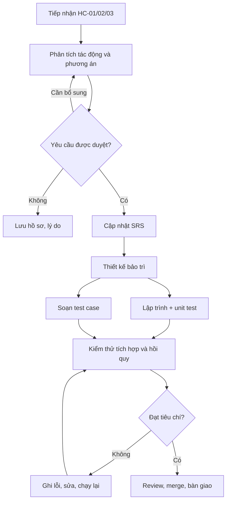

# KẾ HOẠCH BẢO TRÌ HIỆU CHỈNH HỆ THỐNG ĐẶT VÉ XEM PHIM

**Học phần:** Bảo trì phần mềm – CT244  
**Dự án:** Cinema – hệ thống đặt vé xem phim  
**Phiên bản kế hoạch:** 1.1  
**Ngày lập:** 25/11/2026  
**Người lập:** Nhóm thực hiện Project 2  
**Trạng thái:** Kế hoạch đã cập nhật theo quyết định D-01…D-07; HC-03 đã được xác nhận thuộc phạm vi; **chưa triển khai** mã nguồn HC-01/02/03. Phiếu phê duyệt CR vẫn ở trạng thái Draft/chưa ký.

> Tài liệu này là kế hoạch tổ chức và kiểm soát hoạt động bảo trì hiệu chỉnh. Tài liệu không phải báo cáo kết quả đã hoàn thành. Mọi kết quả kiểm thử chỉ được ghi nhận sau khi thực thi thực tế; không sử dụng trạng thái “Pass” cho trường hợp chưa chạy.

**Bảng theo dõi phiên bản**

| Phiên bản | Ngày | Người cập nhật | Nội dung thay đổi | Trạng thái |
|---|---|---|---|---|
| 0.1 | 25/11/2026 | Nhóm thực hiện | Khung kế hoạch, phạm vi sơ bộ HC-01/HC-02 | Nháp |
| 1.0 | 25/11/2026 | Nhóm thực hiện | Bổ sung baseline sau pull, HC-03 đề xuất, WBS, nguồn lực, công cụ, kiểm thử và truy vết | Chờ rà soát nội bộ |
| 1.1 | 25/11/2026 | Nhóm thực hiện | Chốt HC-03 và D-01…D-07; cập nhật ước lượng HC-01 2.5 / HC-02 4.5 / HC-03 2.0 person-days; ghi nhận SRS/SDD/test plan draft đã tạo | Chờ phê duyệt CR |

## 1. Tóm tắt điều hành

Kế hoạch xử lý ba yêu cầu bảo trì hiệu chỉnh:

| Mã | Vấn đề | Mức ưu tiên | Trạng thái |
|---|---|---|---|
| HC-01 | Cho phép tạo/sửa suất chiếu diễn ra trước ngày khởi chiếu của phim | Cao | Chờ phân tích tác động và phê duyệt |
| HC-02 | Ẩn phim làm mất lịch chiếu công khai, gây hiểu nhầm cho khách đã đặt vé | Trung bình, nâng cao nếu ảnh hưởng vé đã thanh toán | Chờ phân tích tác động và phê duyệt |
| HC-03 | Cho phép tạo/sửa suất chiếu trong quá khứ hoặc sát giờ chiếu | Trung bình | **Đã xác nhận phạm vi** (D-03, 25/11/2026); chờ phê duyệt CR chính thức |

**Kết quả mong đợi:** ba lỗi được chặn hoặc được xử lý đúng tại cả giao diện và máy chủ, không làm thay đổi quyền sở hữu đơn/vé, không hủy giao dịch đã có và không mở lại việc bán vé cho phim đã ẩn.

### 1.1. Đối chiếu cấu trúc với mẫu KehoachBT.docx

| Mục theo mẫu | Nội dung tương ứng trong tài liệu |
|---|---|
| 1. Giới thiệu | Mục 1, mục 2 |
| 2. Tài liệu tham khảo | Mục 16 |
| 3. Các định nghĩa | Mục 2.5 |
| 4.1. Tổ chức bảo trì | Mục 4.1, 4.2 |
| 4.2. Kế hoạch làm việc | Mục 5 (WBS, mốc, lịch, giả định) |
| 4.3. Tóm tắt tài nguyên | Mục 4.3 |
| 4.4. Công cụ, kỹ thuật và phương pháp | Mục 4.4 |
| 5. Quy trình bảo trì | Mục 6 |
| 6. Quản lý cấu hình | Mục 6.3 |
| 7. Quản lý chất lượng | Mục 9 |

Bản Word cuối cùng sẽ được trình bày lại theo đúng thứ tự và định dạng của mẫu; bảng trên chỉ bảo đảm không bỏ sót nội dung.

## 2. Căn cứ, mục tiêu và phạm vi

### 2.1. Căn cứ

- Đề bài Bài tập nhóm số 2 – Bảo trì một sản phẩm phần mềm: mỗi loại bảo trì cần tối thiểu 03 yêu cầu; riêng bảo trì dự phòng tối thiểu 02 yêu cầu.
- Tài liệu `De-xuat-bao-tri-hieu-chinh.md`: xác định HC-01 và HC-02, kèm hiện trạng, căn cứ mã nguồn, hướng khắc phục và tiêu chí nghiệm thu.
- Mã nguồn Cinema tại nhánh `main`, commit baseline `3f61df0`.
- Quy trình và mẫu tài liệu trong `ke-hoach-viet-tai-lieu-bao-tri.md`, `quy-trinh-tai-lieu.md`.

### 2.2. Mục tiêu

1. Chặn suất chiếu trước ngày khởi chiếu nhưng vẫn cho phép lập lịch trước cho phim **Sắp chiếu (UPCOMING)** từ ngày khởi chiếu trở đi.
2. Bảo toàn hành trình theo dõi đơn, lịch và vé của khách đã đặt khi phim bị ẩn; giải thích rõ **ẩn phim không phải hủy suất chiếu**.
3. Không để quản trị viên tạo hoặc sửa suất chiếu đã bắt đầu/đã qua, tránh tồn kho không thể bán và dữ liệu lịch chiếu sai.
4. Bảo đảm các thay đổi có kiểm thử, có truy vết yêu cầu – thiết kế – kiểm thử và có minh chứng thực tế.

### 2.3. Phạm vi

**Trong phạm vi:**

- Kiểm tra ngày khởi chiếu tại máy chủ cho cả tạo và cập nhật suất chiếu.
- Hướng dẫn và chặn sớm trên form tạo/sửa suất chiếu.
- Bổ sung thông tin rạp, trạng thái phim/suất chiếu vào dữ liệu đơn hàng dành cho chủ đơn.
- Thông báo phân biệt “phim ngừng hiển thị” với “suất chiếu bị hủy” trên các màn hình vé và đơn hàng.
- Cảnh báo quản trị viên trước khi ẩn phim còn suất chiếu chưa kết thúc có đơn giữ chỗ hoặc đơn đã xác nhận.
- Kiểm tra thời điểm bắt đầu suất chiếu so với thời gian hiện tại.
- Bổ sung kiểm thử đơn vị, kiểm thử tích hợp và kiểm thử giao diện; cập nhật tài liệu bảo trì.

**Ngoài phạm vi:**

- Hủy suất chiếu, hoàn tiền, đổi vé hoặc xử lý tranh chấp thanh toán.
- Thay đổi quy tắc giữ ghế 5 phút/10 phút trước giờ chiếu.
- Mở lại việc bán vé cho phim **HIDDEN**.
- Thay đổi quyền ADMIN/STAFF/CUSTOMER hiện có.
- Tự động xóa, dời hoặc hủy các suất chiếu/dữ liệu lịch sử đã vi phạm.
- Bổ sung bảng hoặc cột cơ sở dữ liệu, trừ khi phân tích tác động chứng minh cần thiết và được phê duyệt riêng.
- Các yêu cầu bảo trì thích ứng, hoàn thiện và dự phòng khác.

### 2.4. Nguyên tắc thực hiện

- **Máy chủ là nguồn quyết định:** mọi kiểm tra nghiệp vụ phải được thực hiện lại ở backend; không tin dữ liệu ngày giờ do giao diện gửi lên.
- **Không phá cam kết với khách:** ẩn phim, đổi ngày khởi chiếu hoặc sửa suất không được tự động hủy booking/vé đã phát hành.
- **Thay đổi API theo hướng bổ sung:** chỉ thêm trường DTO hoặc endpoint mới; không đổi nghĩa trường cũ, không xóa endpoint.
- **So sánh ngày theo múi giờ Việt Nam:** dùng `Asia/Ho_Chi_Minh`; thời điểm lưu UTC không được làm lệch ngày nghiệp vụ.
- **Không ghi nhận kết quả giả định:** test case chưa chạy phải ghi `Not Run`; bị chặn ghi `Blocked`.
- **Thay đổi có kiểm soát:** mỗi yêu cầu có nhánh, commit, review và tiêu chí nghiệm thu riêng.

### 2.5. Thuật ngữ và chữ viết tắt

| Thuật ngữ | Giải thích |
|---|---|
| CR (Change Request) | Yêu cầu thay đổi phần mềm; trong tài liệu này là HC-01, HC-02, HC-03 |
| HC | Bảo trì hiệu chỉnh (corrective maintenance) |
| SRS | Đặc tả yêu cầu phần mềm sau bảo trì |
| SDD | Thiết kế phần mềm bảo trì |
| RTM | Ma trận truy vết yêu cầu – thiết kế – kiểm thử |
| WBS | Phân rã công việc |
| DoD | Định nghĩa hoàn thành |
| Suất chiếu (showtime) | Một buổi chiếu phim tại phòng và thời điểm cụ thể |
| Ngày khởi chiếu (`releaseDate`) | Ngày phim bắt đầu được phép chiếu theo dữ liệu phim |
| `UPCOMING` | Phim sắp chiếu; được phép lập lịch từ ngày khởi chiếu |
| `SHOWING` | Phim đang chiếu |
| `ENDED` | Phim đã kết thúc đợt chiếu |
| `HIDDEN` | Phim bị ẩn khỏi kênh công khai; không đồng nghĩa hủy suất chiếu hay hủy vé |
| `SCHEDULED` | Suất chiếu đang hoạt động |
| `CANCELLED` | Suất chiếu đã bị hủy |
| `COMPLETED` | Suất chiếu đã kết thúc |
| `PENDING` | Đơn đang giữ ghế, chưa thanh toán/xác nhận |
| `CONFIRMED` | Đơn đã xác nhận, vé đã phát hành |
| `EXPIRED` | Đơn hết hạn giữ chỗ |
| `CANCELLED` (booking) | Đơn đã hủy |
| `FAILED` | Đơn/thanh toán thất bại |
| ADMIN / STAFF / CUSTOMER | Vai trò quản trị, nhân viên rạp và khách hàng |
| UTC / ICT | Giờ phối hợp quốc tế / giờ Việt Nam (UTC+7, `Asia/Ho_Chi_Minh`) |
| Cutoff 10 phút | Quy tắc không cho đặt vé muộn hơn 10 phút trước giờ chiếu |
| N+1 query | Lỗi hiệu năng khi một truy vấn danh sách kéo theo nhiều truy vấn con |

## 3. Baseline và kết quả khảo sát hiện trạng

### 3.1. Phiên bản gốc sau khi pull

| Thuộc tính | Giá trị |
|---|---|
| Nhánh | `main` |
| Commit | `3f61df03ed51c6a745ceb1ad11f2dfbae2d7fc23` |
| Thời điểm commit | 25/11/2026 15:32:38 +07:00 |
| Nội dung | Merge pull request #7 – `feat/seat-selection-ui` |
| Khoảng pull | `5100f5e..3f61df0` (fast-forward) |
| Thay đổi từ upstream | 14 tệp, +416/−277; thêm `frontend/src/features/bookings/utils/seat-styles.ts` |

### 3.2. Kết quả kiểm tra baseline

Trước khi ổn định baseline, mã nguồn mới pull về chưa đạt các kiểm tra tự động:

| Kiểm tra | Kết quả ban đầu | Nguyên nhân chính |
|---|---|---|
| `npm run build` | **Fail** – 4 lỗi TS6133 | Biến/tham số/import không dùng trong `CinemaCard.tsx`, `AdminRoomsPage.tsx`, `HomePage.tsx` |
| `npm run test` | **Fail** – 3/196 test | Test kỳ vọng nút “Phòng chiếu” và đường dẫn banner cũ |
| `npm run lint` | Pass với cảnh báo | Cảnh báo biến/import không dùng và fast-refresh |

Sau khi ổn định baseline (mục 3.3), phạm vi frontend:

| Kiểm tra | Kết quả |
|---|---|
| `npm run build` | **Pass** – Vite build thành công; còn cảnh báo chunk > 500 kB |
| `npm run test` | **Pass** – 26 tệp, 196 test |
| `npm run lint` | **Pass** – còn 03 cảnh báo, không có lỗi |

Bộ kiểm thử backend **chưa được chạy** trong bước lập kế hoạch: máy lập kế hoạch không kết nối được Docker Desktop/Testcontainers (`docker info` báo không tìm thấy daemon). Trạng thái ghi nhận: **Not Run – Blocked**; sẽ chạy tại P0/M0 khi môi trường Docker sẵn sàng. Không dùng kết quả frontend thay cho kết quả backend.

### 3.3. Các chỉnh sửa ổn định baseline

Các chỉnh sửa dưới đây **không phải** yêu cầu bảo trì HC-01/HC-02/HC-03. Chúng chỉ khôi phục trạng thái build/test ổn định để bắt đầu công việc bảo trì:

| Tệp | Thay đổi | Lý do |
|---|---|---|
| `frontend/src/features/cinemas/components/CinemaCard.tsx` | Khôi phục nút “Phòng chiếu” gọi `onSelectCinema` | Nút bị thiếu sau thay đổi giao diện; test và modal phòng chiếu phụ thuộc vào nút này |
| `frontend/src/pages/AdminRoomsPage.tsx` | Bỏ import `ShieldAlert`, `Building2` không dùng | Lỗi build TS6133 |
| `frontend/src/pages/HomePage.tsx` | Bỏ biến `totalElements` không dùng | Lỗi build TS6133 |
| `frontend/src/test/movie-hero-banner.test.tsx` | Cập nhật đường dẫn banner kỳ vọng sang `.webp` | Test còn kiểm tra tài nguyên cũ, không khớp component hiện tại |

**Trạng thái:** các thay đổi này đang ở working tree, chưa commit. Trước khi bắt đầu HC-01, cần commit/PR riêng hoặc gộp vào một commit “baseline stabilization” để tách biệt với thay đổi bảo trì.

### 3.4. Tổng hợp lỗi và căn cứ mã nguồn

| Mã | Hiện trạng | Căn cứ chính | Mức độ |
|---|---|---|---|
| HC-01 | Tạo/sửa suất có thể diễn ra trước `releaseDate` | `ShowtimeService.validateSchedule()` chưa kiểm tra `releaseDate`; form chỉ lọc `HIDDEN` | Cao |
| HC-02 | Phim HIDDEN bị ẩn khỏi kênh công khai nhưng khách đã đặt không được giải thích đầy đủ | `MovieService.getPublic()` trả 404; DTO booking thiếu thông tin rạp/trạng thái phim/suất; `AdminMovieForm` không cảnh báo trước khi ẩn | Trung bình |
| HC-03 | Tạo/sửa suất trong quá khứ hoặc sát giờ chiếu vẫn được lưu | `ShowtimeService.validateSchedule()` chỉ kiểm tra khoảng thời gian, thời lượng và giá; chưa so với `DatabaseTime.now()`; `DateTimePicker` không giới hạn ngày | Trung bình |

**Lưu ý về mức độ xác minh:** HC-01 và HC-02 được kế thừa từ tài liệu đề xuất; HC-03 được nhóm rà soát bổ sung từ mã nguồn. Cả ba chưa được tái hiện trực tiếp trên giao diện trong bước lập kế hoạch. Kết quả build/test ở mục 3.2 là kiểm tra baseline, không phải kết quả kiểm thử các yêu cầu HC.

## 4. Tổ chức thực hiện

### 4.1. Vai trò và trách nhiệm

| Vai trò | Trách nhiệm chính | Quyền quyết định |
|---|---|---|
| Trưởng nhóm / điều phối | Giữ kế hoạch, lịch, phạm vi, phê duyệt cuối và báo cáo tổng hợp | Chốt phạm vi, mốc, mức ưu tiên |
| Phụ trách backend | Kiểm tra nghiệp vụ, DTO, endpoint, kiểm thử đơn vị/tích hợp | Phương án kỹ thuật backend |
| Phụ trách frontend | Form suất chiếu, thông báo đơn/vé, cảnh báo ẩn phim, kiểm thử giao diện | Phương án UI/UX trong phạm vi đã duyệt |
| Phụ trách kiểm thử | Kế hoạch kiểm thử, test case, dữ liệu, minh chứng, hồi quy | Đánh giá Pass/Fail/Blocked |
| Phụ trách tài liệu | Phân tích tác động, SRS, SDD, tài liệu kiểm thử, báo cáo | Tính nhất quán và truy vết |
| Người rà soát độc lập | Kiểm tra chéo mã, bảo mật, dữ liệu, tiêu chí nghiệm thu | Yêu cầu sửa trước khi merge |
| Ban quản lý thay đổi | Xem xét, chấp nhận/từ chối/trả hồ sơ | Phê duyệt CR và phạm vi |

Tên thành viên, MSSV và mức hoàn thành sẽ được điền trong bảng phân công của báo cáo Word sau khi nhóm chốt. Kế hoạch này không tự gán tên hoặc tỷ lệ hoàn thành.

### 4.2. Kênh phối hợp

- Trao đổi công việc hằng ngày: kênh nhóm đã thống nhất.
- Báo lỗi và review: issue/PR trên GitHub của dự án.
- Tài liệu: thư mục `maintenance_docs/`; mỗi tài liệu có phiên bản và người rà soát.
- Quyết định thay đổi phạm vi: ghi trong biên bản nhóm và cập nhật kế hoạch.

### 4.3. Tóm tắt tài nguyên

**Nhân lực dự kiến**

| Vai trò | Số người | Kỹ năng cần có | Thời lượng tham gia |
|---|---|---|---|
| Trưởng nhóm / điều phối | 1 | Quản lý dự án nhỏ, Git/GitHub, tổng hợp tài liệu | Toàn bộ 15 ngày |
| Backend | 1–2 | Java, Spring Boot, JPA, JUnit/Mockito, MySQL | P3–P8 |
| Frontend | 1–2 | React, TypeScript, React Testing Library, Vitest | P3–P8 |
| Kiểm thử | 1 | Thiết kế test case, kiểm thử API/UI, quản lý minh chứng | P1, P8 |
| Tài liệu / rà soát | 1 | SRS, SDD, RTM, review chéo | P2–P9 |

Tổng công dự kiến khoảng **16 người-ngày** (mục 5.1). Nhóm có thể kiêm nhiệm; người viết và người review chính không nên là cùng một người.

**Công cụ, thiết bị và môi trường**

- Máy cá nhân chạy Windows, có Node.js, JDK, Git và trình duyệt Chrome/Edge.
- Môi trường frontend: Node.js 24.13.0, npm 11.7.0.
- Môi trường backend: JDK 25.0.2 (mã nguồn khai báo Java 17), Spring Boot 3.3.5, Maven Wrapper.
- Cơ sở dữ liệu: MySQL 8.0.36 chạy bằng `docker-compose.yml` (cổng host 3307) hoặc MySQL local (cổng 3306 theo `application-local.yml`).
- Docker Desktop/Testcontainers: **hiện không khả dụng** trên máy lập kế hoạch; cần bật trước khi chạy kiểm thử tích hợp backend.
- Kho mã: GitHub; tài liệu: thư mục `maintenance_docs/`.
- Swagger UI/OpenAPI (springdoc 2.6.0) và Postman/curl để kiểm thử API.
- Cloudinary chỉ cần khi kiểm thử upload poster; không bắt buộc cho HC-01/02/03. Nếu dùng, sử dụng tài khoản/Free tier của nhóm và không đưa khóa vào kho mã.

**Dữ liệu và quyền truy cập**

- Tài khoản thử cho ADMIN, STAFF và CUSTOMER.
- Dữ liệu seed: ít nhất một phim `UPCOMING` có `releaseDate`, một phim `SHOWING`, một phim `HIDDEN`; rạp/phòng/ghế hoạt động; suất chiếu trong tương lai.
- Booking mẫu: một `PENDING` còn hạn, một `CONFIRMED`, một `EXPIRED`/`CANCELLED`.
- Quyền truy cập repo, issue/PR, môi trường DB thử và tài khoản ADMIN do nhóm quản lý.

**Chi phí dự kiến**

- Công cụ mã nguồn mở: không phí bản quyền.
- Hạ tầng: chạy cục bộ, không phát sinh chi phí cloud bắt buộc.
- Chi phí phát sinh (nếu có): Cloudinary hoặc hosting thử nghiệm, do nhóm quyết định và ghi riêng.

### 4.4. Công cụ, kỹ thuật và phương pháp

| Nhóm | Công cụ | Phiên bản | Mục đích |
|---|---|---|---|
| Quản lý mã | Git, GitHub | — | Nhánh theo CR, pull request, review, lịch sử thay đổi |
| Frontend | Node.js, npm | 24.13.0 / 11.7.0 | Cài đặt, chạy build và test |
| Frontend | React, TypeScript, Vite | 19.3.1 / 7.0.2 / 8.3.5 | Giao diện, kiểm tra kiểu, đóng gói |
| Kiểm thử FE | Vitest, React Testing Library, jsdom | 5.1.0 / 16.3.3 / 29.1.1 | Unit/UI test, mô phỏng trình duyệt |
| Phân tích tĩnh | oxlint | 1.89.0 | Lint, cảnh báo mã không dùng |
| Backend | JDK, Spring Boot, Maven Wrapper | 25.0.2 (source 17) / 3.3.5 | Chạy ứng dụng và kiểm thử |
| Kiểm thử BE | JUnit 5, Mockito, AssertJ | Theo Spring Boot | Unit test service, mock repository |
| Tích hợp | Testcontainers MySQL | 8.0.36 | Kiểm thử tích hợp với DB thật |
| CSDL | MySQL | 8.0.36 | Môi trường chạy thử và kiểm thử |
| API | springdoc OpenAPI/Swagger, Postman/curl | 2.6.0 | Kiểm tra hợp đồng API và phân quyền |
| Trình duyệt | Chrome/Edge DevTools | — | Kiểm thử thủ công, ảnh minh chứng |

**Kỹ thuật kiểm thử và phân tích**

- Tái hiện lỗi trước khi sửa; viết test thất bại trước, sau đó sửa đến khi test đạt.
- Phân vùng tương đương và giá trị biên cho ngày/giờ: trước/đúng/sau `releaseDate`; 00:00–00:30 giờ Việt Nam; `now + 9:59`, `now + 10:00`, `now + 10:01`.
- Kiểm thử đơn vị cho quy tắc nghiệp vụ, kiểm thử tích hợp cho API/DB, kiểm thử giao diện cho form và thông báo.
- Kiểm thử hồi quy theo ma trận mục 8.4; kiểm thử phân quyền và quyền sở hữu dữ liệu.
- Review chéo mã và tài liệu; kiểm tra truy vết CR → SRS → thiết kế → test case.
- Quản lý lỗi theo mức độ; lỗi blocker/critical phải xử lý trước khi nghiệm thu.

**Phương pháp tổ chức**

- Thực hiện lặp theo từng CR, ưu tiên HC-01 và HC-03 vì cùng liên quan `ShowtimeService`, sau đó HC-02.
- Mỗi CR có nhánh, commit, PR, test và tiêu chí nghiệm thu riêng; không gộp thay đổi không liên quan.
- Cập nhật kế hoạch sau phân tích tác động và sau khi có kết quả kiểm thử thực tế.
- Hướng dẫn/đào tạo ngắn trong nhóm: quy ước Git, cách chạy test, cách ghi minh chứng và trạng thái Not Run/Blocked.

## 5. Phân rã công việc và tiến độ

### 5.1. WBS

Ước lượng dưới đây là **dự kiến**, chưa phải cam kết thời gian; sẽ hiệu chỉnh sau phân tích tác động.

| Mã | Công việc | Đầu ra | Phụ thuộc | Ước lượng (người-ngày) |
|---|---|---|---|---|
| P0 | Ổn định baseline, commit riêng | Frontend build/test/lint đạt; backend test chạy được khi Docker sẵn sàng; commit baseline | Đã pull `3f61df0` | 0,5 |
| P1 | Xác nhận quy tắc, tái hiện HC-01/02/03 trên môi trường thử | Biên bản hiện trạng, ảnh/bước tái hiện | P0 | 1,0 |
| P2 | Lập 04 biểu mẫu phân tích tác động cho từng HC; so sánh phương án; phê duyệt | Hồ sơ CR, quyết định phê duyệt | P1 | 1,5 |
| P3 | Đặc tả yêu cầu thay đổi (SRS) cho HC-01/02/03 | SRS cập nhật, mã yêu cầu | P2 | 1,0 |
| P4 | Thiết kế bảo trì (SDD) | Thiết kế dữ liệu, API, UI, thuật toán | P3 | 1,5 |
| P5 | Triển khai HC-01 | Backend + frontend + test | P4 | 2,0 |
| P6 | Triển khai HC-02 | DTO/API + thông báo + cảnh báo admin + test | P4, P5 | 4,5 |
| P7 | Triển khai HC-03 | Backend + frontend + test | P4 | 1,5 |
| P8 | Kiểm thử tích hợp và hồi quy | Kết quả thực tế, minh chứng | P5, P6, P7 | 2,0 |
| P9 | Rà soát, cập nhật tài liệu, slide, kịch bản demo | Báo cáo, slide, demo | P8 | 1,5 |
| | **Tổng dự kiến** | | | **16,0** |

### 5.2. Mốc thực hiện

| Mốc | Điều kiện hoàn thành | Tài liệu kiểm tra |
|---|---|---|
| M0 – Baseline | Frontend build/test/lint đạt; backend test đạt khi Docker/Testcontainers sẵn sàng; commit baseline tách biệt | Kết quả lệnh, git log |
| M1 – Chốt hiện trạng | HC-01/02/03 có bước tái hiện và minh chứng | Biên bản, ảnh trước sửa |
| M2 – Chốt phạm vi | 04 biểu mẫu cho mỗi HC; phương án được chọn; HC-03 được chấp nhận hoặc loại | Hồ sơ phân tích tác động, kế hoạch cập nhật |
| M3 – Chốt yêu cầu | SRS rõ, có thể kiểm thử; RTM bước đầu | SRS, RTM |
| M4 – Chốt thiết kế | SDD đáp ứng SRS; API/DTO/UI được review | SDD, RTM, test case nháp |
| M5 – Xác minh | Test case chạy thực tế; hồi quy đạt; lỗi còn lại được ghi nhận | Tài liệu kiểm thử, log, ảnh |
| M6 – Bàn giao | Báo cáo, slide, demo, mã nguồn, hướng dẫn | Bộ hồ sơ hoàn chỉnh |

### 5.3. Lịch đề xuất

Lịch 15 ngày làm việc, tính từ ngày kế hoạch được duyệt:

| Tuần | Nội dung chính | Mốc |
|---|---|---|
| Tuần 1 | P0, P1, P2, P3; chốt phạm vi và yêu cầu | M0–M3 |
| Tuần 2 | P4, P5, P7; bắt đầu P6 | M4, HC-01/HC-03 có bản chạy thử |
| Tuần 3 | Hoàn tất P6, P8, P9; demo và bàn giao | M5–M6 |

Có thể đổi thứ tự HC-01 và HC-03 vì cùng sửa `ShowtimeService`; không nên chạy song song hai nhánh cùng sửa một phương thức nếu chưa thống nhất điểm chèn kiểm tra.

### 5.4. Giả định và phụ thuộc

- Nhóm có môi trường chạy frontend, backend và MySQL/Testcontainers để kiểm thử.
- Có tài khoản ADMIN và dữ liệu thử cho phim, rạp, phòng, ghế, suất chiếu.
- Có ít nhất một phim `UPCOMING` có `releaseDate`, một phim `HIDDEN` có booking `CONFIRMED`, một booking `PENDING` còn hạn.
- Quyết định về `releaseDate` rỗng và thời gian dẫn tối thiểu của HC-03 được chốt trước khi code.
- HC-03 đã được xác nhận thuộc phạm vi bảo trì hiệu chỉnh (D-03); phiếu phê duyệt CR chính thức vẫn cần chữ ký.

## 6. Quy trình bảo trì và quản lý thay đổi

### 6.1. Luồng quy trình



### 6.2. Quản lý thay đổi

1. Mỗi yêu cầu có mã `HC-01`, `HC-02`, `HC-03`; mọi tài liệu, commit, test case dùng cùng mã.
2. Thay đổi phạm vi phải được ghi nhận, đánh giá lại tác động và cập nhật kế hoạch.
3. Không gộp ba yêu cầu vào một commit lớn; ưu tiên PR riêng để dễ rollback.
4. Không sửa trực tiếp trên `main`; tạo nhánh từ baseline đã ổn định.
5. Mọi PR phải có: mô tả hiện trạng – cách sửa – phạm vi ảnh hưởng – lệnh kiểm thử – kết quả thực tế – ảnh hưởng API/DB.

### 6.3. Quản lý cấu hình

| Đối tượng | Quy ước đề xuất |
|---|---|
| Nhánh baseline | `main` tại commit `3f61df0` (hoặc commit baseline stabilization kế tiếp) |
| Nhánh HC-01 | `fix/hc-01-showtime-release-date` |
| Nhánh HC-02 | `fix/hc-02-hidden-movie-guidance` |
| Nhánh HC-03 | `fix/hc-03-past-showtime` |
| Commit | `fix(hc-01): ...`, `test(hc-01): ...`, `docs(hc-01): ...` |
| Phiên bản tài liệu | `1.0` nháp → `1.1` sau review → `1.2` sau phê duyệt |
| Migration | Không dự kiến; nếu cần index, tạo migration riêng và được duyệt trước |

## 7. Kế hoạch chi tiết theo yêu cầu

### 7.1. HC-01 – Chặn suất chiếu trước ngày khởi chiếu

### 7.1.1. Thông tin yêu cầu

| Thuộc tính | Nội dung |
|---|---|
| Mã | HC-01 |
| Loại bảo trì | Hiệu chỉnh lỗi |
| Chức năng | Tạo và chỉnh sửa suất chiếu |
| Đối tượng | ADMIN; ảnh hưởng khách hàng và vận hành rạp |
| Ưu tiên | Cao |
| Nguồn | `De-xuat-bao-tri-hieu-chinh.md`, mục 3 |

### 7.1.2. Hiện trạng và nguyên nhân gốc

- `frontend/src/pages/AdminShowtimeFormPage.tsx` chỉ loại phim `HIDDEN` khỏi danh sách chọn; không hiển thị `releaseDate`, không kiểm tra ngày giờ trước khi gửi.
- `backend/src/main/java/com/example/cinema/showtime/service/ShowtimeService.java`:
  - `movieForSchedule()` chỉ chặn phim `HIDDEN`.
  - `validateSchedule()` kiểm tra thời lượng, khoảng thời gian, giá và độ chính xác phần giây; không so sánh `startsAt` với `Movie.releaseDate`.
  - Cả `create()` và `update()` đều gọi `validateSchedule()`, nên chỉ cần bổ sung một điểm kiểm tra dùng chung.
- `ShowtimeRequest` không có kiểm tra chéo với dữ liệu phim; việc kiểm tra chỉ dựa vào dữ liệu client là không đủ.

### 7.1.3. Phương án so sánh

| Tiêu chí | PA1: Loại phim UPCOMING khỏi danh sách chọn | PA2: Chỉ kiểm tra ở giao diện | PA3: Kiểm tra máy chủ + hướng dẫn giao diện |
|---|---|---|---|
| Cách làm | Ẩn mọi phim chưa đến ngày khởi chiếu | So sánh ngày trong form | Máy chủ so sánh `releaseDate`; form hiển thị và chặn sớm |
| Lập lịch trước | Không còn khả năng | Có nhưng có thể bị bỏ qua | Giữ được |
| Chống bỏ qua | Có | Không | Có |
| Tác động | Chặn nghiệp vụ hợp lệ | Không an toàn | Trung bình, có kiểm soát |
| Kết luận | **Loại** | **Loại** | **Chọn** |

### 7.1.4. Giải pháp được chọn

**a. Backend**

- Trong `validateSchedule(request, movie)`, sau khi kiểm tra khoảng thời gian, bổ sung:
  - Lấy ngày suất chiếu theo `Asia/Ho_Chi_Minh`: `request.startsAt().atZone(VIETNAM).toLocalDate()`.
  - Nếu `movie.getReleaseDate() != null` và ngày suất chiếu `< releaseDate`, ném `AppException(ErrorCode.SCHEDULE_INVALID)` với thông báo nêu rõ ngày khởi chiếu.
  - Nếu `releaseDate == null`, áp dụng quyết định D-01 (mục 13). Đề xuất mặc định: từ chối lập lịch và yêu cầu bổ sung ngày khởi chiếu trước.
- Dùng `movie` đọc từ `MovieRepository` tại máy chủ; không nhận ngày khởi chiếu từ request.
- Giữ nguyên các kiểm tra phòng, ghế, trùng lịch, thời lượng và bảo vệ suất đã có booking.
- Không đổi endpoint/HTTP status; dùng mã lỗi hiện có `SCHEDULE_INVALID` để hạn chế ảnh hưởng hợp đồng API. Nếu cần phân biệt lỗi ngày khởi chiếu với lỗi thời lượng, có thể bổ sung mã mới sau khi được duyệt.

**b. Frontend**

- Hiển thị ngày khởi chiếu ngay dưới tên phim được chọn.
- Bổ sung giới hạn ngày tối thiểu cho `DateTimePicker` (prop `minDate`/`minDateTime`) hoặc ít nhất chặn ngày trước `releaseDate` ở tầng chọn ngày.
- Kiểm tra lại khi:
  - đổi phim;
  - đổi ngày/giờ;
  - bấm gửi form.
- Nếu không hợp lệ: giữ nguyên dữ liệu đã nhập, đánh dấu trường giờ bắt đầu, hiển thị thông báo cụ thể, không gọi API.
- Vẫn cho phép chọn phim `UPCOMING` và lập lịch từ ngày khởi chiếu trở đi.

**c. Kiểm soát khi đổi ngày khởi chiếu của phim**

- Trong `MovieService.update()`, nếu `releaseDate` thay đổi, kiểm tra các suất `SCHEDULED` chưa kết thúc của phim.
- Nếu có suất bắt đầu trước ngày khởi chiếu mới, từ chối cập nhật với `RESOURCE_STATE_CONFLICT` và thông báo danh sách/thời gian cần xử lý.
- Không tự động dời hoặc xóa suất; không ảnh hưởng booking đã có.
- Phương án thay thế (chỉ cảnh báo và cho xác nhận) cần được phê duyệt riêng; mặc định chọn chặn để bảo toàn quy tắc.

### 7.1.5. Ảnh hưởng dự kiến

| Thành phần | Ảnh hưởng |
|---|---|
| API | Không đổi đường dẫn; lỗi `SCHEDULE_INVALID` có thêm trường hợp và thông báo |
| DTO | Không bắt buộc đổi; frontend đã có `releaseDate` trong `Movie` |
| Database | Không đổi schema |
| Backend | `ShowtimeService`, `MovieService`, repository truy vấn suất theo phim |
| Frontend | `AdminShowtimeFormPage`, `DateTimePicker`, hiển thị lỗi |
| Kiểm thử | `ShowtimeServiceTest`, `MovieServiceTest`, test form suất chiếu |
| Dữ liệu cũ | Chỉ báo cáo; không tự sửa/xóa |

### 7.1.6. Tiêu chí nghiệm thu và test case

| Mã | Tình huống | Kết quả mong đợi |
|---|---|---|
| HC01-T01 | Phim UPCOMING, suất sau ngày khởi chiếu | Lưu thành công nếu các điều kiện khác hợp lệ |
| HC01-T02 | Suất đúng ngày khởi chiếu | Lưu thành công |
| HC01-T03 | Suất trước ngày khởi chiếu | Từ chối; thông báo có ngày khởi chiếu |
| HC01-T04 | Sửa suất hợp lệ sang ngày trước khởi chiếu | Từ chối; dữ liệu cũ không đổi |
| HC01-T05 | Gọi thẳng API, bỏ qua giao diện | Máy chủ vẫn từ chối |
| HC01-T06 | Suất 00:30 ngày khởi chiếu theo giờ Việt Nam (UTC ngày trước) | Cho phép; không so sánh nhầm theo UTC |
| HC01-T07 | Chọn phim A, nhập ngày hợp lệ, đổi sang phim B có ngày khởi chiếu muộn hơn | Kiểm tra lại và cảnh báo nếu không còn hợp lệ |
| HC01-T08 | Phim HIDDEN hoặc phòng không đủ điều kiện | Vẫn bị chặn theo quy tắc hiện có |
| HC01-T09 | Phim chưa có `releaseDate` | Theo D-01: từ chối lập lịch và hướng dẫn bổ sung ngày |
| HC01-T10 | Đổi `releaseDate` của phim làm suất đã lập vi phạm | Từ chối cập nhật; không tự dời suất |
| HC01-T11 | Suất sát nửa đêm theo múi giờ Việt Nam | So sánh đúng ngày nghiệp vụ |
| HC01-T12 | Suất đã có booking | Vẫn bị chặn sửa theo quy tắc hiện có |

**Điều kiện nghiệm thu:** giao diện và máy chủ cùng chặn suất trước ngày khởi chiếu; phim UPCOMING vẫn lập lịch được từ ngày khởi chiếu; không hủy hoặc sửa dữ liệu booking hiện có.

### 7.1.7. Rủi ro và rollback

- **Lệch múi giờ:** dùng duy nhất `Asia/Ho_Chi_Minh`; test biên 00:00–00:30.
- **Dữ liệu cũ vi phạm:** lập báo cáo, không tự xóa; xử lý theo quyết định nghiệp vụ.
- **Chặn nhầm phim không có releaseDate:** cần chốt D-01 trước khi code.
- **Rollback:** revert commit HC-01; không có migration; dữ liệu booking/vé không bị thay đổi.

### 7.2. HC-02 – Bảo toàn thông tin đơn, lịch và vé khi ẩn phim

### 7.2.1. Thông tin yêu cầu

| Thuộc tính | Nội dung |
|---|---|
| Mã | HC-02 |
| Loại bảo trì | Hiệu chỉnh thông tin và hành trình sử dụng |
| Chức năng | Ẩn phim; xem lịch; xem đơn và vé |
| Đối tượng | Khách đã đặt vé; ADMIN thực hiện ẩn |
| Ưu tiên | Trung bình; nâng cao nếu khách không xem được đơn/vé đã thanh toán |
| Nguồn | `De-xuat-bao-tri-hieu-chinh.md`, mục 4 |

### 7.2.2. Hiện trạng và nguyên nhân gốc

- `MovieService.list()` và `getPublic()` loại/trả 404 với phim `HIDDEN`; đây là hành vi đúng cho kênh bán vé công khai.
- `ShowtimeService.publicMovie()` và `seatMap()` chặn truy cập công khai với phim `HIDDEN`; không có nghĩa là suất bị hủy.
- `BookingQueries.detail()` và `TicketQueries.tickets()` vẫn cho chủ đơn xem đơn/vé; `CheckinTransactions` không chặn chỉ vì phim ẩn. Vì vậy không có căn cứ kết luận ẩn phim làm mất vé.
- Tuy nhiên:
  - `BookingSummaryResponse` chỉ có `movieTitle`, `startsAt`; thiếu tên rạp, trạng thái phim, trạng thái suất.
  - `BookingDetailResponse` có `roomName` nhưng thiếu tên rạp, trạng thái phim/suất và thời điểm kết thúc.
  - `MovieDetailsPage` chỉ báo “không tồn tại hoặc đã bị ẩn”, không hướng dẫn khách đã đặt vào “Vé của tôi”.
  - `AdminMovieForm` cho đổi trạng thái sang `HIDDEN` mà không cảnh báo về suất/booking đang hiệu lực.

### 7.2.3. Phương án so sánh

| Tiêu chí | PA1: Cho phim HIDDEN hiển thị lại | PA2: Chỉ sửa thông báo 404 | PA3: Giữ phim ẩn + bổ sung dữ liệu/thông báo + cảnh báo admin |
|---|---|---|---|
| Bán vé mới | Mở lại ngoài ý muốn | Không | Không |
| Khách đã đặt | Có thể thấy phim nhưng sai mục đích ẩn | Chưa đủ thông tin lịch/vé | Theo dõi được đơn, lịch, vé |
| Phân biệt ẩn/hủy | Không rõ | Một phần | Rõ bằng trạng thái và thông điệp |
| Tác động | Trái nghiệp vụ | Thấp nhưng thiếu | Trung bình, có kiểm soát |
| Kết luận | **Loại** | **Loại** | **Chọn** |

### 7.2.4. Giải pháp được chọn

**a. Bổ sung dữ liệu DTO (chỉ cho chủ đơn/admin)**

- `BookingSummaryResponse`: bổ sung tối thiểu `cinemaName`, `roomName`, `movieStatus`, `showtimeStatus`, `endsAt`.
- `BookingDetailResponse`: bổ sung cùng các trường để ba màn hình dùng chung logic.
- `BookingQueries.detail()` dùng truy vấn có `EntityGraph` cho `showtime`, `showtime.movie`, `showtime.room`, `showtime.room.cinema` để tránh N+1/lazy load.
- `BookingSummaryResponse.from()` lấy dữ liệu từ quan hệ đã nạp; không gọi API phim công khai để dựng thông tin vé.
- Thay đổi là **bổ sung trường**, không đổi nghĩa trường cũ; client cũ bỏ qua trường mới.

**b. Quy tắc hiển thị thông báo**

Chỉ hiển thị thông báo “vé vẫn có giá trị” khi đồng thời:

- đơn `CONFIRMED`;
- suất `SCHEDULED`;
- thời điểm hiện tại trước `endsAt`;
- phim `HIDDEN`.

Nội dung đề xuất:

> Phim hiện không còn hiển thị để đặt vé mới. Suất chiếu của bạn vẫn diễn ra theo lịch; vé đã thanh toán vẫn có giá trị sử dụng.

Các trường hợp khác:

- `PENDING` còn hạn: thông báo riêng rằng đơn đang giữ chỗ, có thể tiếp tục thanh toán theo chính sách hiện tại; không gọi là vé đã phát hành.
- `EXPIRED`, `CANCELLED`: hiển thị đúng trạng thái; không khẳng định vé còn giá trị.
- Suất `CANCELLED` hoặc đã kết thúc: không hiển thị thông báo “vẫn diễn ra”.
- Không dùng nhãn “Hợp lệ” cố định; dùng “Đã phát hành” nếu cần.

**c. Cập nhật màn hình**

- `MyTicketsPage`: hiển thị tên rạp, thông báo phim ngừng hiển thị (nếu đủ điều kiện), giữ nút xem chi tiết/vé.
- `BookingDetailPage`: hiển thị tên rạp, trạng thái suất/phim và thông báo theo quy tắc trên.
- `BookingSuccessPage`: hiển thị tên rạp; thông báo giữ nguyên quyền sử dụng vé nếu phim bị ẩn sau khi mua.
- `MovieDetailsPage`: đổi thông báo 404 thành nội dung trung tính, có liên kết “Vé của tôi”:

> Nội dung này hiện không còn hiển thị công khai. Nếu bạn đã đặt vé, vui lòng đăng nhập và vào “Vé của tôi” để kiểm tra thông tin suất chiếu.

- Không tiết lộ booking/vé cho người không sở hữu; giữ kiểm tra đăng nhập và quyền sở hữu hiện có.

**d. Cảnh báo trước khi ẩn phim**

- Thêm endpoint chỉ đọc `GET /api/admin/movies/{id}/hide-impact` (ADMIN) trả về:
  - số suất `SCHEDULED` chưa kết thúc;
  - số booking `CONFIRMED` thuộc các suất đó;
  - số booking `PENDING` còn hạn.
- `AdminMovieForm`: khi người dùng đổi trạng thái sang `HIDDEN`, gọi endpoint; nếu có cam kết đang hiệu lực, hiển thị modal xác nhận:
  - ẩn phim chỉ ngừng hiển thị và nhận đặt mới;
  - không hủy suất, không hủy vé;
  - đơn giữ chỗ còn hạn xử lý theo chính sách hiện tại.
- Nếu endpoint lỗi: hiển thị cảnh báo chung, không chặn thao tác ẩn; ghi nhận lỗi để kiểm tra.
- Không cấm ẩn chỉ vì có booking lịch sử của suất đã kết thúc.
- Không tự động hủy hoặc hoàn tiền.

### 7.2.5. Ảnh hưởng dự kiến

| Thành phần | Ảnh hưởng |
|---|---|
| API | Thêm endpoint đọc `hide-impact`; DTO booking thêm trường |
| DTO | `BookingSummaryResponse`, `BookingDetailResponse` |
| Database | Không đổi schema; có thể cân nhắc index cho truy vấn đếm nếu cần |
| Backend | `BookingQueries`, repository booking/showtime, service cảnh báo ẩn phim |
| Frontend | Types booking, `MyTicketsPage`, `BookingDetailPage`, `BookingSuccessPage`, `MovieDetailsPage`, `AdminMovieForm` |
| Kiểm thử | Booking integration, DTO contract, admin movie form, ticket/check-in regression |
| Bảo mật | Endpoint mới chỉ ADMIN; DTO chỉ trả cho chủ đơn/ADMIN |

### 7.2.6. Tiêu chí nghiệm thu và test case

| Mã | Tình huống | Kết quả mong đợi |
|---|---|---|
| HC02-T01 | Ẩn phim có đơn CONFIRMED cho suất chưa kết thúc | Đơn/vé không bị hủy; khách xem đầy đủ lịch |
| HC02-T02 | Chủ đơn xem chi tiết sau khi phim bị ẩn | Có thông báo phân biệt ngừng hiển thị với hủy chiếu |
| HC02-T03 | Khách mở lại liên kết phim công khai đã lưu | Có hướng dẫn “Vé của tôi”; không khẳng định sai vé bị hủy |
| HC02-T04 | Khách chưa đặt tìm phim HIDDEN hoặc tạo booking mới | Phim không được bán công khai; không tạo được booking |
| HC02-T05 | Check-in vé đã thanh toán của phim bị ẩn trong thời gian hợp lệ | Được check-in nếu các điều kiện khác hợp lệ |
| HC02-T06 | Booking PENDING còn hạn khi phim bị ẩn | Thông báo đúng trạng thái giữ chỗ; vẫn thanh toán được |
| HC02-T07 | Booking EXPIRED hoặc CANCELLED | Không hiển thị thông báo vé còn giá trị |
| HC02-T08 | Người khác truy cập đơn/vé không thuộc mình | Bị từ chối; không lộ dữ liệu |
| HC02-T09 | ADMIN ẩn phim còn suất có booking hiệu lực | Có cảnh báo và yêu cầu xác nhận |
| HC02-T10 | Phim chỉ có booking của suất đã kết thúc | Không bị cấm ẩn chỉ vì lịch sử |
| HC02-T11 | Suất đã hủy hoặc kết thúc | Không hiện “vẫn diễn ra”/“Hợp lệ” mặc định |
| HC02-T12 | DTO booking sau thay đổi | Có tên rạp, trạng thái phim/suất, `endsAt`; client cũ vẫn đọc được trường cũ |
| HC02-T13 | Gọi `hide-impact` bằng STAFF/CUSTOMER | Bị từ chối 403 |
| HC02-T14 | Ẩn phim có booking nhưng endpoint cảnh báo lỗi | Có cảnh báo chung; không tự hủy dữ liệu |
| HC02-T15 | Truy vấn danh sách đơn có nhiều booking | Không phát sinh N+1 quá mức; dữ liệu rạp/phim đúng |

**Điều kiện nghiệm thu:** ẩn phim không làm khách mất khả năng theo dõi đơn/lịch/vé; giao diện phân biệt được phim ngừng hiển thị với suất bị hủy; phim vẫn không được bán công khai; quyền sở hữu và phân quyền được giữ nguyên.

### 7.2.7. Rủi ro và rollback

- **Hiểu nhầm thông điệp:** chỉ hiển thị khi đủ điều kiện; test các trạng thái PENDING/EXPIRED/CANCELLED/ENDED.
- **N+1 khi thêm trường:** dùng `EntityGraph`/projection; kiểm tra số truy vấn.
- **Endpoint cảnh báo chậm:** đếm theo khóa chính/chỉ mục; nếu cần, bổ sung migration index được duyệt riêng.
- **Rò rỉ dữ liệu:** endpoint ADMIN; DTO chỉ trả cho chủ đơn/ADMIN; test quyền sở hữu.
- **Rollback:** revert commit HC-02; các trường DTO mới là additive nên client cũ vẫn hoạt động; không có migration bắt buộc.

### 7.3. HC-03 – Chặn suất chiếu trong quá khứ hoặc sát giờ chiếu

### 7.3.1. Thông tin yêu cầu

| Thuộc tính | Nội dung |
|---|---|
| Mã | HC-03 |
| Loại bảo trì | Hiệu chỉnh lỗi |
| Chức năng | Tạo và chỉnh sửa suất chiếu |
| Đối tượng | ADMIN; ảnh hưởng vận hành và dữ liệu lịch chiếu |
| Ưu tiên | Trung bình |
| Nguồn | Đề xuất bổ sung của nhóm từ rà soát mã nguồn; **đã xác nhận phạm vi** (D-03), chờ phê duyệt CR chính thức |

### 7.3.2. Hiện trạng và nguyên nhân gốc

- `ShowtimeService.validateSchedule()` chỉ kiểm tra `MIN_TIME`, `MAX_TIME`, thứ tự `startsAt/endsAt`, thời lượng phim, thời gian dọn phòng và giá.
- Không có kiểm tra `startsAt` so với thời gian hiện tại.
- `DateTimePicker` cho phép chọn mọi ngày/giờ, không có giới hạn tối thiểu.
- `BookingRules.requireBeforeCutoff()` chặn đặt vé khi đã quá 10 phút trước giờ chiếu. Vì vậy suất đã qua hoặc sát giờ sẽ tạo tồn kho không thể bán, gây nhiễu lịch và báo cáo.
- `DatabaseTime` đã có sẵn và được dùng trong `seatMap()`/booking; nên dùng cùng nguồn thời gian để kiểm thử và nhất quán.

### 7.3.3. Phương án so sánh

| Tiêu chí | PA1: Chỉ giới hạn ở giao diện | PA2: Chỉ chặn suất đã qua | PA3: Chặn ở máy chủ + giao diện, dùng thời gian dẫn 10 phút |
|---|---|---|---|
| Chống bỏ qua API | Không | Có | Có |
| Suất sát giờ | Vẫn tạo được | Vẫn tạo được | Bị chặn |
| Đồng bộ với quy tắc đặt vé | Không | Một phần | Có |
| Tác động | Thấp nhưng không an toàn | Trung bình | Trung bình, có kiểm soát |
| Kết luận | **Loại** | **Cân nhắc** | **Chọn** |

### 7.3.4. Giải pháp được chọn

**a. Backend**

- Trong `validateSchedule()`, dùng `databaseTime.now()` và từ chối nếu:
  - `startsAt` trước thời điểm hiện tại; hoặc
  - `startsAt` trước `now + 10 phút` (thời gian dẫn tối thiểu, cần chốt D-02).
- Dùng `SCHEDULE_INVALID` với thông báo cụ thể; giữ nguyên các kiểm tra hiện có.
- Áp dụng cho cả `create()` và `update()`.
- Không sửa/xóa các suất đã tồn tại trong quá khứ; chỉ chặn thao tác mới.
- Nếu nghiệp vụ cần cho phép nhập suất lịch sử, phải có quyền/cờ riêng và được phê duyệt; mặc định không.

**b. Frontend**

- Bổ sung giới hạn ngày/giờ tối thiểu cho `DateTimePicker` (now + 10 phút).
- Hiển thị thông báo nếu người dùng chọn thời điểm không hợp lệ; không gửi form.
- Vẫn giữ kiểm tra ở server để chống gọi thẳng API.

**c. Kiểm thử**

- Cập nhật `ShowtimeServiceTest` để stub `databaseTime.now()` cho các test hiện có; nếu không, các test dùng mốc cố định sẽ bị ảnh hưởng.
- Thêm test biên `now + 9:59`, `now + 10:00`, `now + 10:01`.

### 7.3.5. Ảnh hưởng dự kiến

| Thành phần | Ảnh hưởng |
|---|---|
| API | Không đổi đường dẫn; `SCHEDULE_INVALID` thêm trường hợp |
| DTO | Không đổi |
| Database | Không đổi |
| Backend | `ShowtimeService`, `ShowtimeServiceTest` |
| Frontend | `AdminShowtimeFormPage`, `DateTimePicker` |
| Dữ liệu cũ | Không tự sửa; lập báo cáo nếu cần |

### 7.3.6. Tiêu chí nghiệm thu và test case

| Mã | Tình huống | Kết quả mong đợi |
|---|---|---|
| HC03-T01 | Tạo suất có `startsAt` trong quá khứ | Từ chối; không lưu suất/tồn kho |
| HC03-T02 | Tạo suất `now + 5 phút` | Từ chối theo thời gian dẫn |
| HC03-T03 | Tạo suất đúng `now + 10 phút` | Cho phép nếu các điều kiện khác hợp lệ |
| HC03-T04 | Tạo suất `now + 11 phút` | Cho phép |
| HC03-T05 | Sửa suất sang thời điểm quá khứ | Từ chối; dữ liệu cũ không đổi |
| HC03-T06 | Gọi thẳng API, bỏ qua giao diện | Máy chủ vẫn từ chối |
| HC03-T07 | Kiểm tra biên theo múi giờ Việt Nam | So sánh đúng, không lệch UTC |
| HC03-T08 | Giao diện chọn ngày/giờ bị chặn | Không cho chọn hoặc báo lỗi rõ |
| HC03-T09 | Suất cũ đã tồn tại trong quá khứ | Không bị tự động xóa/sửa |
| HC03-T10 | Chạy lại bộ test cũ với `DatabaseTime` | Test ổn định, không phụ thuộc ngày chạy thực tế |

**Điều kiện nghiệm thu:** không thể tạo/sửa suất đã qua hoặc sát giờ hơn thời gian dẫn; suất hợp lệ trong tương lai vẫn tạo được; dữ liệu lịch sử không bị thay đổi ngoài ý muốn.

### 7.3.7. Rủi ro và rollback

- **Thay đổi hành vi hiện có:** có thể ảnh hưởng thao tác nhập liệu lịch sử; cần chốt D-02 và thông báo cho nhóm vận hành.
- **Test cũ dùng mốc thời gian cố định:** phải stub `DatabaseTime` trước khi bật kiểm tra.
- **Rollback:** revert commit HC-03; không có migration; không ảnh hưởng booking/vé.

## 8. Kế hoạch kiểm thử và hồi quy

### 8.1. Phạm vi kiểm thử

- **Trực tiếp:** HC-01, HC-02, HC-03.
- **Hồi quy:** đặt vé, giữ ghế, hủy đơn, hết hạn giữ chỗ, thanh toán, vé, check-in, lịch công khai, quản trị phim/suất chiếu.
- **Phi chức năng:** phân quyền, không lộ dữ liệu, hiệu năng truy vấn danh sách đơn, tính nhất quán thời gian.

### 8.2. Cấp độ và công cụ

| Cấp độ | Công cụ | Phạm vi |
|---|---|---|
| Unit backend | JUnit 5, Mockito | `ShowtimeService`, `MovieService`, DTO mapping, điều kiện thông báo |
| Integration backend | Spring Boot Test, Testcontainers MySQL | API tạo/sửa suất, ẩn phim, booking detail, phân quyền |
| Frontend | Vitest, React Testing Library | Form suất chiếu, `DateTimePicker`, thông báo đơn/vé, cảnh báo ẩn phim |
| Thủ công | Trình duyệt, tài khoản ADMIN/CUSTOMER/STAFF | Luồng end-to-end và ảnh minh chứng |
| Hồi quy | Bộ test hiện có + test mới | Các luồng bị ảnh hưởng và lân cận |

### 8.3. Lệnh kiểm tra

```powershell
# Frontend
cd frontend
npm run build
npm run test
npm run lint

# Backend (cần Docker/Testcontainers)
cd backend
.\mvnw.cmd test
```

Tại thời điểm lập kế hoạch, phần backend chưa chạy được vì Docker daemon không hoạt động; ghi `Blocked`, không ghi Pass.

Kết quả phải được ghi kèm:
- commit đang chạy;
- thời điểm, người chạy;
- số test pass/fail/skip;
- log hoặc ảnh minh chứng;
- lỗi còn lại và mức ảnh hưởng.

### 8.4. Ma trận hồi quy tối thiểu

| Luồng | HC-01 | HC-02 | HC-03 |
|---|---|---|---|
| Tạo/sửa suất chiếu | Bắt buộc | Không đổi | Bắt buộc |
| Đặt vé/giữ ghế | Bắt buộc | Bắt buộc | Bắt buộc |
| Hủy đơn/hết hạn giữ chỗ | Bắt buộc | Bắt buộc | Không đổi |
| Thanh toán/vé | Không đổi | Bắt buộc | Không đổi |
| Check-in | Không đổi | Bắt buộc | Không đổi |
| Lịch công khai | Bắt buộc | Bắt buộc | Bắt buộc |
| Quản trị phim | Bắt buộc | Bắt buộc | Không đổi |
| Phân quyền ADMIN/STAFF/CUSTOMER | Bắt buộc | Bắt buộc | Bắt buộc |

### 8.5. Tiêu chí vào/ra

- **Entry:** frontend build/test/lint đạt; backend test đạt khi Docker/Testcontainers sẵn sàng; dữ liệu thử sẵn sàng; test case đã review.
- **Exit:** tất cả test case bắt buộc Pass; không còn lỗi blocker/critical; lỗi còn lại có mức độ và kế hoạch xử lý; hồi quy đạt; tài liệu cập nhật.
- Test chưa chạy hoặc bị chặn phải ghi `Not Run`/`Blocked`, không ghi Pass.

## 9. Quản lý chất lượng và định nghĩa hoàn thành

### 9.1. Definition of Done cho mỗi HC

- [ ] Có hồ sơ phân tích tác động được duyệt.
- [ ] SRS và SDD cập nhật, có truy vết.
- [ ] Code được review bởi người khác người viết.
- [ ] Unit test/integration test/frontend test tương ứng đạt.
- [ ] `npm run build`, `npm run test`, `npm run lint` đạt (warning được ghi nhận).
- [ ] Không có migration trái phép; không thay đổi dữ liệu lịch sử ngoài phạm vi.
- [ ] Kiểm thử hồi quy đạt.
- [ ] Ảnh/log minh chứng được lưu.
- [ ] Tài liệu và thông báo cho người dùng/ADMIN được cập nhật.

### 9.2. Checklist review

- [ ] Kiểm tra nghiệp vụ nằm ở server, không chỉ UI.
- [ ] Ngày giờ dùng `Asia/Ho_Chi_Minh`; không so sánh UTC trực tiếp với `LocalDate`.
- [ ] Không tin `releaseDate`, `movieStatus`, `startsAt` do client gửi.
- [ ] Quyền ADMIN/STAFF/CUSTOMER và quyền sở hữu booking/vé không bị nới lỏng.
- [ ] DTO chỉ bổ sung trường; không phá vỡ client cũ.
- [ ] Không tự hủy/hoàn tiền/dời suất.
- [ ] Thông báo không khẳng định vé còn giá trị khi suất đã hủy/kết thúc.
- [ ] Có test cho điều kiện biên và luồng thay thế.

## 10. Rủi ro và biện pháp xử lý

| Mã | Rủi ro | Khả năng | Ảnh hưởng | Biện pháp |
|---|---|---|---|---|
| R-01 | So sánh ngày sai múi giờ | Trung bình | Cao | Dùng `Asia/Ho_Chi_Minh`; test 00:00–00:30 và biên ngày |
| R-02 | `releaseDate` rỗng gây chặn nhầm | Trung bình | Trung bình | Chốt D-01; thông báo yêu cầu bổ sung ngày |
| R-03 | Dữ liệu cũ đã vi phạm | Cao | Trung bình | Báo cáo, không tự xóa; xử lý theo nghiệp vụ |
| R-04 | Đổi ngày khởi chiếu làm hỏng lịch đã có | Trung bình | Cao | Chặn cập nhật nếu có suất chưa kết thúc vi phạm; không tự dời |
| R-05 | DTO mới gây N+1/chậm | Trung bình | Trung bình | `EntityGraph`/projection; đo truy vấn; index nếu được duyệt |
| R-06 | Thông báo HC-02 gây hiểu nhầm | Trung bình | Cao | Chỉ hiện khi đủ điều kiện; test PENDING/EXPIRED/CANCELLED/ENDED |
| R-07 | Endpoint cảnh báo ẩn phim bị lỗi | Thấp | Trung bình | Có cảnh báo chung; không chặn thao tác; ghi log |
| R-08 | Test cũ phụ thuộc ngày chạy | Cao với HC-03 | Trung bình | Stub `DatabaseTime`; không dùng `LocalDate.now()` trong test |
| R-09 | Scope creep sang hủy suất/hoàn tiền | Trung bình | Cao | Giữ ngoài phạm vi; yêu cầu riêng nếu phát sinh |
| R-10 | Môi trường backend không có Docker | Trung bình | Trung bình | Ghi `Blocked`; chạy unit/frontend trước; bổ sung sau |
| R-11 | Xung đột nhánh do cùng sửa `ShowtimeService` | Trung bình | Thấp | HC-01/HC-03 tuần tự hoặc thống nhất điểm chèn |
| R-12 | Hiểu nhầm kết quả test baseline là test HC | Thấp | Trung bình | Ghi rõ phạm vi từng lần chạy; không dùng lại minh chứng |

## 11. Xử lý dữ liệu hiện có và rollback

### 11.1. Rà soát dữ liệu

Chỉ chạy truy vấn đọc, không cập nhật/xóa tự động.

**Suất chiếu trước ngày khởi chiếu:**

```sql
SELECT s.id, s.movie_id, s.starts_at, m.release_date
FROM showtimes s
JOIN movies m ON m.id = s.movie_id
WHERE m.release_date IS NOT NULL
  AND DATE(DATE_ADD(s.starts_at, INTERVAL 7 HOUR)) < m.release_date
ORDER BY s.starts_at;
```

**Phim ẩn còn suất/booking hiệu lực:**

```sql
SELECT m.id, m.title, COUNT(DISTINCT s.id) AS active_showtimes
FROM movies m
JOIN showtimes s ON s.movie_id = m.id
WHERE m.status = 'HIDDEN'
  AND s.status = 'SCHEDULED'
  AND s.ends_at > UTC_TIMESTAMP()
GROUP BY m.id, m.title;
```

Kết quả dùng để lập báo cáo và quyết định nghiệp vụ; không tự động hủy hoặc dời.

### 11.2. Rollback

- Mỗi HC có commit/PR riêng; rollback bằng revert commit tương ứng.
- Không có migration bắt buộc cho HC-01/HC-02/HC-03; nếu có migration index, rollback theo migration đó.
- Dữ liệu booking, vé, thanh toán không bị thay đổi bởi kế hoạch này.
- Nếu phát hiện lỗi sau triển khai:
  1. Dừng triển khai, ghi nhận commit/phiên bản.
  2. Revert phần gây lỗi, giữ dữ liệu.
  3. Chạy lại test hồi quy.
  4. Cập nhật tài liệu và thông báo nếu ảnh hưởng người dùng.

## 12. Truy vết yêu cầu

| Mã CR | Yêu cầu gốc | SRS dự kiến | Thiết kế dự kiến | Test case | Trạng thái |
|---|---|---|---|---|---|
| HC-01 | Suất chiếu trước ngày khởi chiếu | REQ-HC01 | DES-HC01 | HC01-T01..T12 | Kế hoạch |
| HC-02 | Ẩn phim và thông tin đơn/vé | REQ-HC02 | DES-HC02 | HC02-T01..T15 | Kế hoạch |
| HC-03 | Suất chiếu quá khứ/sát giờ | REQ-HC03 | DES-HC03 | HC03-T01..T10 | Kế hoạch, chờ duyệt |

RTM đầy đủ sẽ được cập nhật khi SRS/SDD/test case được chốt. Không đánh dấu “đã đạt” khi chưa có kết quả thực thi.

## 13. Quyết định cần chốt trước khi triển khai

| Mã | Nội dung | Đề xuất mặc định | Người quyết định |
|---|---|---|---|
| D-01 | Phim chưa có `releaseDate` có được lập lịch? | Không; yêu cầu bổ sung ngày khởi chiếu trước khi lập lịch | Nhóm + giảng viên/nghiệp vụ |
| D-02 | Thời gian dẫn tối thiểu của HC-03 | 10 phút, đồng bộ với `BOOKING_CUTOFF_PASSED` | Nhóm |
| D-03 | HC-03 có được đưa vào phạm vi bảo trì hiệu chỉnh? | Có, để đủ tối thiểu 03 yêu cầu của đề bài | Ban quản lý thay đổi |
| D-04 | Đổi `releaseDate` khi có suất vi phạm: chặn hay chỉ cảnh báo? | Chặn cập nhật, không tự dời suất | Nhóm + nghiệp vụ |
| D-05 | Cảnh báo ẩn phim: bắt buộc xác nhận hay chỉ thông báo? | Bắt buộc xác nhận khi có cam kết hiệu lực | Nhóm |
| D-06 | Có bổ sung `movieStatus`/`showtimeStatus` vào DTO booking không? | Có; chỉ trả cho chủ đơn/ADMIN | Nhóm |
| D-07 | Có cần index cho truy vấn `hide-impact`? | Chỉ thêm nếu đo thấy chậm; migration riêng | Nhóm kỹ thuật |

## 14. Sản phẩm bàn giao

- Mã nguồn đã sửa cho HC-01, HC-02, HC-03 (nếu được duyệt).
- Unit test, integration test, frontend test và bộ test hồi quy.
- Hồ sơ phân tích tác động (04 biểu mẫu/CR), SRS, SDD, tài liệu kiểm thử.
- Kết quả chạy test thực tế kèm commit, log/ảnh minh chứng.
- Báo cáo Word, slide thuyết trình và kịch bản demo.
- Danh sách lỗi còn lại, rủi ro và khuyến nghị.

## 15. Tiêu chí nghiệm thu tổng thể

1. HC-01: không lưu được suất trước ngày khởi chiếu; phim UPCOMING vẫn lập lịch được từ ngày khởi chiếu.
2. HC-02: khách đã đặt vẫn xem được đơn/lịch/vé; thông báo phân biệt rõ ẩn phim với hủy suất; phim vẫn không bán công khai.
3. HC-03: không tạo/sửa được suất đã qua hoặc sát giờ; dữ liệu lịch sử không bị tự động thay đổi.
4. Không thay đổi trái phép quyền ADMIN/STAFF/CUSTOMER, quyền sở hữu booking/vé, quy tắc giữ ghế/thanh toán/check-in.
5. Build/test/lint đạt; kết quả kiểm thử có minh chứng thực tế; tài liệu và RTM nhất quán.

## 16. Tài liệu tham khảo

| Tài liệu | Tác giả / tổ chức | Phiên bản, ngày | Vị trí |
|---|---|---|---|
| Yêu cầu Bài tập nhóm số 2 – Bảo trì một sản phẩm phần mềm | Bộ môn / giảng viên CT244 | Không ghi trên tệp; truy cập 25/11/2026 | `F:\HOC TAP\Bao tri phan mem\Project2\Yeucau_Project2.pdf` |
| Đề xuất bảo trì hiệu chỉnh hệ thống đặt vé xem phim | Nhóm thực hiện Project 2 | Không ghi phiên bản; truy cập 25/11/2026 | `F:\HOC TAP\Bao tri phan mem\Project2\De-xuat-bao-tri-hieu-chinh.md` và bản sao trong `maintenance_docs/` |
| Kế hoạch chi tiết xây dựng tài liệu Project 2 – CT244 | Nhóm thực hiện / tài liệu môn học | Không ghi phiên bản; truy cập 25/11/2026 | `maintenance_docs/ke-hoach-viet-tai-lieu-bao-tri.md` |
| Quy trình viết tài liệu Project 2 – CT244 | Nhóm thực hiện / tài liệu môn học | Không ghi phiên bản; truy cập 25/11/2026 | `maintenance_docs/quy-trinh-tai-lieu.md` |
| Mã nguồn Cinema | Nhóm phát triển dự án | Commit `3f61df0`, 25/11/2026 15:32:38 +07:00 | Nhánh `main`, kho Git của dự án |

Ghi chú: các tài liệu nguồn không nêu phiên bản hoặc ngày ban hành; cột “Phiên bản, ngày” ghi đúng thông tin quan sát được, không suy đoán.
