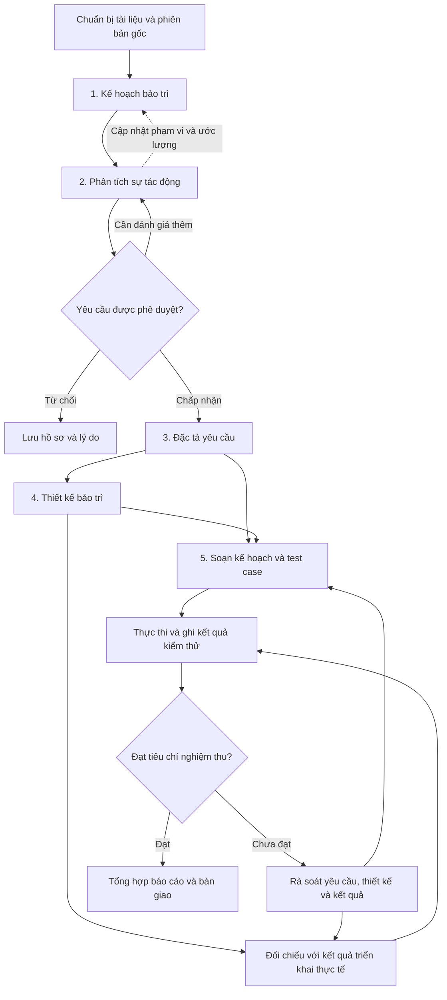

# Kế hoạch chi tiết xây dựng tài liệu Project 2 – CT244

**Học phần:** Bảo trì phần mềm  
**Phạm vi:** Hướng dẫn quy trình xây dựng tài liệu, độc lập với chủ đề và nội dung bảo trì cụ thể.

> Tài liệu này là kế hoạch thực hiện, không phải báo cáo bảo trì đã hoàn thành. Các đề mục bám theo mẫu giảng viên; quy ước quản lý, checklist và mốc nghiệm thu là đề xuất tổ chức công việc của nhóm.

## 1. Căn cứ và yêu cầu chung

Theo đề bài, nhóm cần đề xuất tối thiểu 3 yêu cầu hiệu chỉnh, 3 yêu cầu thích ứng, 3 yêu cầu hoàn thiện và 2 yêu cầu dự phòng; các yêu cầu phải đi sâu vào bản chất của sản phẩm. Báo cáo được xây dựng song song với hoạt động bảo trì. Không ghi nhận kết quả chưa thực hiện hoặc tự tạo minh chứng.

### 1.1. Tài liệu nguồn

Sử dụng năm mẫu tài liệu dưới dạng `.docx` để soạn thảo và tài liệu ví dụ đặc tả, thiết kế dưới dạng `.docx` để tham khảo cách trình bày.

| Tài liệu | Vai trò |
|---|---|
| [KehoachBT.docx](https://docs.google.com/document/d/1Mnb14c7t6kRd4wcsb9XNjLslb8IACCZlyOr2ttnTSkw/edit) | Mẫu kế hoạch bảo trì |
| [Phantichsutacdong.docx](https://docs.google.com/document/d/1234EYW6EMAtOC6XOnRua86UDrgCiMrREHvFdMpA0hsQ/edit) | Mẫu bốn biểu mẫu quản lý thay đổi |
| [DactaYCTD.docx](https://docs.google.com/document/d/1ftiMd4-lI_PaAKgaRvTLrK770H6F1xWeit6d6gZk8eA/edit) | Mẫu đặc tả bảo trì |
| [ThietkeYCTD.docx](https://docs.google.com/document/d/1g18kEmFJw7-7GnRydFii0ethNBr1cyKf0qhauOb0CTA/edit) | Mẫu thiết kế bảo trì |
| [Tài liệu kiểm thử.docx](https://docs.google.com/document/d/1lXHaxpCpzdb0Kr3hlQe5z-TC5USTqFZs/edit) | Mẫu kế hoạch và trường hợp kiểm thử |
| `Vidu_Dacta_Thietke.docx` | Tham khảo cách trình bày đặc tả và thiết kế |

## 2. Quy trình tổng thể

| Thứ tự | Tài liệu | Điều kiện bắt đầu | Đầu ra chính |
|---|---|---|---|
| 0 | Chuẩn bị | Có sản phẩm và đề bài | Baseline, nguồn tham chiếu, quy ước chung |
| 1 | Kế hoạch bảo trì | Biết phạm vi sơ bộ | Kế hoạch, phân công, quy trình, tiêu chí chất lượng |
| 2 | Phân tích tác động | Có danh sách đề xuất và baseline | Hồ sơ yêu cầu, phương án, quyết định phê duyệt |
| 3 | Đặc tả | Có yêu cầu đã phê duyệt | Các yêu cầu và mô hình được cập nhật |
| 4 | Thiết kế | Có đặc tả và phương án đã chọn | Thiết kế chi tiết và bảng tham chiếu |
| 5 | Kiểm thử | Có đặc tả; thiết kế bổ sung dần | Kế hoạch, test case, kết quả thực tế |
| 6 | Tổng hợp | Các tài liệu đã rà soát | Báo cáo Word, slide, kịch bản demo |

Không cần chờ toàn bộ yêu cầu hoàn thành một giai đoạn mới chuyển giai đoạn khác. Có thể xử lý theo từng yêu cầu hoặc nhóm yêu cầu có phụ thuộc chung. Kế hoạch bảo trì được cập nhật sau phân tích tác động; tài liệu kiểm thử được soạn từ sớm, nhưng phần kết quả chỉ hoàn thiện sau thực thi.

## 3. Giai đoạn chuẩn bị chung

1. Đọc đề bài và toàn bộ mẫu; lập danh mục đề mục bắt buộc để tránh bỏ sót.
2. Thu thập phiên bản phần mềm, đặc tả, thiết kế, kiểm thử và hướng dẫn sử dụng gốc nếu có.
3. Xác định phiên bản gốc (baseline) bằng mã phiên bản hoặc commit; lưu bản tài liệu tương ứng ở nơi không bị ghi đè.
4. Lập danh mục các chức năng, yêu cầu và thành phần hiện có. Nếu thiếu mã yêu cầu gốc, lập bảng ánh xạ bổ sung, ghi rõ nguồn và trạng thái khôi phục; không giả định đó là mã có từ trước.
5. Thống nhất cấu trúc tài liệu, thuật ngữ, tên file, mã định danh, phiên bản, người viết và người rà soát.
6. Lập bảng theo dõi yêu cầu và kho lưu minh chứng. Chỉ nhập thông tin đã xác minh; đánh dấu nội dung còn thiếu.
7. Tạo bản nháp của năm tài liệu theo đúng đề mục mẫu; phân quyền chỉnh sửa và chỉ định người tích hợp cuối cùng.

**Đầu ra:** bộ tài liệu gốc, danh mục nguồn, bộ khung năm tài liệu, bảng theo dõi và quy ước chung.

## 4. Tài liệu 1 – Kế hoạch bảo trì phần mềm

**Mẫu:** `KehoachBT.docx`  
**Mục đích:** thống nhất cách tổ chức, thực hiện và kiểm soát công việc.  
**Đầu vào:** đề bài, baseline, nguồn lực, lịch học và phạm vi sơ bộ.

### 4.1. Trình tự viết

| Đề mục theo mẫu | Cách thực hiện |
|---|---|
| 1. Giới thiệu | Xác định tên sản phẩm, mục đích, mục tiêu và phạm vi. Nêu rõ phạm vi bao gồm/không bao gồm; chọn phạm vi bảo trì phù hợp và giải thích. |
| 2. Tài liệu tham khảo | Lập danh sách nguồn; ghi tiêu đề, tác giả/tổ chức, phiên bản, ngày và đường dẫn hoặc vị trí lưu trữ. |
| 3. Các định nghĩa | Thu thập thuật ngữ và chữ viết tắt; chuẩn hóa với các tài liệu còn lại. |
| 4.1. Tổ chức bảo trì | Xác định vai trò, trách nhiệm, quyền phê duyệt, kênh trao đổi và cách phối hợp. |
| 4.2. Kế hoạch làm việc | Phân rã công việc (WBS), xác định phụ thuộc, mốc bắt đầu/kết thúc, người phụ trách, tài nguyên và sản phẩm đầu ra. Ước lượng lại sau khi phân tích tác động. |
| 4.3. Tóm tắt tài nguyên | Kiểm kê nhân sự, công cụ, thiết bị, chi phí, quyền truy cập và các yêu cầu thủ tục. |
| 4.4. Công cụ, kỹ thuật và phương pháp | Xác định công cụ, phiên bản, mục đích sử dụng, môi trường vận hành/kiểm thử, kỹ năng và hỗ trợ cần thiết. |
| 5. Quy trình bảo trì | Chọn quy trình phù hợp với lý thuyết học phần; mô tả từng giai đoạn theo đầu vào, công việc, kiểm soát, trách nhiệm, đầu ra và điều kiện chuyển bước. |
| 6. Quản lý cấu hình | Xây dựng vòng đời yêu cầu thay đổi; quy định quản lý baseline, phiên bản, nhánh, review, kiểm soát cập nhật và lưu vết. |
| 7. Quản lý chất lượng | Quy định chuẩn tài liệu, lập trình, review, kiểm thử, quản lý lỗi và nghiệm thu; xác định ai kiểm tra và cách xử lý sai lệch. |

### 4.2. Các bước triển khai

- Bước 1: Viết phần giới thiệu và lập danh mục nguồn/thuật ngữ.
- Bước 2: Thống nhất cơ cấu tổ chức và phân công vai trò.
- Bước 3: Tạo WBS và lịch trình dự kiến; xác định các công việc có thể song song.
- Bước 4: Kiểm kê tài nguyên và điều kiện môi trường.
- Bước 5: Vẽ sơ đồ quy trình; bổ sung bảng đầu vào/đầu ra cho mỗi giai đoạn.
- Bước 6: Thống nhất cơ chế quản lý cấu hình và chất lượng.
- Bước 7: Rà soát tính khả thi, phê duyệt kế hoạch sơ bộ; cập nhật lịch và nguồn lực khi phạm vi thay đổi được duyệt.

### 4.3. Checklist nghiệm thu

- [ ] Đủ 7 mục của mẫu, bao gồm các tiểu mục 4.1–4.4.
- [ ] Có phân công, mốc thời gian, phụ thuộc và đầu ra.
- [ ] Quy trình có điều kiện chuyển bước và trách nhiệm rõ ràng.
- [ ] Có cơ chế quản lý cấu hình, thay đổi, chất lượng và phiên bản tài liệu.
- [ ] Các ước lượng được ghi là dự kiến hoặc thực tế đúng bản chất.

**Đầu ra:** kế hoạch được nhóm thống nhất và cập nhật có kiểm soát.

## 5. Tài liệu 2 – Phân tích sự tác động của các yêu cầu thay đổi

**Mẫu:** `Phantichsutacdong.docx`  
**Mục đích:** xây dựng hồ sơ có căn cứ để quyết định phạm vi và phương án thay đổi.  
**Đầu vào:** kế hoạch sơ bộ, baseline, danh sách đề xuất, tài liệu và minh chứng hiện trạng.

### 5.1. Phần giới thiệu

Soạn mục đích, nhóm người đọc, bảng thuật ngữ và tài liệu tham khảo (mục 1.1–1.4). Tạo bảng theo dõi phiên bản tài liệu. Thống nhất mã yêu cầu trước khi lập hồ sơ.

### 5.2. Quy trình lập hồ sơ cho từng yêu cầu

Thực hiện đủ bốn biểu mẫu của mẫu giảng viên theo thứ tự dưới đây. Mỗi biểu mẫu phải tham chiếu cùng một mã yêu cầu.

#### Bước 1 – Mục 2.1: Phiếu đề xuất yêu cầu thay đổi

1. Ghi thông tin dự án, người đề xuất, ngày và thông tin liên hệ theo mẫu; mã số chính thức do người tiếp nhận ghi.
2. Thu thập hiện trạng từ phiên bản gốc, mô tả điều quan sát được và đính kèm minh chứng nếu có.
3. Mô tả trạng thái mong muốn bằng ngôn ngữ yêu cầu; chưa chốt phương án kỹ thuật tại bước này.
4. Ghi chú bối cảnh, ràng buộc vận hành và lợi ích dự kiến.
5. Chuyển phiếu sang người tiếp nhận; kiểm tra nội dung có đủ rõ để phân tích.

#### Bước 2 – Mục 2.2: Phiếu tiếp nhận yêu cầu thay đổi

1. Cấp mã duy nhất, ghi người tiếp nhận, ngày và thông tin liên hệ theo mẫu.
2. Đối chiếu đặc tả gốc để xác định mã yêu cầu liên quan (nếu có).
3. Phân loại vào nhóm bảo trì phù hợp, giải thích căn cứ phân loại.
4. Đánh giá mức ưu tiên sơ bộ dựa trên mức ảnh hưởng, tính cấp thiết và phạm vi.
5. Kiểm tra trùng lặp và phụ thuộc; nếu cần, yêu cầu bổ sung thông tin trước khi phân tích.
6. Cập nhật danh sách theo dõi và giao người phân tích.

#### Bước 3 – Mục 2.3: Bảng phân tích sự tác động

1. Ghi mã yêu cầu, người phân tích, ngày và thông tin liên hệ.
2. Rà soát lại loại bảo trì; nếu đổi phân loại thì ghi lý do.
3. Đọc đặc tả, thiết kế, kiểm thử, hướng dẫn sử dụng gốc và xác định chính xác mục nào bị ảnh hưởng.
4. Khảo sát cấu trúc chương trình để xác định hệ thống con, module, file, dữ liệu, giao diện và phụ thuộc có liên quan. Phân biệt ảnh hưởng trực tiếp và gián tiếp; chỉ ghi thành phần có căn cứ.
5. Đánh giá mức độ ảnh hưởng, rủi ro, phụ thuộc, tính khả thi và khả năng kiểm thử.
6. Xây dựng **ít nhất hai phương án** cho mỗi yêu cầu; mô tả cách thực hiện, nhân lực (số lượng, kỹ năng, mức thành thạo), công cụ và môi trường (tên, phiên bản, mục đích), thời gian và chi phí dự kiến.
7. So sánh các phương án trên cùng tiêu chí; nêu giả định và giới hạn của ước lượng.
8. Đề xuất phương án phù hợp nhất và giải thích lý do; ghi các vấn đề còn mở.
9. Rà soát chéo với người phụ trách thiết kế và kiểm thử trước khi chuyển phê duyệt.

Khung bảng so sánh bổ trợ (không thay thế biểu mẫu chính thức):

| Tiêu chí | Phương án 1 | Phương án 2 |
|---|---|---|
| Cách thực hiện | | |
| Phạm vi tác động | | |
| Nhân lực và kỹ năng | | |
| Công cụ, phiên bản, môi trường | | |
| Thời gian dự kiến | | |
| Chi phí dự kiến | | |
| Rủi ro, ưu điểm và hạn chế | | |
| Khả năng kiểm thử | | |

#### Bước 4 – Mục 2.4: Phiếu phê duyệt yêu cầu thay đổi

1. Tập hợp ba biểu mẫu trước đó và minh chứng kèm theo.
2. Ban quản lý thay đổi xem xét phạm vi, phân loại, ưu tiên, phương án và nguồn lực.
3. Ghi thành viên phê duyệt, ngày, thông tin liên hệ và quyết định theo mẫu: chấp nhận, từ chối hoặc cần đánh giá thêm.
4. Ghi lý do, đặc biệt khi không chấp nhận; nếu cần đánh giá thêm, trả hồ sơ về bước phân tích.
5. Với yêu cầu được chấp nhận, xác định phương án đã duyệt và cập nhật kế hoạch, trạng thái theo dõi.
6. Lưu cả hồ sơ không được chấp nhận để bảo đảm truy vết; chỉ chuyển yêu cầu được duyệt sang đặc tả và thiết kế.

### 5.3. Checklist nghiệm thu

- [ ] Có đủ số lượng đề xuất theo từng loại mà đề bài yêu cầu.
- [ ] Mỗi yêu cầu có đủ bốn biểu mẫu và cùng mã định danh.
- [ ] Hiện trạng, phân loại, ưu tiên và thành phần ảnh hưởng có căn cứ.
- [ ] Mỗi phân tích có ít nhất hai phương án và đầy đủ ước lượng theo mẫu.
- [ ] Có lý do chọn phương án, quyết định phê duyệt và trạng thái rõ ràng.
- [ ] Kế hoạch bảo trì được cập nhật theo kết quả phê duyệt.

**Đầu ra:** hồ sơ phân tích tác động và danh sách yêu cầu được phê duyệt, kèm phương án đã chọn.

## 6. Tài liệu 3 – Đặc tả yêu cầu phần mềm bảo trì (SRS)

**Mẫu:** `DactaYCTD.docx`  
**Mục đích:** mô tả hệ thống phải đáp ứng điều gì sau thay đổi, không thay thế thiết kế kỹ thuật.  
**Đầu vào:** đặc tả gốc, hồ sơ yêu cầu đã duyệt, quy ước trình bày.

### 6.1. Trình tự viết theo đề mục

| Đề mục | Cách thực hiện |
|---|---|
| 1.1. Mục đích | Xác định vai trò và phạm vi của bản đặc tả bảo trì. |
| 1.2. Nhóm người đọc | Xác định đối tượng đọc và hướng dẫn sử dụng các phần liên quan. |
| 1.3. Phạm vi sản phẩm | Mô tả phạm vi yêu cầu được cập nhật và giới hạn của tài liệu. |
| 1.4. Bảng chú giải thuật ngữ | Dùng từ điển thuật ngữ chung; bổ sung khi cần. |
| 1.5. Tài liệu tham khảo | Tham chiếu baseline và hồ sơ đã duyệt, ghi đầy đủ thông tin nguồn. |
| 1.6. Quy ước trình bày | Thống nhất cách đánh dấu thêm, sửa, xóa và nội dung giữ nguyên. |
| 2.1.1. Yêu cầu chức năng cần điều chỉnh | Tìm yêu cầu gốc, giữ mã gốc và bổ sung mã thay đổi; cập nhật các trường có ảnh hưởng, đánh dấu khác biệt. |
| 2.1.2. Yêu cầu chức năng mới | Gán mã yêu cầu mới, mô tả đầy đủ hành vi, điều kiện, kết quả và ngoại lệ. |
| 2.2.1. Yêu cầu phi chức năng cần điều chỉnh | Đối chiếu tiêu chí gốc, xác định phần thay đổi và điều kiện đo hoặc đánh giá. |
| 2.2.2. Yêu cầu phi chức năng mới | Gán mã mới, xác định tiêu chí có thể xác minh và phạm vi áp dụng. |
| 3.1. Tính năng được điều chỉnh | Tổ chức yêu cầu theo nhóm tính năng; cập nhật mô hình/use case có thay đổi và đánh dấu khác biệt. |
| 3.2. Tính năng mới | Tổ chức các tính năng mới; xây dựng mô hình và mô tả use case khi phù hợp. |

### 6.2. Các bước đặc tả từng yêu cầu

1. Lấy yêu cầu từ danh sách đã phê duyệt và xác định mã tham chiếu.
2. Phân biệt yêu cầu chức năng và phi chức năng; xác định mới hay điều chỉnh. Một yêu cầu thay đổi có thể liên quan nhiều mục SRS.
3. Với yêu cầu điều chỉnh, trích phần đặc tả gốc liên quan và đánh dấu chính xác nội dung được sửa, thêm hoặc loại bỏ.
4. Với yêu cầu mới, tạo mục mới theo quy ước mã.
5. Viết đặc tả chức năng theo các trường của mẫu:

| Trường | Hướng dẫn điền |
|---|---|
| Mã yêu cầu | Mã gốc nếu có, mã mới nếu cần và mã yêu cầu thay đổi liên quan |
| Tên yêu cầu | Tên ngắn, nhất quán với danh mục |
| Mục đích | Giá trị hoặc mục tiêu của yêu cầu |
| Đối tượng sử dụng | Các đối tượng có quyền thực hiện hoặc tương tác |
| Tiền điều kiện | Điều kiện phải thỏa trước khi thực hiện |
| Cách xử lý | Luồng chính, luồng thay thế, ngoại lệ và quy tắc xử lý theo góc nhìn người sử dụng |
| Kết quả | Đầu ra và trạng thái sau khi thực hiện |
| Ghi chú | Ràng buộc, giả định và các lưu ý |

6. Với yêu cầu phi chức năng, mô tả thuộc tính chất lượng, phạm vi, tiêu chí đo/đánh giá, điều kiện kiểm chứng và ngưỡng chấp nhận nếu đã xác định.
7. Đối chiếu các mô hình gốc; chỉ sửa hoặc bổ sung sơ đồ thực sự bị ảnh hưởng. Nếu mô hình không đổi, ghi rõ khi cần thay vì tạo sơ đồ giả tạo.
8. Rà soát tính đúng, đầy đủ, nhất quán, khả thi, không mơ hồ và có thể kiểm thử.
9. Cập nhật bảng truy vết từ mã thay đổi tới mã SRS; xác nhận với người phê duyệt trước khi chốt bản đặc tả.

### 6.3. Quy ước thay đổi đề xuất

- `[UNCHANGED]`: nội dung gốc được giữ lại để đối chiếu.
- `[MODIFIED]`: nội dung gốc được điều chỉnh.
- `[NEW]`: nội dung mới.
- `[REMOVED]`: nội dung bị loại bỏ, có thể dùng gạch ngang kèm ghi chú.

Khi xuất Word, có thể kết hợp màu chữ, kiểu chữ và nhãn; không chỉ dùng màu vì cần đọc được cả khi in đen trắng. Không xóa dấu vết của yêu cầu gốc trong bản đối chiếu.

### 6.4. Checklist nghiệm thu

- [ ] Đủ cấu trúc mục 1–3 theo mẫu.
- [ ] Mọi yêu cầu đã duyệt có liên kết đến mục đặc tả thích hợp hoặc lý do không làm thay đổi SRS.
- [ ] Phân biệt chức năng/phi chức năng và điều chỉnh/mới.
- [ ] Luồng xử lý có điều kiện, ngoại lệ, đầu ra và tiêu chí xác minh.
- [ ] Các khác biệt so với baseline được đánh dấu rõ.
- [ ] Không đưa chi tiết hiện thực vào phần mô tả hành vi nếu không cần thiết.

**Đầu ra:** SRS bảo trì được rà soát và chốt phiên bản, làm căn cứ cho thiết kế và kiểm thử.

## 7. Tài liệu 4 – Thiết kế phần mềm bảo trì (SDD)

**Mẫu:** `ThietkeYCTD.docx`, tham khảo cách trình bày trong `Vidu_Dacta_Thietke.docx`.  
**Mục đích:** xác định cách đáp ứng yêu cầu về mặt kỹ thuật.  
**Đầu vào:** SRS đã chốt, thiết kế gốc, phân tích tác động và phương án được duyệt.

### 7.1. Trình tự viết theo đề mục

| Đề mục | Cách thực hiện |
|---|---|
| 1.1–1.6. Giới thiệu | Viết mục đích, nhóm người đọc, phạm vi, thuật ngữ, tài liệu tham khảo, quy ước đánh dấu thay đổi. |
| 2.1. Thiết kế kiến trúc | Đối chiếu kiến trúc gốc; mô tả trách nhiệm và quan hệ giữa các hệ thống con, kho dữ liệu. Vẽ lại sơ đồ nếu có thay đổi. |
| 2.2. Mô tả sự phân rã | Phân tích module, chức năng, đối tượng, giao diện và luồng tương tác; cập nhật mô hình liên quan theo cách tiếp cận của hệ thống. |
| 2.3. Cơ sở thiết kế | Giải thích quyết định kiến trúc, ràng buộc, đánh đổi và lý do chọn phương án đã được phê duyệt. |
| 3.1. Mô tả dữ liệu | Đối chiếu mô hình dữ liệu gốc, xác định cấu trúc và quan hệ cần thay đổi; cập nhật sơ đồ và ghi rõ khác biệt. |
| 3.2. Từ điển dữ liệu | Cập nhật danh mục dữ liệu theo thứ tự và cách trình bày mẫu; mô tả kiểu, ý nghĩa, ràng buộc; bổ sung hàm/đối số hoặc đối tượng/thuộc tính/phương thức phù hợp phương pháp thiết kế. |
| 4.1. Thiết kế chức năng điều chỉnh | Tham chiếu mã thiết kế gốc; mô tả và đánh dấu thay đổi theo từng chức năng. |
| 4.2. Thiết kế chức năng mới | Tạo mã thiết kế, mô tả đầy đủ các thành phần theo mẫu. |
| 5. Bảng tham khảo tới các yêu cầu | Ánh xạ mã yêu cầu SRS tới thành phần thiết kế; cập nhật bảng gốc và đánh dấu thay đổi. |

### 7.2. Quy trình thiết kế từng chức năng

1. Lấy mã yêu cầu từ SRS và quyết định giải pháp từ phân tích tác động.
2. Xác định thiết kế gốc có liên quan và mã thiết kế gốc nếu có.
3. Xác định phạm vi thay đổi ở kiến trúc, dữ liệu, giao diện, xử lý và các ràng buộc.
4. Lập bản thiết kế theo mẫu, giữ liên kết với yêu cầu:

| Thành phần | Cách trình bày |
|---|---|
| Mã thiết kế | Mã gốc nếu điều chỉnh, mã mới nếu bổ sung; liên kết mã SRS và mã thay đổi |
| Mục đích | Mục đích của chức năng thiết kế |
| Giao diện | Mockup hoặc ảnh thiết kế; phân biệt bản gốc và bản dự kiến |
| Các thành phần giao diện | Bảng STT, loại điều khiển, giá trị mặc định, lưu ý |
| Sử dụng dữ liệu | Bảng STT, tên bảng, thao tác thêm/sửa/xóa/truy vấn |
| Cách xử lý | Mô tả bằng lời hoặc sơ đồ luồng xử lý |
| Hàm/sự kiện | Giải thuật, giả mã hoặc sơ đồ tương ứng nếu có |
| Ràng buộc | Điều kiện kỹ thuật, dữ liệu và giới hạn cần bảo đảm |

5. Với thay đổi không liên quan giao diện hoặc dữ liệu, ghi không áp dụng và lý do; không tạo giao diện hoặc thao tác dữ liệu không tồn tại.
6. Chọn loại sơ đồ dựa trên nội dung thay đổi: kiến trúc cho quan hệ hệ thống con; lớp/thành phần cho cấu trúc; tuần tự cho tương tác; hoạt động cho luồng xử lý; ERD cho dữ liệu; triển khai cho môi trường. Không bắt buộc vẽ mọi loại sơ đồ cho mọi yêu cầu.
7. Đối chiếu thiết kế với SRS: mọi hành vi, ngoại lệ và ràng buộc phải được đáp ứng.
8. Cập nhật bảng tham chiếu yêu cầu, tổ chức review kỹ thuật và chốt thiết kế.
9. Khi kết quả thực hiện khác bản thiết kế đã duyệt, ghi lý do, đánh giá tác động và cập nhật phiên bản tài liệu; không âm thầm ghi đè baseline.

### 7.3. Checklist nghiệm thu

- [ ] Đủ mục giới thiệu, kiến trúc, dữ liệu, thiết kế chức năng và bảng tham khảo.
- [ ] Các mục thiết kế điều chỉnh có tham chiếu bản gốc, phần mới có mã riêng.
- [ ] Quyết định thiết kế phù hợp phương án đã duyệt; có căn cứ và đánh đổi.
- [ ] Sơ đồ, từ điển dữ liệu và mô tả xử lý nhất quán.
- [ ] Tất cả yêu cầu liên quan được ánh xạ tới thiết kế; không có thiết kế ngoài phạm vi chưa được duyệt.
- [ ] Nội dung thêm, sửa, xóa có dấu hiệu nhận biết.

**Đầu ra:** SDD bảo trì được rà soát, bảng tham chiếu yêu cầu và các mô hình cập nhật.

## 8. Tài liệu 5 – Tài liệu kiểm thử

**Mẫu:** `Tài liệu kiểm thử.docx`  
**Mục đích:** xác định phương pháp xác minh yêu cầu và ghi nhận bằng chứng thực tế.  
**Đầu vào:** SRS, phân tích tác động, SDD, tài liệu kiểm thử gốc, phiên bản phần mềm cần kiểm thử.

### 8.1. Trình tự viết theo mẫu

| Đề mục | Cách thực hiện |
|---|---|
| Giới thiệu – Mục tiêu | Xác định mục tiêu kiểm thử, căn cứ nghiệm thu. |
| Phạm vi | Xác định phạm vi trực tiếp, phạm vi hồi quy, giới hạn và giả định. |
| Bảng chú giải thuật ngữ | Thống nhất thuật ngữ và mã test case. |
| Tài liệu tham khảo | Liên kết SRS, SDD, hồ sơ thay đổi và tài liệu kiểm thử gốc. |
| Chi tiết kế hoạch – Tính năng sẽ kiểm thử | Lập danh mục từ yêu cầu và thành phần bị ảnh hưởng; xác định mức ưu tiên. |
| Tính năng sẽ không kiểm thử | Nêu rõ phạm vi loại trừ, lý do và rủi ro còn lại. |
| Cách tiếp cận | Chọn cấp độ, loại và kỹ thuật kiểm thử theo rủi ro và đặc điểm yêu cầu. |
| Tiêu chí thành công/thất bại | Quy định Pass/Fail cho từng trường hợp và điều kiện nghiệm thu tổng thể. |
| Tiêu chí đình chỉ và bắt đầu lại | Xác định điều kiện dừng, cách xử lý trở ngại, điều kiện tiếp tục. |
| Sản phẩm bàn giao kiểm thử | Liệt kê kế hoạch, test case, dữ liệu, kết quả, minh chứng và báo cáo lỗi. |
| Quản lý kiểm thử – Hoạt động và tiến hành | Phân rã công việc kiểm thử, xác định thứ tự và phụ thuộc. |
| Môi trường | Ghi phiên bản phần mềm, cấu hình, dữ liệu và công cụ kiểm thử. |
| Trách nhiệm và quyền hạn | Phân công người thiết kế test, thực thi, rà soát và xác nhận kết quả. |
| Giao tiếp giữa các nhóm | Xác định kênh báo lỗi, thời điểm phản hồi và cơ chế chuyển giao. |
| Tài nguyên và cấp phát | Liệt kê nguồn lực và phân bổ. |
| Huấn luyện | Xác định kiến thức hoặc hướng dẫn cần thiết. |
| Kế hoạch, dự đoán và chi phí | Ước lượng thời gian, nhân lực, chi phí và mốc thực hiện. |
| Các rủi ro | Xác định trở ngại, khả năng xảy ra, ảnh hưởng và biện pháp xử lý. |
| Các trường hợp kiểm thử | Xây dựng bảng test case theo mẫu và ghi kết quả khi thực thi. |

### 8.2. Quy trình thiết kế và ghi kết quả test case

1. Lấy danh sách yêu cầu đã duyệt, tiêu chí chấp nhận và các thành phần bị ảnh hưởng.
2. Rà soát bộ kiểm thử gốc; xác định test case giữ nguyên, điều chỉnh, bổ sung hoặc không còn áp dụng.
3. Chọn phạm vi kiểm thử trực tiếp, kiểm thử lại khi có lỗi và kiểm thử hồi quy cho chức năng liên quan; chọn kiểm thử phi chức năng khi có tiêu chí tương ứng.
4. Từ mỗi yêu cầu, xác định trường hợp hợp lệ, không hợp lệ, điều kiện biên, luồng thay thế và ngoại lệ phù hợp; không ép mọi kỹ thuật vào mọi yêu cầu.
5. Gán mã duy nhất; viết dữ liệu vào, tiền điều kiện, các bước thực hiện và kết quả mong đợi trước khi chạy test. Tiền điều kiện và bước thực hiện là cột bổ sung đề xuất.
6. Rà soát test case với SRS và SDD; cập nhật ma trận truy vết và chuẩn bị môi trường/dữ liệu.
7. Thực thi trên phiên bản xác định; ghi dữ liệu ra thực tế, Pass/Fail và minh chứng. Dùng trạng thái Not Run hoặc Blocked khi chưa chạy hoặc bị chặn; không ghi Pass giả định.
8. Nếu thất bại, ghi nhận lỗi, chuyển xử lý, kiểm thử lại và chạy hồi quy cần thiết. Lưu lịch sử lần chạy thay vì xóa kết quả cũ.
9. Tổng hợp kết quả và đối chiếu tiêu chí nghiệm thu; ghi rõ trường hợp chưa đạt hoặc chưa kiểm thử và rủi ro còn lại.

Khung bảng theo mẫu giảng viên:

| TC | Tên chức năng | Dữ liệu vào | Dữ liệu ra mong đợi | Dữ liệu ra thực tế | Kết quả |
|---|---|---|---|---|---|
| | | | | | |

Có thể bổ sung mã yêu cầu, tiền điều kiện, bước thực hiện, phiên bản chạy, người thực thi, ngày chạy và đường dẫn minh chứng để nâng cao khả năng truy vết.

### 8.3. Checklist nghiệm thu

- [ ] Đủ các nhóm mục trong mẫu kiểm thử.
- [ ] Phạm vi kiểm thử và phạm vi loại trừ có lý do.
- [ ] Có tiêu chí thành công/thất bại, đình chỉ/tiếp tục và sản phẩm bàn giao.
- [ ] Test case liên kết được với yêu cầu, bao phủ hành vi và ngoại lệ phù hợp.
- [ ] Có kiểm thử hồi quy theo phạm vi ảnh hưởng.
- [ ] Kết quả thực tế có phiên bản và minh chứng; trạng thái chưa chạy được ghi đúng.
- [ ] Các sai lệch và kết quả kiểm thử lại được lưu vết.

**Đầu ra:** tài liệu kiểm thử hoàn chỉnh, kết quả thực tế, minh chứng và báo cáo tình trạng nghiệm thu.

## 9. Quản lý liên kết giữa các tài liệu

### 9.1. Quy ước mã định danh đề xuất

| Đối tượng | Mẫu mã |
|---|---|
| Yêu cầu thay đổi | `CR-<LOAI>-<STT>` |
| Yêu cầu chức năng | `REQ-<STT>` hoặc giữ mã gốc |
| Yêu cầu phi chức năng | `NFR-<STT>` hoặc giữ mã gốc |
| Thiết kế | `DES-<STT>` hoặc giữ mã gốc |
| Trường hợp kiểm thử | `TC-<STT>` |

Mã CR là định danh của yêu cầu thay đổi, không đồng nhất với mã SRS. Một CR có thể ánh xạ nhiều yêu cầu, một yêu cầu có thể liên quan nhiều thiết kế và test case. Không tái sử dụng mã đã cấp cho đối tượng khác.

### 9.2. Ma trận truy vết (RTM)

| Mã CR | Mã yêu cầu gốc | Mã SRS sau thay đổi | Mục thiết kế | Mã TC | Phiên bản/minh chứng | Trạng thái |
|---|---|---|---|---|---|---|
| | | | | | | |

Cập nhật RTM khi phê duyệt yêu cầu, chốt SRS, chốt SDD và hoàn thành test case. Nếu không có thay đổi ở một loại tài liệu, ghi không áp dụng và lý do. Rà soát yêu cầu không có thiết kế hoặc kiểm thử tương ứng, và thiết kế/test case không có nguồn yêu cầu.

### 9.3. Theo dõi phiên bản và review

| Phiên bản | Ngày | Người cập nhật | Lý do thay đổi | Người rà soát | Trạng thái |
|---|---|---|---|---|---|
| | | | | | |

Quy trình đề xuất: Nháp → Rà soát → Chỉnh sửa → Phê duyệt → Lưu phiên bản. Khi thay đổi tài liệu đã phê duyệt, xác định các tài liệu phụ thuộc cần cập nhật và thông báo cho người phụ trách. Giữ bản gốc riêng biệt với bản bảo trì.

## 10. Kế hoạch phối hợp và các mốc nghiệm thu

Các mốc dưới đây là thứ tự logic, không ấn định ngày hoặc thời lượng khi chưa biết lịch và nhân lực thực tế.

| Mốc | Điều kiện hoàn thành | Tài liệu được kiểm tra |
|---|---|---|
| M0 – Chuẩn bị | Có baseline, nguồn tài liệu, quy ước và phân công | Bộ khung tài liệu |
| M1 – Lập kế hoạch | Có quy trình, nguồn lực, mốc và kiểm soát | Kế hoạch bảo trì |
| M2 – Chốt phạm vi | Hồ sơ đầy đủ, phương án và quyết định được ghi nhận | Phân tích tác động; kế hoạch cập nhật |
| M3 – Chốt yêu cầu | Yêu cầu rõ, nhất quán, có thể kiểm thử | SRS; RTM |
| M4 – Chốt thiết kế | Thiết kế đáp ứng SRS, phương án và ràng buộc | SDD; RTM; test case nháp |
| M5 – Xác minh | Có kết quả thực tế, hồi quy và xử lý sai lệch | Tài liệu kiểm thử; SRS/SDD cập nhật nếu cần |
| M6 – Bàn giao | Đủ nội dung, hình thức và truy vết | Toàn bộ báo cáo, slide và kịch bản demo |

### Phân công đề xuất

- Trưởng nhóm: giữ kế hoạch, lịch trình, quy ước và bản tích hợp cuối.
- Người phụ trách yêu cầu: chịu trách nhiệm về tính nhất quán của hồ sơ thay đổi, đặc tả, thiết kế và liên kết kiểm thử thuộc phạm vi được giao.
- Người rà soát: kiểm tra chéo căn cứ, phạm vi, phương án và sự nhất quán.
- Người phụ trách kiểm thử: xây dựng kế hoạch, quản lý test case, minh chứng và kết quả.
- Ban quản lý thay đổi: ghi nhận quyết định phê duyệt theo mẫu.

Một người có thể kiêm nhiều vai trò tùy quy mô nhóm; nên có người rà soát khác người viết khi khả thi. Không tự ghi tên, thời gian hoặc tỷ lệ hoàn thành trước khi nhóm thống nhất và thực hiện.

## 11. Tổng hợp và bàn giao báo cáo

1. Kiểm tra đầy đủ năm tài liệu và toàn bộ biểu mẫu, đối chiếu đề bài và checklist của từng phần.
2. Rà soát chéo mã, thuật ngữ, phiên bản, nội dung trước–sau, sơ đồ, phương án và kết quả kiểm thử.
3. Ghép vào báo cáo Word theo thứ tự: trang bìa; mục lục; bảng phân công nhóm; kế hoạch bảo trì; phân tích tác động; đặc tả; thiết kế; kiểm thử.
4. Trang bìa có tên trường/khoa, logo, tên Project, thành viên và tháng năm hoàn thành. Bảng phân công có MSSV, tên, công việc, mức hoàn thành, trách nhiệm/kỷ luật và các thông tin cần thiết theo đề bài.
5. Định dạng Times New Roman, khổ A4; thống nhất tiêu đề, đánh số bảng/hình, chú thích, mục lục và tài liệu tham khảo. Các quy định không có trong đề bài cần thống nhất nội bộ hoặc đối chiếu hướng dẫn bổ sung của giảng viên.
6. Chuẩn bị PowerPoint và kịch bản demo bám theo hồ sơ và bằng chứng đã xác minh; kiểm tra khả năng mở file và thực hiện demo.
7. Kiểm tra bản cuối, nộp báo cáo Word và slide PowerPoint trên hệ thống ELCIT theo yêu cầu đề bài; lưu lại bản đã nộp.

## 12. Checklist tổng kết

- [ ] Đã xác lập baseline và chuẩn hóa mã tài liệu/yêu cầu.
- [ ] Kế hoạch bảo trì đầy đủ, cập nhật theo phạm vi đã duyệt.
- [ ] Phân tích tác động đủ bốn biểu mẫu cho mỗi yêu cầu và ít nhất hai phương án phân tích.
- [ ] Đặc tả phân biệt rõ yêu cầu mới và điều chỉnh, chức năng và phi chức năng.
- [ ] Thiết kế đáp ứng đặc tả, có dấu vết thay đổi và bảng tham chiếu.
- [ ] Tài liệu kiểm thử đủ kế hoạch, test case, kết quả thực tế và hồi quy phù hợp.
- [ ] Ma trận truy vết không có liên kết thiếu mà chưa giải thích.
- [ ] Mọi tài liệu được review, quản lý phiên bản và thống nhất thuật ngữ.
- [ ] Báo cáo Word, slide và kịch bản demo đáp ứng đề bài.

**Nguyên tắc xuyên suốt:** viết theo mẫu, lấy tài liệu trước làm đầu vào của tài liệu sau, cập nhật có kiểm soát và chỉ ghi nhận nội dung có căn cứ. Tài liệu này không xác định chủ đề, giải pháp kỹ thuật hay hoạt động bảo trì cụ thể thay cho nhóm.
