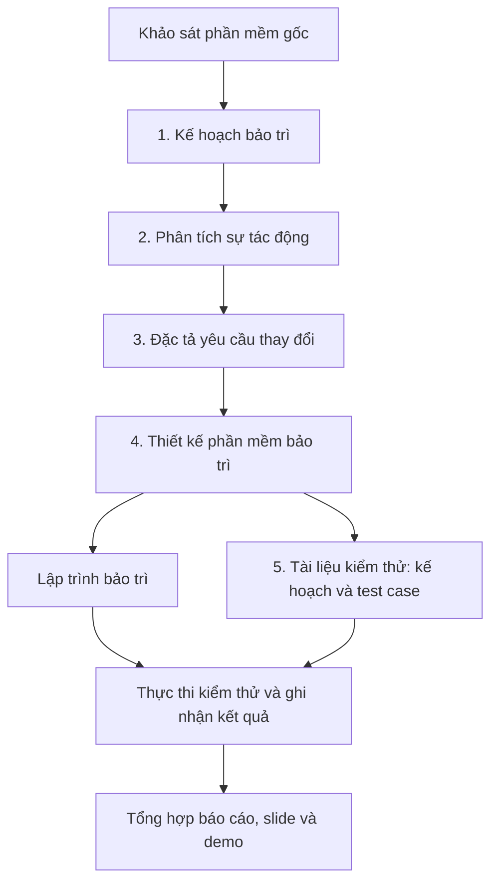

# Quy trình viết tài liệu Project 2 – CT244 Bảo trì phần mềm

## 1. Thứ tự viết tài liệu

| Thứ tự | Tài liệu | Nội dung trọng tâm |
|---|---|---|
| 1 | **Kế hoạch bảo trì** | Xác định phạm vi, mục tiêu, phân công, tiến độ, công cụ và quy trình bảo trì. |
| 2 | **Phân tích sự tác động** | Đề xuất, tiếp nhận, phân tích ảnh hưởng, so sánh ít nhất hai giải pháp và phê duyệt yêu cầu thay đổi. |
| 3 | **Đặc tả yêu cầu thay đổi** | Mô tả các yêu cầu chức năng, phi chức năng được điều chỉnh hoặc bổ sung. |
| 4 | **Thiết kế phần mềm bảo trì** | Thiết kế kiến trúc, cơ sở dữ liệu, giao diện, thuật toán và các thành phần bị thay đổi. |
| 5 | **Tài liệu kiểm thử** | Lập kế hoạch kiểm thử, xây dựng test case, kiểm thử hồi quy và ghi nhận kết quả thực tế. |

## 2. Quy trình thực hiện

| Giai đoạn | Mục đích |
|---|---|
| Khảo sát phần mềm gốc | Tìm lỗi, hạn chế và xác lập phiên bản gốc (baseline). |
| Kế hoạch bảo trì | Tổ chức hoạt động bảo trì. |
| Phân tích sự tác động | Tại sao thay đổi? Ảnh hưởng đến đâu? |
| Đặc tả yêu cầu thay đổi | Thay đổi những gì? |
| Thiết kế phần mềm bảo trì | Thay đổi bằng cách nào? |
| Lập trình bảo trì | Hiện thực hóa thiết kế. |
| Tài liệu kiểm thử | Xác minh tính đúng đắn của thay đổi. |
| Tổng hợp báo cáo, slide và demo | Hoàn thiện sản phẩm bàn giao. |

## 3. Nguyên tắc cần lưu ý

- Kế hoạch bảo trì được viết đầu tiên nhưng có thể cập nhật trong suốt dự án.
- Phân tích tác động, đặc tả và thiết kế nên được thực hiện trước khi lập trình.
- Kế hoạch kiểm thử và test case có thể viết song song với quá trình thiết kế, lập trình.
- Kết quả kiểm thử chỉ được ghi nhận sau khi thực thi kiểm thử thực tế.
- Sử dụng mã yêu cầu thống nhất xuyên suốt cả năm tài liệu để đảm bảo khả năng truy vết.
- Đặc tả và thiết kế phải đánh dấu rõ những nội dung thêm, sửa, xóa so với phiên bản gốc.

**Tóm lại:** Kế hoạch → Phân tích tác động → Đặc tả → Thiết kế → Lập trình → Kiểm thử → Bàn giao.
